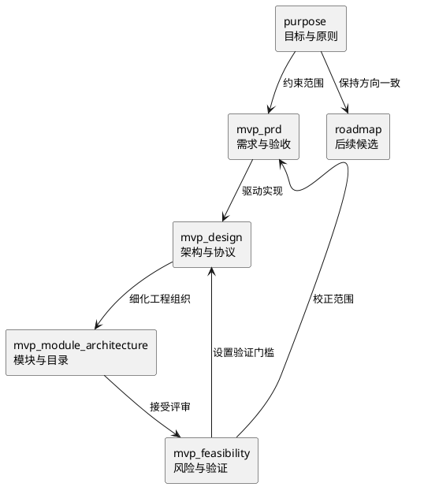

# Engirdle 产品文档索引

> 文档状态：MVP 基线候选  
> 基线日期：2026-08-07  
> 适用范围：单用户、PC 内容生产、移动端离线听读的个人研究项目

本目录将原先混合记录愿景、需求与实现的 `purpose_and_design.md` 拆分为职责单一、可独立演进的文档。

## 文档地图

| 文档 | 回答的问题 | 规范性 |
|---|---|---|
| [purpose.md](./purpose.md) | 为什么做、为谁做、坚持什么边界 | 产品方向基线 |
| [mvp/mvp_prd.md](./mvp/mvp_prd.md) | MVP 必须交付什么、怎样算完成 | 需求与验收基线 |
| [mvp/mvp_design.md](./mvp/mvp_design.md) | MVP 如何实现、组件怎样协作、协议如何定义 | 技术设计基线 |
| [mvp/mvp_module_architecture.md](./mvp/mvp_module_architecture.md) | 前后端模块怎样划分、源码与测试目录怎样组织 | 工程架构基线候选 |
| [mvp/mvp_feasibility.md](./mvp/mvp_feasibility.md) | 方案是否合理可行、风险是什么、先验证什么 | 评审与决策依据 |
| [roadmap.md](./roadmap.md) | MVP 之后可能向哪里演进 | 非承诺性路线图 |
| [ux_review_notes.md](./ux_review_notes.md) | Android 设计稿 UX 评审发现了什么、哪些暂缓 | 评审记录（非基线） |

原文内容迁移关系如下：

| 原主题 | 新位置 |
|---|---|
| 背景、定位、长期原则、结论中的核心主张 | `purpose.md` |
| 原始需求、MVP 范围、明确排除项 | `mvp/mvp_prd.md` |
| 系统架构、数据模型、流水线、包、PC/移动端设计、技术栈 | `mvp/mvp_design.md` |
| 前后端业务模块、依赖规则、源码/测试/契约目录 | `mvp/mvp_module_architecture.md` |
| 原风险与缓解措施，加上本次合理性审查和验证门槛 | `mvp/mvp_feasibility.md` |
| MVP 后演进方向 | `roadmap.md` |

## 推荐阅读路径

- 了解项目：`purpose.md` → `mvp/mvp_prd.md`。
- 开始实现：`mvp/mvp_prd.md` → `mvp/mvp_design.md` → `mvp/mvp_module_architecture.md` → `mvp/mvp_feasibility.md` 中的验证门槛。
- 评审范围：`mvp/mvp_feasibility.md` → `mvp/mvp_prd.md` 的明确排除项。
- 讨论后续功能：`roadmap.md`，不要直接把候选功能视为 MVP 承诺。

## 文档职责

发生冲突时按以下规则处理：

1. “为什么做”的冲突以 `purpose.md` 为准。
2. “是否必须交付”的冲突以 `mvp/mvp_prd.md` 为准。
3. “当前准备怎样实现”的冲突以 `mvp/mvp_design.md` 为准。
4. 模块边界和源码目录以 `mvp/mvp_module_architecture.md` 为准，但不得改变 `mvp/mvp_design.md` 的技术语义。
5. `mvp/mvp_feasibility.md` 中未关闭的门槛优先于未经验证的技术假设。
6. `roadmap.md` 不构成需求承诺。

## 维护约定

- 需求使用稳定 ID；删除需求时保留变更说明，不复用旧 ID。
- 包格式、目录接口或持久化兼容性发生变化时，同时更新 PRD 验收条件、设计和评估结论。
- 模型、词典、依赖和许可证必须记录精确版本或提交，不以产品系列名称替代版本信息。
- 图形化流程和状态优先使用 PlantUML；公共协议示例只保留理解接口所需字段。
- 文档中的“必须”表示 MVP 发布条件，“建议”表示当前偏好，“候选”表示尚未承诺。

## 本次拆分的主要校正

- 将移动端 MVP 收敛为 Android 首发；Flutter 仍保留未来 iOS 复用空间。
- 明确 PC 端需要最小本机管理界面，否则无法完成分句人工修正。
- 为包内文件补齐大小和 SHA-256 元数据，并区分“损坏检测”与“来源认证”。
- 句子引用统一包含文章修订版本，避免升级文章后生词上下文失效。
- 将移动端选词、压缩音频区间播放、Qwen3-TTS 目标硬件表现和词典授权设为实现前验证门槛。
- 将翻译基线固定为 DeepSeek V4 Flash 的完整原文上下文加顺序逐段翻译。
- 将 TTS 基线固定为 CustomVoice 人工选定风格锚点，再由 Base 复用 clone prompt 逐句生成。
- 明确 `.tts/` 仅为本地参考，必须被 Git 忽略且不能成为安装、测试或构建依赖。
