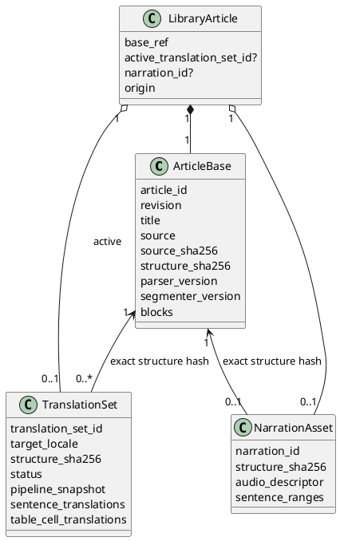
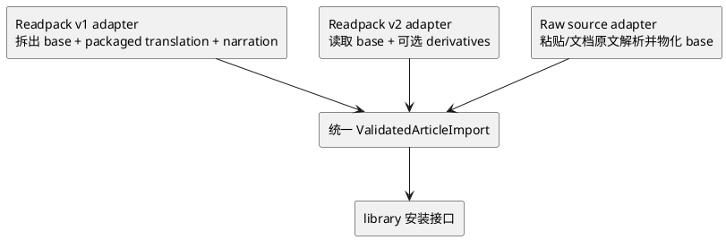
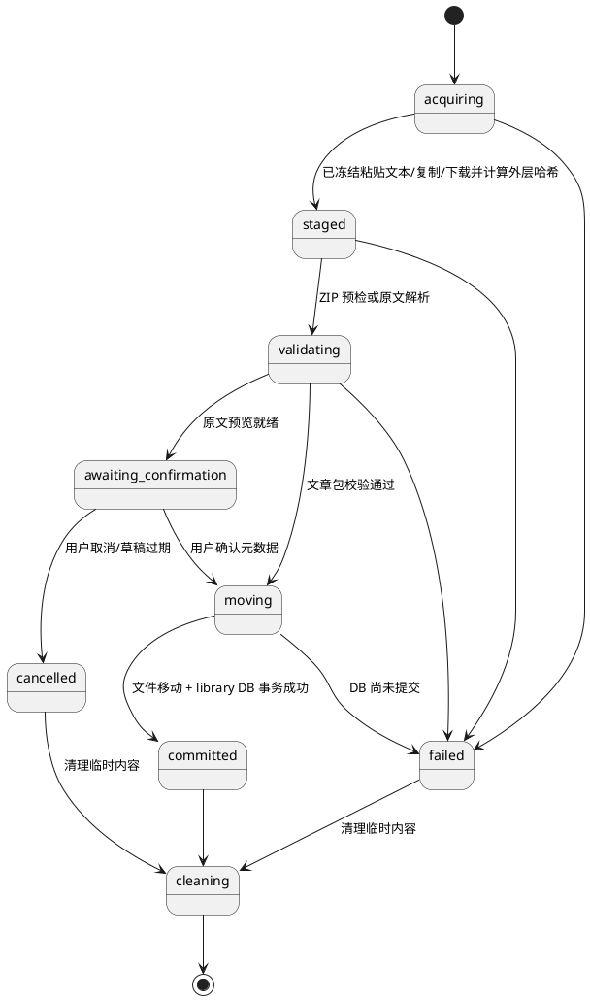
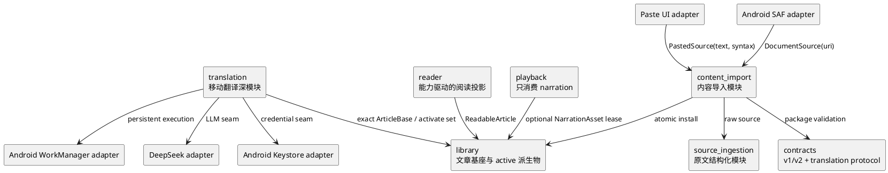
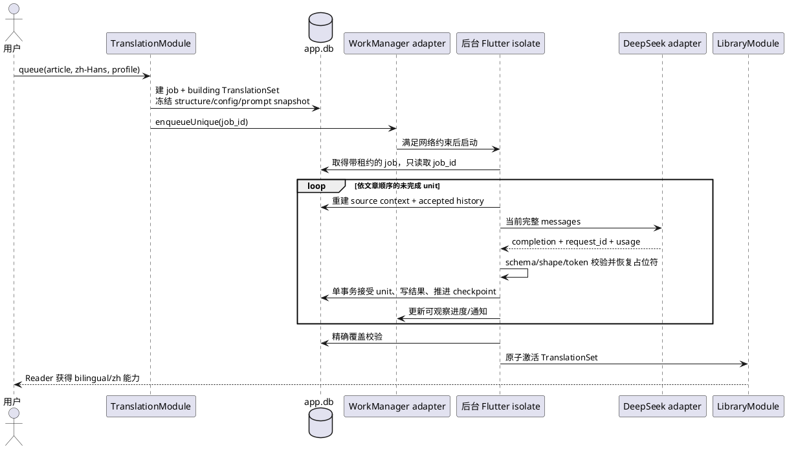
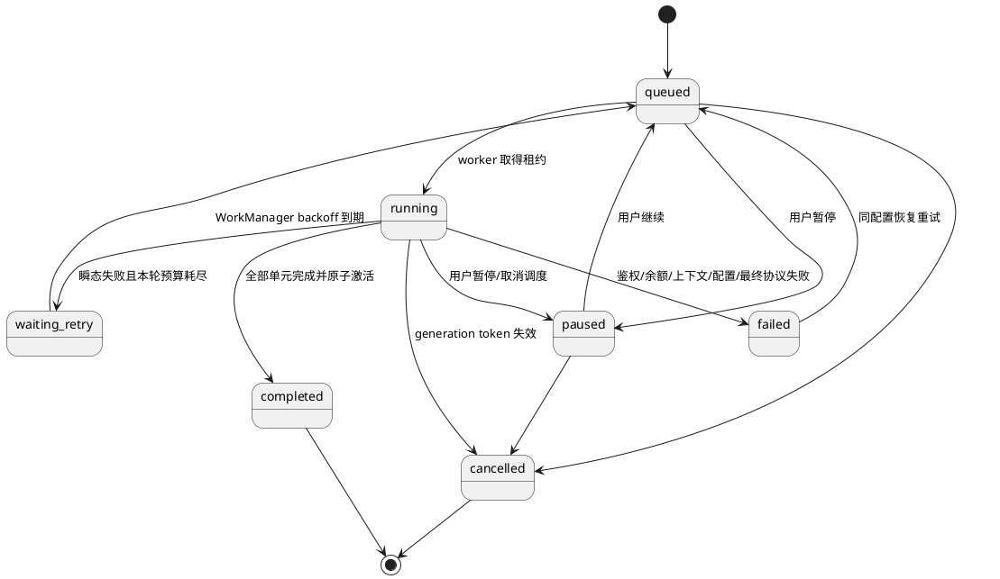

# Engirdle 移动端轻量文章包与后台翻译方案

> 文档状态：候选实施方案  
> 更新时间：2026-08-24  
> 适用范围：`apps/mobile`、Readpack 契约、PC/mobile 翻译协议对齐  
> 相关基线：[产品目的](./purpose.md) · [MVP 总体设计](./mvp/mvp_design.md) · [Markdown 处理方案](./mvp/markdown_article_processing_design.md) · [PC 翻译模块](./mvp/translation_module_design.md)

## 1. 结论

建议把现有“PC 完整生产、mobile 纯消费”扩展为两条并存路径，而不是让 mobile 复制一套完整 PC 生产端：

1. **完整听读路径保持不变**：PC 继续生成 Readpack v1.1，mobile 继续获得译文和语音。
2. **轻量阅读路径新增**：mobile 可以直接粘贴英文原文、从本机选择 UTF-8 `.txt` / `.md` 原文，或导入新的 source-only Readpack v2；导入完成后立刻可阅读、选词、查词和保存生词。
3. **译文成为可选派生物**：mobile 可由用户显式启动 LLM 后台翻译；结果保存为独立、不可变的 `TranslationSet`，全部完成并校验后才原子激活。
4. **mobile 永不生成语音**：后台管线只有“预检 → 顺序翻译 → 校验 → 激活”，不存在 speech、audio、TTS 占位文件或伪造时长。
5. **后台执行可恢复**：应用数据库是任务事实源，Android WorkManager 只负责调度；每个翻译单元接受后立即落 checkpoint，进程退出、断网或系统停止任务后可继续。
6. **首期只接 DeepSeek 官方 HTTPS 端点**：复用 PC 当前的完整上下文、顺序单元、严格结构校验和保护占位符协议。模块接口允许后续增加第二个 LLM adapter，但首期不开放携带密钥的任意自定义端点。

这不是 Readpack v1.2。现有 v1 把固定四文件布局、逐句译文和音频设为必需语义，而仓库兼容规则明确规定改变必需文件需要提升 major，因此轻量包应使用 **Readpack v2.0**。v1.0/v1.1 继续长期可导入。

## 2. 范围与假设

### 2.1 本方案包含

- 在 mobile 专用页面直接粘贴并编辑原文，以纯文本或 Markdown 语法导入；
- 从 Android 系统文件选择器导入 `.txt`、`.md`、`.markdown` 和 `.readpack`；
- 在 mobile 导入阶段完成确定性的规范化、受限 GFM 解析、分句、稳定 ID 分配和结构冻结；
- source-only Readpack v2.0 契约；
- 对 v1 和 v2 的统一 mobile 内部内容模型；
- 基于用户自备 API Key 的简体中文文章翻译；
- 后台调度、进度、取消、失败重试、进程重启恢复和结果原子激活；
- 书架、阅读器、归属页和设置页的能力降级；
- 现有 v1 内容、播放、生词快照和局域网下载的兼容迁移。

### 2.2 首期不包含

- URL 抓取、浏览器分享、HTML、EPUB、PDF、图片 OCR 或任意网页正文提取；
- 导入完成后的结构编辑和人工译文审阅；粘贴页允许在确认导入前编辑原文，若预览不正确则返回修改，文件输入则修改源文件后重新导入；
- mobile TTS、系统 TTS 回退、音频拼接或空音频占位；
- 多目标语言、并行多模型、自动模型降级或上下文摘要；首期目标固定为 `zh-Hans`；
- 把 mobile 生成的译文重新导出或同步到 PC；
- 在多设备之间同步文章、任务、API Key 或生词；
- 后台任务在用户对应用执行“强行停止”后仍运行的承诺。

“英文原文”在首期指纯文本或本项目冻结 GFM 子集。语言检测只给警告，不以概率模型硬拒绝内容。

## 3. 当前实现与改造原因

| 当前实现 | 轻量路径的冲突 | 改造方向 |
|---|---|---|
| Readpack v1 固定包含 `manifest.json`、`article.json`、`attribution.json`、`audio/article.m4a` | source-only 包无法通过布局校验 | v2 只强制前三个 JSON 文件，派生物按描述符可选 |
| v1 validator 要求每个文本句有译文、完整音频范围且全文至少一句可朗读 | 未翻译、无音频文章必然被拒绝 | v2 分别校验原文、译文集和 narration，互不伪造 |
| `articles` 表的时长、codec、采样率、声道均非空 | 无音频文章只能写入错误哨兵值 | 把可选 narration 拆到独立表 |
| `InstalledContent.audioFilePath` 必填 | 阅读模型被迫假设总有音频 | 用可选 `NarrationAsset` 表达真实能力 |
| 表格译文内嵌在 `blocks.payload_json`，句译内嵌在 `sentences` | 后补译文需要原地改写基础内容，且无法原子切换一整套结果 | 译文进入独立 `TranslationSet` 与 typed rows |
| `ImportService` 接受 `CatalogPackage` 且预检固定四条路径 | 无法接收粘贴文本或系统文件选择器输入，也无法处理动态 v2 布局 | 深化为统一内容导入模块，并为粘贴、LAN、文档包和原文文件提供 adapter |
| Reader 始终展示三种阅读模式及播放动作 | source-only 会出现空译文和无效播放 | 由 `ArticleCapabilities` 控制入口和模式 |
| 生词快照的 `sentence_translation_zh` 已允许空值 | 与轻量阅读兼容 | 保留现状；翻译完成后只影响新保存快照 |

现有类型化块、句子 runs、词典、生词快照、安全 ZIP 读取器、SQLite WAL、原子安装日志和 PC `ProcessingPlan` 都可以复用其设计，不需要推倒重来。

## 4. 目标领域模型

核心变化是把“文章原文”和“派生内容”分成不同生命周期。原文一旦导入即不可变；译文和语音都只能引用其精确 `structure_sha256`。

### 4.1 核心不变量

1. `ArticleBase` 不包含 `translation_zh`、音频区间或音频路径。
2. 一个 `TranslationSet` 必须完整覆盖该结构的所有 translation units：文本句和表格 cell；代码与分隔线不得出现。
3. 一个 `NarrationAsset` 若存在，必须完整覆盖 narration plan 中的文本句；它不决定译文是否存在。
4. 只有 `status=complete` 且覆盖集合完全一致的译文集可以成为 active；partial 结果只对任务详情可见。
5. `structure_sha256` 不相等时禁止复用、激活或按文本猜测映射译文/音频。
6. 更新原文只创建新的 article revision；翻译同一原文不增加 article revision 或 artifact revision。
7. 同一文章、结构哈希和目标语言最多一个 active translation set；历史完整集合可以保留到清理策略执行。
8. mobile 生成的结果永不创建 `NarrationAsset`。

### 4.2 用户可见能力矩阵

| 内容状态 | 英文阅读 | 选词/词典 | 生词本 | 英中/中文模式 | 句译抽屉 | 播放 |
|---|---:|---:|---:|---:|---:|---:|
| v2/source-only、粘贴原文或本机原文 | 是 | 是 | 是 | 否 | 否 | 否 |
| source-only + mobile 完整译文集 | 是 | 是 | 是 | 是 | 是 | 否 |
| PC v1.0/v1.1 完整包 | 是 | 是 | 是 | 是 | 是 | 是 |
| 未来 v2 + 译文 + narration | 是 | 是 | 是 | 是 | 是 | 是 |
| 翻译进行中或失败 | 是 | 是 | 是 | 仍使用上一个完整译文集；没有则否 | 同左 | 仅取决于已导入 narration |

## 5. Readpack v2.0

### 5.1 为什么使用 major 版本

不采用以下两种方案：

- **不把空字符串和零时长塞进 v1**：这会破坏 v1 的发布不变量，并把错误状态扩散到 reader 与 playback。
- **不另建与 Readpack 高度重复的 `litepack` 契约族**：文章身份、块结构、归属、安全 ZIP 和兼容规则会形成两套几乎相同的规范。

Readpack v2 仍是同一个 `.readpack` 格式族，但把基础内容与派生物分层。旧客户端看到主版本 2 必须拒绝；新客户端通过不同 validator adapter 将 v1 和 v2 都投影到统一领域模型。

### 5.2 逻辑布局

| 路径 | source-only | 含译文 | 含 narration | 语义 |
|---|---:|---:|---:|---|
| `manifest.json` | 必需 | 必需 | 必需 | 信封、文件哈希、派生物描述符 |
| `article.json` | 必需 | 必需 | 必需 | 只含不可变原文结构 |
| `attribution.json` | 必需 | 必需 | 必需 | 原文与处理依赖归属 |
| `derivatives/translation.zh-Hans.json` | 禁止 | 必需 | 可选 | 完整简中译文集与翻译管线快照 |
| `derivatives/narration.json` | 禁止 | 可选 | 必需 | 音频描述及句级区间 |
| `audio/article.m4a` | 禁止 | 可选 | 必需 | narration 引用的不可变音频 |

ZIP 中的实际路径必须与 manifest 声明集合完全相等，不允许目录条目、未声明文件或同义路径。source-only 包因此只有三个普通文件。

### 5.3 `manifest.json` 接口

| 字段 | 规则 |
|---|---|
| `format` / `format_version` | 固定 `readpack` / `2.0` |
| `package_id` / `created_at` | 不透明 UUID / RFC 3339 时间 |
| `article` | `id`、`revision`、`artifact_revision` |
| `files` | 除 manifest 自身外每个载荷的 path、size、SHA-256、media type；不得多报少报 |
| `content` | 指向 `article.json`，声明 `structure_sha256`、parser、segmenter |
| `derivatives.translations` | 零或多个目标语言描述符；首期 mobile 只认识 `zh-Hans` |
| `derivatives.narration` | 可空；存在时同时引用 narration descriptor 与音频文件 |
| `required_capabilities` | 仅表达不能忽略的语法/语义扩展；未知值仍拒绝 |

不再用 `profile=source/translated/narrated` 枚举组合。能力由派生物描述符的存在以及完整校验结果推导，避免将来出现 profile 组合爆炸。

### 5.4 `article.json` 接口

沿用 v1.1 已验证的块判别联合与资源上限，但移除全部派生字段：

- 文本句保留 `sentence_id`、`order`、`text`、非空 `runs`；
- 表格保留 cell ID、runs、对齐、header 和 rows，不含 `translation_zh`；
- code 与 divider 语义不变；
- 顶层保留来源字段、`source_sha256`、`normalized_sha256`、`structure_sha256`；
- 不出现音频样本/毫秒边界；
- 允许没有 narration units 的可展示文章，不再继承 v1 “至少一句有音频”的发布 profile；
- 为支持文章翻译，至少需要一个文本句或一张非空表；纯代码/分隔线包可以阅读，但 `can_translate=false`。

### 5.5 translation derivative 接口

| 字段 | 规则 |
|---|---|
| 文章身份 | `article_id`、`revision` 与 base 完全一致 |
| `structure_sha256` | 与 base 完全一致 |
| `target_locale` | 首期固定 `zh-Hans` |
| `sentences` | 有序 `{sentence_id, text}`，精确覆盖所有文本句 |
| `tables` | 按 block 分组的有序 `{cell_id, text}`，精确保持每张表的二维身份顺序 |
| `pipeline` | provider、model、prompt version、thinking/reasoning 配置、生成时间、客户端版本 |
| 完整性 | 每条译文非空且不超过 40,000 字符；包内不允许 partial 集合 |

### 5.6 narration derivative 接口

narration descriptor 从 v1 `article.json` 中抽出音频信息：codec、sample rate、channels、duration、相对路径和每个 sentence 的 sample/ms 半开区间。校验规则沿用 v1；它只能引用 base 的 narration plan，不能为表格、代码或分隔线建立区间。

### 5.7 兼容投影

PC 在第一阶段仍发布 v1.1，因此 catalog v1 无需同步升级。只有未来 PC 开始发布 v2 时，才单独演进 catalog 的 `format_version` 约束和 fixture。

## 6. mobile 原文导入

### 6.1 输入方式

首期提供三个用户入口，但后端只保留一条结构化与原子安装管线：

| 用户入口 | 输入语义 | 后续处理 |
|---|---|---|
| `粘贴原文` | 用户在专用多行编辑页显式粘贴/编辑文本，并选择 `纯文本` 或 `Markdown` | 确认的字符串按 UTF-8 物化到应用私有 staging，再进入原文结构化 |
| `选择原文文件` | 从本机选择 `.txt`、`.md` 或 `.markdown` | 内容流复制到 staging，再进入原文结构化 |
| `选择文章包` | 从本机选择 `.readpack` | 内容流复制到 staging，再进入安全 ZIP 与版本校验 |

文件入口使用 Android Storage Access Framework 的 `ACTION_OPEN_DOCUMENT`，不申请广泛存储权限。[Android 官方文档](https://developer.android.com/training/data-storage/shared/documents-files)说明该方式为应用提供用户明确选择文档的 URI 访问权。应用不在页面打开时主动读取剪贴板；只有用户通过系统编辑菜单或键盘明确粘贴的内容才进入编辑器。

首期允许：

| 类型 | 处理 |
|---|---|
| `.readpack` | 安全 ZIP 预检后按 manifest 主版本路由到 v1/v2 validator |
| `.md` / `.markdown` | 解析与 PC 相同的冻结 GFM 子集 |
| `.txt` | 空行分块、段内按相同英文分句规范生成 plain runs |
| 粘贴 + `Markdown` | 与 `.md` 使用同一 parser、限制和警告规则 |
| 粘贴 + `纯文本` | 与 `.txt` 使用同一分块和分句规则；这是默认选项 |
| 其他扩展或无效 UTF-8 | 拒绝并给出可操作错误 |

原文候选上限统一为 UTF-8 编码后的 8 MiB；块、句、表格、代码和 runs 继续使用现有跨端上限。超过上限时不截断、不部分导入。文件的 raw SHA-256 基于用户选择的原始字节；粘贴原文的 raw SHA-256 基于用户点击“预览”时确认字符串的无 BOM UTF-8 快照。BOM 和换行等规范化只影响 canonical source，不改变 raw 快照与哈希。

### 6.2 粘贴原文页

粘贴入口是正式的 source adapter，不是临时文本框：

- 页面包含多行原文编辑器、`纯文本` / `Markdown` 显式选择器、UTF-8 字节计数和“预览”动作；默认选择纯文本，不根据正文符号静默猜测 Markdown；
- 允许用户在粘贴后继续编辑；空白正文、非法 Unicode、NUL/不允许的控制字符和超限内容在本页阻止预览，并保留当前编辑内容供修正；
- 不自动读取、监听、记录或上传系统剪贴板，也不把正文写入分析日志和崩溃面包屑；
- 点击“预览”前内容只存在于当前编辑状态，退出即丢弃且不创建文章、任务或 staging；
- 点击“预览”时冻结文本与语法选择，写入应用私有 staging 并进入通用导入 journal；进程随后退出时可恢复到预览确认，用户返回编辑则废弃旧快照，再次点击“预览”时才创建新快照；
- 标题可从首个非空行或首个 Markdown heading 建议，但正文中的该行不会被自动删除。

### 6.3 导入确认页

原文不是带完整元数据的包，导入前需要一个轻量确认页：

- 标题必填；可从首个 heading 或文件名建议，但必须允许用户确认；
- 作者、来源显示名、来源 URL 可空；
- 许可必须显式选择已知值或 `unknown`，不得静默猜测；
- 展示块数、句数、表格数、代码块数、警告和前几块预览；
- unclosed fence 等警告需要用户再次确认；raw HTML、资源超限等错误不允许绕过；
- 语言检测只显示“内容可能不是英文”的提醒。

粘贴与文件原文使用同一确认页；它们只在输入 adapter 上不同。确认后生成 UUID `article_id`、revision 1、artifact revision 1，保存 raw source、canonical source、类型化 `ArticleBase` 及归属信息。相同 raw SHA-256 视为精确重复；相同 `normalized_sha256 + source_syntax` 视为内容重复候选，以覆盖粘贴与文件只因 BOM 或换行编码不同的情况。两者都先提示已存在，不静默覆盖或自动合并。

### 6.4 解析一致性

移动端必须在导入时解析一次，Reader 不得再次解析 Markdown 或重新分句。Dart 与 Python 不共享运行时代码，但共享语言无关的输入/输出黄金 fixture：

- 同一组 `.md` 输入；
- 期望块种类、顺序、可见文本、runs、句界和警告；
- 期望 `structure_sha256`；
- 表格、链接、inline code、代码块、Unicode 和缩写边界的对抗样本。

如果 Dart Markdown 库的 AST 与 `markdown-it-py` 无法稳定映射，首期应缩小 mobile `.md` 子集并明确拒绝差异语法，不能把库差异留给 Reader 猜测。parser 与 segmenter 分别记录版本，例如 `engirdle-gfm-dart@1` 和 `engirdle-segmenter-dart@2`。

### 6.5 通用导入状态机

现有 importer 的 download/staged/moving/committed 恢复模型应深化为输入无关的 `ContentImportModule`：

`acquiring` 的输入可以是粘贴文本快照、SAF 内容流或 LAN 下载；从 `staged` 起不再区分来源。粘贴输入也不得绕过 journal、资源限制、parser 或重复内容检查。`awaiting_confirmation` 只持有 staging 与解析预览，不产生可见文章；实现应为未完成预览设置清理期限。

对 v2 动态布局，ZIP 处理顺序调整为：预检所有中央目录项和资源上限 → 单独提取受限大小的 `manifest.json` → 解析版本和精确 allow-list → 确认实际路径集合完全一致 → 流式提取其余文件 → 哈希与语义校验。不能先信任 manifest，也不能继续使用固定四路径集合。

## 7. 模块与 seam

### 7.1 模块关系

### 7.2 对外接口

| 模块 | 小接口 | 隐藏的实现复杂度 |
|---|---|---|
| `ContentImportModule` | `import(ImportRequest) -> ImportResult`、`recover()` | paste/LAN/SAF adapters、ZIP、安全限制、解析、日志、预览确认、原子安装 |
| `LibraryModule` | `list()`、`open(articleId)`、`install(validated)`、`activateTranslation(setId)` | v1/v2 归一化、DB joins、制品目录、能力计算、迁移 |
| `TranslationModule` | `queue(request)`、`cancel(jobId)`、`retry(jobId)`、`watch(jobId)` | plan、prompt、历史、校验、checkpoint、后台调度、激活 |
| `Reader` | 消费一个 `ReadableArticle` | 不认识包版本、provider、任务表或文件路径 |
| `Playback` | 获取可选 narration lease | 无 narration 时明确失败；不推断或生成音频 |

`TranslationModule` 的测试面就是上述接口；prompt builder、placeholder codec、HTTP client 和 DAO 是内部 seam，不应逐个暴露给 Widget。

`ImportRequest` 使用有判别字段的值对象表达 `PastedSource`、`DocumentSource` 和 `CatalogPackage`，不能以松散 `Map` 携带输入。`PastedSource` 明确包含冻结文本与所选语法；`DocumentSource` 只携带受控 URI 及系统提供的名称/MIME 提示，真实类型仍由导入模块校验。两者都在模块内部产出同一个 `ValidatedArticleImport`。

### 7.3 必要 adapter

| seam | 生产 adapter | 测试 adapter |
|---|---|---|
| LLM completion | `DeepSeekMobileAdapter` | 脚本化内存 adapter |
| 后台调度 | WorkManager adapter | 进程内同步 scheduler |
| 秘密读取 | Android Keystore adapter | 内存 secret store |
| 原文输入 | Paste UI adapter、Android SAF adapter | string/fixture byte-stream adapter |

这些 seam 都有真实变化需求，不是为了形式创建的单实现抽象。

## 8. mobile 翻译管线

### 8.1 与 PC 对齐的协议

mobile v1 翻译协议保持 PC 的以下行为：

1. 从冻结的 `ArticleBase` 一次派生 `TranslationPlan`；文本块为 sentence batch，整表为一个 table unit，code/divider 没有 unit。
2. 构造不含 code body 的完整文章上下文；代码位置只放 `omitted_code_block` 标记。
3. inline code 和“显示文字等于 URI”的 autolink 使用 `‰N‰` 占位；href 本身从不进入 LLM 内容。
4. 单元严格按文章顺序串行执行；每次请求完整重放 system、原文上下文和此前已接受的 user/assistant 轮次。
5. sentence 响应必须是同长度非空字符串数组；table 响应必须保持 block ID、列数、对齐、二维 cell ID 及位置完全一致。
6. BOM/单层 JSON fence 可以剥离；其他 prose、对象包裹、错长、空值、占位符损坏或结构变化均视为协议错误。
7. 验证通过后才把原始 assistant `content` 与类型化结果在同一事务中写入 journal；不保存 reasoning content。
8. 不滑窗、不摘要、不自动换模型；上下文超限明确失败。

“参考 PC”不应变成复制后各自漂移。建议新增 `contracts/translation/v1`，保存：

- system prompt 和 `prompt_version`；
- source context、sentence unit、table unit 的 wire schema；
- placeholder 语法和恢复规则；
- 合法/非法响应 fixture；
- 一份小型 ArticleBase 到完整 messages 的黄金投影。

PC Python 与 mobile Dart 分别实现，但必须通过同一批 fixture。底层 HTTP SDK不属于共享契约。

### 8.2 任务执行流程

### 8.3 任务状态

WorkManager 自身状态不是产品状态。`translation_jobs` 中的状态、租约和 generation token 才是事实源，避免 UI、系统调度和数据库出现三套互相竞争的状态机。

### 8.4 checkpoint 与恢复

- 每个 job 冻结 `article_id`、revision、`structure_sha256`、目标语言、provider origin、model、prompt version、thinking/reasoning、timeout、retry 上限和客户端版本；设置变化只影响新 job。
- `translation_units` 以 `(job_id, unit_order)` 唯一，保存 unit ID/kind、接受的原始 assistant content、request ID、用量和完成时间。
- 每个已接受 unit 与其句译/cell 译文在同一 SQLite 事务提交；checkpoint 不可领先于结果。
- Worker 重启后从 ArticleBase 确定性重建所有 user 消息，从 accepted content 重建 assistant 历史。
- claimed checkpoint 与实际 unit rows 不一致时，从实际已验证结果恢复，不盲目跳过。
- API 调用成功但本机在提交前崩溃时可能产生一次重复计费；若 provider 没有可靠 idempotency key，客户端无法彻底消除，只能在 UI 与日志中如实说明。
- 同一 article/structure/locale 只允许一个 active job；全局首期只并行一个 LLM job，避免功耗、历史竞争和 rate limit 放大。

### 8.5 错误和重试

| 分类 | 例子 | 行为 |
|---|---|---|
| 等待约束 | 断网、用户要求仅 Wi-Fi/充电 | 不计业务失败，保持 queued/waiting |
| 瞬态 transport | 429、5xx、连接错误、timeout | 单请求内有限指数退避；耗尽后交给 WorkManager backoff |
| 瞬态协议 | fenced/错长/空值/表结构损坏 | 与 PC 一样有限重试；失败响应不进历史 |
| 鉴权 | 401/403、secret 缺失 | 停止为可操作失败，等待重新配置，不循环请求 |
| 余额 | 402 或 provider 等价错误 | 停止并提示账户余额 |
| 上下文 | 400/413 且命中明确上下文标记 | 明确失败，不压缩上下文或自动换模型 |
| 配置 | 非 HTTPS、非绑定 origin、模型不可用 | 请求前失败 |
| stale source | structure hash 改变或文章被删除 | 取消且永不激活旧结果 |

`Retry-After` 若存在优先使用；其他瞬态错误采用带 jitter 的有限指数退避。日志只记录 job/unit ID、请求 ID、状态码分类、用量和耗时，不记录正文、译文、messages、reasoning 或 secret。

### 8.6 成本与上下文预检

完整文章上下文与历史在每个 unit 重放，累计输入成本会随 unit 数明显增长。这是与 PC 一致性的有意取舍。queue 前应展示：

- 文章字符数、句数、表格数和 unit 数；
- 基于字符数的保守 token/费用区间，并声明只是估算；
- 所选 provider/model 与网络约束；
- 全文将发送到第三方 LLM 的明确确认。

若仅完整原文上下文已经超过模型配置的安全上限，直接拒绝 queue；不开始一个注定在中途失败的任务。

## 9. Android 后台执行

### 9.1 选择 WorkManager

Android 将 WorkManager 作为持久后台工作的推荐方案；任务可以在约束满足后执行，并在应用重启和设备重启后继续保留调度。[Android persistent work](https://developer.android.com/develop/background-work/background-tasks/persistent) 与 [Flutter 后台进程说明](https://docs.flutter.dev/packages-and-plugins/background-processes)均支持这一方向。

候选实现使用 Flutter community `workmanager`。截至本文日期，0.10.9 已提供 Android 长任务 foreground service、进度上报和 work 状态观察能力；实施前仍需在本仓库锁定版本并做真机 spike，不能只根据示例假定可用。[插件 quickstart](https://github.com/fluttercommunity/flutter_workmanager/blob/main/docs/quickstart.mdx) · [版本记录](https://pub.dev/packages/workmanager/changelog)

### 9.2 调度规则

- 用户点击“开始翻译”时注册 unique one-off work，唯一名由 job ID 构造，重复点击不生成第二条管线。
- 强制 `NetworkType.connected`；“仅非计费网络”“仅充电时”是用户选项。
- 长任务以 `dataSync` foreground service 运行，使用独立“文章翻译”通知频道，展示文章标题、完成 unit/总 unit 和取消动作；不得复用现有 media playback service。
- WorkManager input data 只传 `job_id`；文章内容、messages、配置快照和 API Key 全部从受控存储读取。
- 后台 callback 构建精简的 `TranslationWorkerDependencies`，只装配数据库、library 读取、翻译、secret、HTTPS 与日志；不初始化 Widget、AudioService、播放器或词典。
- Worker 在每个 unit、每次 backoff 和每次提交前检查取消/generation token。过期 worker 即使收到网络响应也不得写结果。
- 数据库使用独立连接和 WAL；迁移入口必须能处理 UI isolate 与后台 isolate 的并发启动，并在事务内重新检查 `user_version`。

### 9.3 系统限制与降级

WorkManager 普通 worker 有有限执行窗口；长任务可以升级为 foreground worker，但不能把它理解为无限后台线程。Android 15 起 `dataSync` foreground service 在后台有每 24 小时累计 6 小时限制；Android 16 的 long-running WorkManager 还会消耗 JobScheduler quota。[长任务说明](https://developer.android.com/develop/background-work/background-tasks/persistent/how-to/long-running) · [foreground service timeout](https://developer.android.com/develop/background-work/services/fgs/timeout)

因此正确性依赖 unit checkpoint，而不依赖一次连续运行：

- 系统 stop、quota 或厂商省电策略只让 job 回到等待/重调度，不丢失已接受 unit；
- 预计单篇任务应远小于 6 小时；超过产品预算时主动让出并等待下一次调度；
- Android 13+ 在 UI 请求通知权限；Android 14+ 声明 `dataSync` foreground service 类型与对应权限；如果未来上架 Play，还要完成该特殊类型的申报；
- 用户拒绝通知权限时给出明确提示，仍不伪装为“保证持续运行”；
- 真机验收至少覆盖 API 31、33、35、36 和一个有激进省电策略的厂商设备。

## 10. API Key 与隐私

### 10.1 secret 模型

- 用户自备 API Key；不把公共共享 key 编译进 APK。
- Key 不进入 SQLite、preferences、WorkManager input、manifest、translation set、日志、崩溃报告或备份。
- 使用 Android Keystore 中不可导出的设备密钥加密 secret，数据库只保存非秘密的 profile ID 与 secret alias。Android 官方说明 Keystore 可使密钥材料保持不可导出并限制用途：[Android Keystore](https://developer.android.com/privacy-and-security/keystore)。
- 后台使用要求无需再次解锁用户界面，因此首期不能把该加密密钥配置为“每次使用必须生物认证”；若产品以后要求此等级，必须接受无人值守后台翻译不可用。
- 设备恢复或 Keystore secret 丢失时，job 进入 `credentials_missing`，原文和已有完整译文仍可阅读。

### 10.2 provider 与传输

- 首期 `DeepSeekMobileAdapter` 固定官方 HTTPS origin，并在构造与请求前双重校验；证书使用系统信任链，不提供忽略 TLS 错误的开关。
- secret 与 provider origin 绑定；修改 origin 必须重新输入 key，防止把已有 key 发送到新地址。
- provider/model 可用性测试在设置页由用户显式触发；queue 时再次验证配置快照。
- 若未来增加自定义 OpenAI-compatible adapter，应作为单独安全决策交付，而不是把任意 URL 字段直接接到现有 key。
- 翻译前明确提示全文会离开设备，并记录用户确认时间；默认离线原则保持不变，绝不因导入或打开文章自动发起 LLM 请求。

## 11. mobile 存储迁移

不建议只在现有非空 audio 列中写 `0` / `none`。应执行一次明确的表重建，把可选派生物正规化。

### 11.1 目标表所有权

| 所有模块 | 表 | 关键字段/职责 |
|---|---|---|
| library | `articles` | base 身份、标题/来源、origin、source/structure hash、parser/segmenter、当前 base artifact |
| library | `article_artifacts` | package/local artifact 身份、`ingress_kind`（paste/document/catalog）、source syntax、目录、大小、哈希、raw manifest/attribution |
| library | `blocks` / `sentences` | 不可变原文结构；sentence 不再拥有 active 译文 |
| library | `table_cells` 或 typed payload projection | 表格 cell 身份与原文；逐步替代把可变译文写进 block JSON |
| library/playback seam | `narration_assets` / `sentence_audio_ranges` | 可选音频描述、路径和区间 |
| translation | `translation_sets` | building/complete/superseded、结构哈希、语言、pipeline snapshot |
| translation | `sentence_translations` | set + sentence ID + text |
| translation | `table_cell_translations` | set + block/cell ID + text |
| translation | `translation_jobs` | 状态、租约、generation、checkpoint、错误、进度、WorkManager identity |
| translation | `translation_units` | 有序 journal、accepted content、request ID、usage |
| translation settings | `llm_profiles` | provider、origin、model、非秘密参数、secret alias |

active translation pointer 建议单独放 `article_active_translations(article_id, locale, translation_set_id)`，由 library 提供原子切换接口；translation 模块不能直接修改 library 私有表。

### 11.2 v4 数据迁移

1. 创建新表并保持 migration 全程事务化。
2. 对每个现有 v1 article 建立 `ArticleBase` 与 `article_artifact`。
3. 从 `sentences.translation_zh` 和 table payload 中拆出一个 `origin=packaged`、`status=complete` 的 `TranslationSet`。
4. 从 article audio 列和 sentence audio ranges 建立 `NarrationAsset`。
5. 把该译文集设为 active；阅读模式与播放行为保持不变。
6. 校验每篇迁移后的 v1 内容能力仍是 `translated + narrated`，再删除旧派生列或将其标为只读兼容列。
7. 生词表不迁移语义；既有快照保持原样。

升级失败必须回滚到 v4，不允许出现 base 已迁移而 active translation/narration 缺失的半状态。

## 12. 阅读器与书架 UX

### 12.1 书架

- 顶部增加“导入”入口，动作面板明确列出“粘贴原文”“选择原文文件”“选择文章包”，并将“粘贴原文”放在首位；
- 卡片显示能力徽标：`原文`、`翻译中 7/24`、`已翻译`、`含语音`；
- 翻译失败不把文章标成损坏，卡片继续可打开；
- 同一文章存在 active 完整译文时，重试 job 的进度不替换该徽标；
- 删除文章时取消相关 WorkManager work，generation 失效，然后按现有制品租约规则删除；生词快照继续保留。

### 12.2 粘贴与导入预览

- “粘贴原文”打开专用页面，不用文件选择器，也不在页面进入时弹出剪贴板权限或自动抓取剪贴板；
- 原文编辑器支持系统原生选择、粘贴、撤销和滚动，持续显示字符数与 UTF-8 字节数；超过 8 MiB 时保留可编辑内容但禁用预览并明确说明限制；
- 用户选择纯文本或 Markdown 后点击“预览”，进入与文件原文共用的结构预览和元数据确认页；
- 解析错误返回编辑页时保留本次文本与光标附近上下文；解析警告在预览页定位到对应行/块；
- 最终确认前不会把文章放入书架；取消预览会清理 staging，不产生空壳文章。

### 12.3 Reader

- 没有 active 译文时仅显示“仅英文”，隐藏而非禁用英中/中文模式；
- 没有 narration 时句子菜单不渲染“单句朗读/从此朗读”，全局 playback bar 不受影响但不会为该文章启动；
- 未翻译句子仍保持独立 `SelectableText`，继续支持词典、复制、本机划词翻译和生词保存；
- 没有译文时保存的生词快照允许 `sentence_translation_zh=null`，以后翻译完成不反写历史快照；
- 翻译任务在正文上方显示小型非阻塞状态条，阅读不被锁住；
- complete set 激活后通过 library change notification 刷新能力；若用户当前在仅英文模式，不自动切换阅读模式；
- 译文集失效或移除时，持久化的 bilingual/zh 模式在打开文章时安全回退到 en-only。

### 12.4 设置和任务详情

- LLM 设置页：provider、固定 origin、model、key 新增/替换/删除、连接测试、仅 Wi-Fi、仅充电；从不回显完整 key；
- 翻译确认页：隐私确认、估算、配置快照和“开始翻译”；
- 任务详情：状态、完成 unit/总 unit、开始/更新时间、模型、可操作错误、暂停/继续/取消/同配置重试；
- 通知：进度、等待网络、完成、失败和取消动作；不在通知中显示正文或译文。

## 13. PC 侧影响

首期不改变 PC 生产和发布路径，也不让 PC 接收 mobile 任务。需要的 PC 改动限于协议对齐：

1. 把当前 prompt、wire schema、placeholder 规则和黄金 messages 提炼到 `contracts/translation/v1`；
2. PC 保持当前行为，通过共享 fixture 证明提炼没有改变请求内容；
3. mobile Dart 实现同一协议并运行相同 fixture；
4. PC packaging 继续输出 v1.1；
5. 后续若需要 PC 快速导出 source-only 包，再让 packaging 增加 v2 adapter；这不应依赖 translation/speech/audio 模块。

这种安排保留 PC 管线成熟行为，同时避免 mobile 依赖 Python、启动 PC 进程或共享内部数据库。

## 14. 测试与验收

### 14.1 契约测试

- v2 source-only 最小合法包；
- v2 完整译文、完整 narration 和两者组合；
- 缺基础文件、额外文件、重复路径、错误 hash、未知 major/capability；
- translation 少/多/swap sentence 或 cell、结构 hash 不符、空译文；
- narration 无音频、区间越界、覆盖集合不完整；
- 所有既有 v1 valid/invalid fixture 继续保持原结果；
- v1 adapter 与 v2 adapter 投影到等价 `ReadableArticle` 的黄金测试。

### 14.2 原文解析测试

- `.txt` 空行、缩写、小数、引号和 Unicode 句界；
- GFM 标题、列表、引用、表格、代码、divider 与 inline runs；
- 同一 UTF-8 内容经粘贴纯文本与 `.txt` 导入产生相同 canonical structure/hash，经粘贴 Markdown 与 `.md` 导入亦然；
- 粘贴不自动读取剪贴板、不静默截断超限内容，取消预览不留下文章、journal 或 staging；
- 粘贴语法选择被冻结到预览快照，返回修改后旧快照不可被误提交；
- raw HTML 拒绝、unclosed fence 警告、资源上限；
- Python/Dart 共享 fixture 的结构和 hash 一致；
- 同一输入重导入产生同一块/句序列，不受 Widget 或平台 locale 影响。

### 14.3 翻译模块接口测试

- 完整 code-free context 和顺序历史重放；
- code body、href 和 protected literals 不进入请求/日志；
- sentence/table 形状、placeholder 和 40,000 字符上限；
- 协议错误不污染 journal；
- 429/5xx/timeout/鉴权/余额/上下文分类；
- checkpoint 跨 worker 实例恢复、stale hash 拒绝；
- pause/cancel 与迟到 response 的 generation race；
- 完成前 reader 看不到 partial，完成事务后一次性看到完整译文；
- 已有 active set 在新 job 失败时保持不变；
- DB、WorkManager input、日志、manifest 中搜索不到测试 key。

### 14.4 迁移和集成测试

- 从真实 v4 数据库迁移，v1 阅读、表格译文、音频播放和阅读模式不变；
- 粘贴或文件 source-only 导入时没有 audio 文件、audio row 或播放入口；
- 粘贴点击预览后杀进程可恢复确认页；预览前退出不持久化正文；确认与取消竞争不会产生空壳文章；
- app 在第一个、中间和最后一个 unit 后被杀，重启均能恢复；
- 网络切换、锁屏、滑走任务、设备重启、通知权限拒绝、API 31/33/35/36；
- 翻译期间继续离线阅读、查词和保存生词；
- 删除文章与后台 worker 并发时没有孤儿结果或复活文章。

### 14.5 端到端验收场景

1. 飞行模式下直接粘贴一篇英文原文，以纯文本预览并确认；立即阅读、选词、查词、保存生词，且不存在译文模式和播放入口。
2. 同一原文以粘贴和 `.txt` 文件分别导入时触发重复内容提示，不静默创建两个副本；取消其中一个预览不留下 staging。
3. 粘贴含表格和代码的 Markdown，启动翻译后锁屏；恢复应用后任务继续，代码从未出现在 fake provider capture，表格保持同形状。
4. 中途断网并终止进程，已接受单元保留；联网后从下一单元继续，最终一次性出现英中/中文模式。
5. 鉴权失败或 context limit 时原文仍可读，partial 结果不激活；修正同一 profile 后可恢复或新建 job。
6. 导入现有 PC v1.1 包，阅读、译文、后台播放、归属和生词行为与迁移前一致。

## 15. 实施顺序

### 阶段 0：风险 spike 与契约冻结

- 验证 Flutter `workmanager` 长任务、进度、取消、后台 isolate 中的 `sqlite3`、path provider 和 Keystore 访问；
- 在 API 35/36 真机验证 notification、dataSync 类型、进程停止与恢复；
- 冻结 Readpack v2 schema、兼容说明和最小 fixtures；
- 冻结 shared translation protocol v1 fixtures；
- 决定 Dart Markdown parser；无法通过共享 fixture 时收窄 mobile Markdown 子集。

退出条件：一个两段文章能在 app 后台完成 fake 翻译，进程中断后恢复，且 source-only v2 fixture 可安全导入。

### 阶段 1：内部能力解耦

- 完成数据库重建迁移和 v1 adapter；
- 引入 `ArticleBase`、`TranslationSet`、`NarrationAsset`、`ArticleCapabilities`；
- 让 Reader/Playback 只依赖能力，不再假设译文和音频存在；
- 保证所有现有 mobile 测试及 v1 端到端测试通过。

这是后续工作的前置 tracer bullet：先让一篇手工构造的 source-only 内容能进入书架并完整使用有限功能。

### 阶段 2：粘贴、本机原文与 v2 导入

- 深化通用导入模块，先接入粘贴 adapter 形成最短 tracer bullet，再接入 SAF adapter；
- 实现粘贴纯文本与 `.txt` 共用的结构化，再实现粘贴 Markdown 与 `.md` 共用且通过共享 fixture 的子集；
- 实现 v2 validator、确认页、归属生成、重复内容提示和恢复；
- 添加 source-only 书架/Reader UX。

### 阶段 3：前台可恢复翻译

- 建 translation tables、DeepSeek adapter、secret store 和设置页；
- 先在进程内 scheduler 下完成段落文章的 queue → checkpoint → complete → atomic activate；
- 再加入 table、protected token、完整错误矩阵和成本预检。

### 阶段 4：Android 后台化

- 接入 WorkManager adapter、foreground notification、约束、暂停/取消和 startup reconciliation；
- 完成进程/网络/删除竞争的真机测试；
- 更新 README、权限说明、隐私说明和运维诊断。

### 阶段 5：可选后续

- PC source-only v2 exporter 与 catalog v2；
- mobile 译文导出/回传；
- 第二 LLM adapter；
- URL/share/EPUB 等新的 source adapter。

## 16. 主要风险与控制

| 风险 | 影响 | 控制 |
|---|---|---|
| Dart/Python 解析漂移 | 同文不同句界，译文无法互换 | 共享 source→structure fixture、版本化 parser/segmenter、必要时收窄语法 |
| 完整历史导致 O(n²) 级输入增长 | 成本和 context limit | queue 前估算、单 job 串行、明确失败；首期不偷偷降质 |
| Android 后台限制或厂商杀进程 | 任务延迟/中断 | WorkManager + foreground notification + 每 unit checkpoint；不承诺连续线程 |
| Key 在设备侧被滥用 | 费用和隐私 | BYOK、Keystore 加密、origin 绑定、日志/备份排除、可撤销 |
| partial 结果进入阅读器 | 内容混合、恢复困难 | building set 隔离，完整覆盖后原子 active pointer |
| 原文更新后误用旧译文 | 错句对齐 | 所有派生物绑定 exact structure hash，禁止文本猜测 |
| v1 迁移破坏播放 | 现有核心能力回归 | v4 migration fixture、能力等价断言、保留旧包目录直到事务成功 |
| API 成功后本机提交前崩溃 | 重复请求/计费 | 每 unit 最小提交窗口；provider 支持时使用 idempotency key；否则明确不可消除 |
| 粘贴正文被静默读取、截断或按错语法解释 | 隐私预期受损、文章内容不可逆失真 | 仅响应用户显式粘贴；显示 UTF-8 字节数；超限阻止预览；显式选择纯文本/Markdown；确认前提供结构预览 |

## 17. 完成定义

满足以下条件才算交付，而不是“页面上出现导入和翻译按钮”：

- 粘贴原文、原文文件和 source-only 包均无需网络即可导入并立即阅读、选词、查词和保存生词；
- source-only 数据中不存在伪造 translation/audio 值；
- mobile 翻译与 PC 协议共享 fixture，code/URI 保护和表格形状校验一致；
- 翻译可在后台继续，并能从任一已提交 unit 恢复；
- partial/failed job 不改变 active reader projection；
- mobile 生成的文章永远没有播放入口或 narration 制品；
- v1.0/v1.1 导入和播放没有功能回归；
- API Key 不出现在数据库、文件包、任务参数或日志；
- 契约 schema、兼容文档、valid/invalid fixtures、PC 测试、Flutter 测试和真机验收在同一交付中更新。
