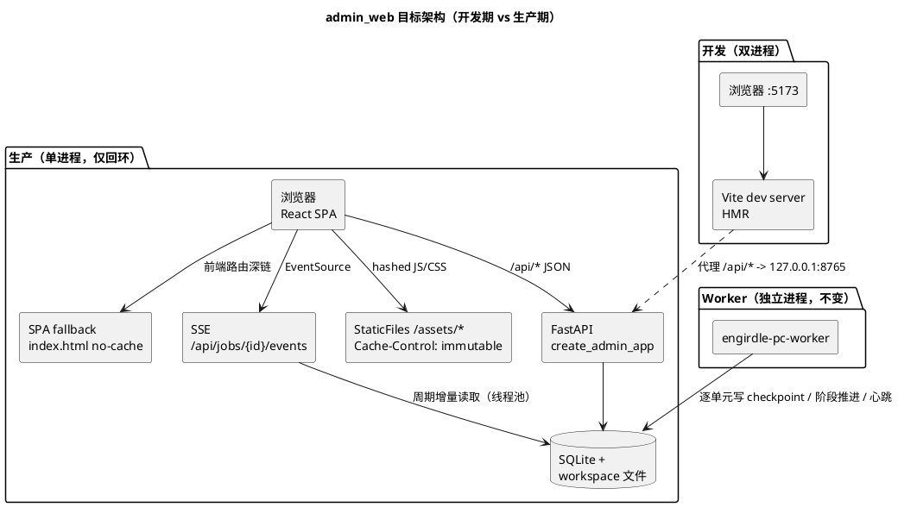
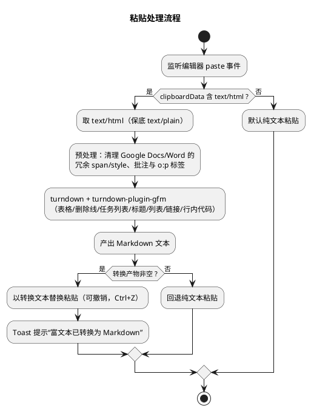
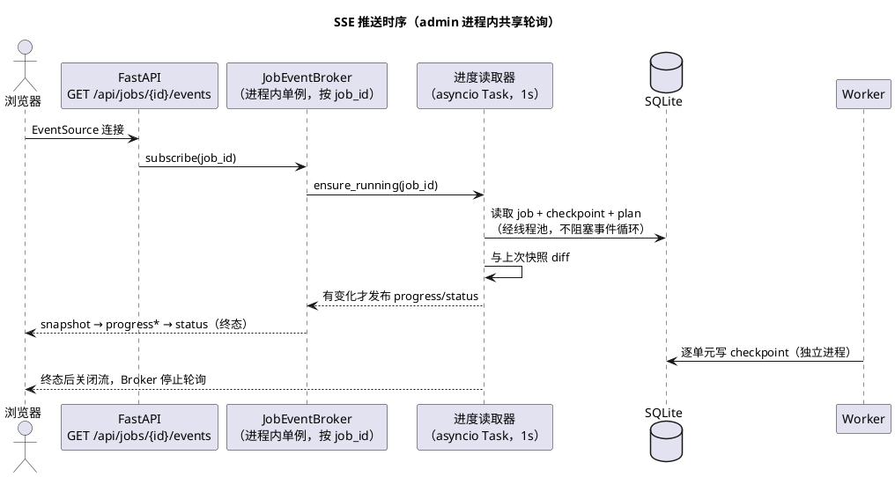
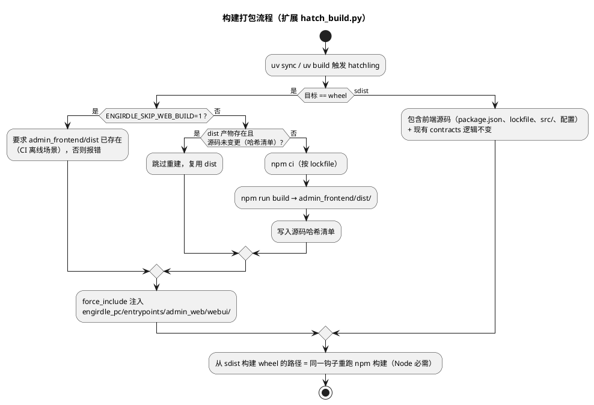

# Engirdle PC 管理端 Web 界面重构设计（Vite + React SPA）

> 文档状态：设计基线，待实施<br>
> 更新时间：2026-08-15<br>
> 适用范围：`apps/pc` 管理端（`engirdle_pc.entrypoints.admin_web`）<br>
> 总体设计：[mvp_design.md](./mvp_design.md)　文章管线：[markdown_article_processing_design.md](./markdown_article_processing_design.md)　运行说明：`apps/pc/README.md`

## 1. 决策摘要

管理端从 Jinja2 服务端渲染页面迁移为 Vite + React 单页应用（SPA），后端继续由 FastAPI 提供 JSON API 并托管构建产物。核心决策：

- **前端栈**：Vite + React 19 + TypeScript（strict）。开发期 Vite dev server 代理 `/api`，生产期 FastAPI 直接托管 hashed 静态产物，部署形态仍是 `engirdle-pc admin` 单命令单进程，只绑定回环地址。
- **UI 方案**：**shadcn/ui + Tailwind CSS v4**（产品决策：不采用 Ant Design 风格）。组件源码复制进仓库，基于 Radix UI 无障碍原语自行组合；信息架构重设计为左侧导航 + 卡片式面板的现代布局，支持暗色模式。管理台无复杂表格行内编辑需求（Markdown 表格编辑由 Markdown 编辑器承担），因此放弃组件库全托管方案、换取完全的视觉控制权是成立的。
- **Markdown 编辑器**：CodeMirror 6（`@uiw/react-codemirror` 封装）+ `@lezer/markdown` 的 GFM 扩展，覆盖表格、删除线、任务列表等 GFM 子集语法高亮；富文本粘贴（网页/Office/Google Docs）经 **turndown + turndown-plugin-gfm** 自动转换为 Markdown。
- **任务进度**：任务详情页新增阶段步进条（Stage Stepper）与进度条（Progress），进度百分比由 Worker 已持久化的检查点（checkpoint）对照 ProcessingPlan 单元总数**派生**，不改动领域模型；经新增的 **SSE 端点**实时推送，同时完整保留现有详情展示（状态、阶段、尝试次数、适配器配置快照等）。
- **构建时机（对原始方案的关键修正）**：`npm ci && npm run build` 挂在 **hatchling 构建钩子**（扩展现有 `hatch_build.py`），在 `uv sync` / `uv build` / sdist→wheel 构建时触发；**wheel 内已含产物，安装期不需要 Node**。原方案“打包安装到本地时触发 npm run build”按此语义修正，否则无 Node 环境的机器无法安装预构建 wheel。
- **页面层退役**：`routes/pages.py`、`templates/`、`static/`、`view_models.py` 与 `jinja2` 依赖最终全部删除；现有约 40 个 `/api/*` 端点是既存契约，仅少量增补。

## 2. 目标与非目标

### 2.1 目标

1. 管理端界面达到现代水准：美观、高效、清晰、易用，信息密度适中，中英文排版一致，支持亮/暗主题。
2. Markdown 录入具备语法高亮编辑器；粘贴富文本自动转 Markdown；体验上“粘贴即所得”。
3. 任务进度可视化：阶段步进 + 阶段内百分比进度条 + SSE 实时更新 + 现有任务详情完整保留。
4. 结构确认页从“整页 JSON textarea”升级为结构化块编辑器（重排、句级编辑、拆分合并）。
5. 构建与安装链路确定：`uv sync` 自动完成前端构建；`uv build` 产物在无 Node 环境可直接安装运行；sdist 可二次构建。
6. 前后端契约有类型保障：OpenAPI schema 生成 TS 类型，前后端不漂移。
7. 现有 API 测试与验收测试（已 API 化）基本不受影响。

### 2.2 非目标

1. 不改动领域与应用模块（content / production / translation / speech / audio / release），进度信息全部从既有持久化状态派生。
2. 不做独立前端仓库、不做分离部署、不加跨端鉴权（管理端仍仅绑定 127.0.0.1）。
3. 不引入 SSR、Next.js 等服务端渲染框架。
4. 不实现表格组件级的单元格行内编辑（Markdown 表格在编辑器内编辑）。
5. 工作台列表首期用 TanStack Query 轮询刷新，SSE 仅覆盖任务详情页（见 §8.8 扩展项）。
6. 移动端 Android 客户端不在本设计范围。

## 3. 总体架构



要点：

- **Worker 跨进程事实决定 SSE 实现方式**：Worker 是独立进程，进度写入 SQLite；管理端无法订阅 Worker 的内存事件。SSE 端点在管理端进程内以共享轮询任务周期性读取（默认 1s），经增量比对后向所有订阅者推送。本地单用户场景下 1s 级延迟完全够用。
- 前端为纯静态产物，无 BFF、无 Node 运行时依赖。

## 4. 技术选型

| 层 | 选择 | 版本基线 | 理由与代价 |
|---|---|---|---|
| 构建 | Vite | 7.x | 事实标准；dev proxy 解决 API 转发 |
| 框架 | React | 19.x | 当前稳定大版本；shadcn/ui 生态已适配 |
| 语言 | TypeScript | 5.x，`strict` | 与 mypy strict 的纪律对齐 |
| UI | **shadcn/ui** | CLI 添加组件，源码入仓 | Radix 原语保证无障碍；Tailwind token 完全可控；无组件库运行时锁定。**代价**：Stepper、详情网格等少量组件需自建（§6.4），组件代码由本仓库维护 |
| 样式 | Tailwind CSS | 4.x（`@tailwindcss/vite`） | CSS-first 配置（`@theme`）；与 shadcn 标准搭配 |
| 路由 | React Router | 7.x（library 模式） | 声明式路由 + 深链 fallback |
| 数据 | TanStack Query | 5.x | 请求缓存、失效、乐观更新；SSE 事件驱动 `invalidateQueries` |
| 表单 | react-hook-form + zod | — | zod discriminated union 与后端 `EditedBlockRequest`（pydantic discriminator）同构，结构编辑器复用同一 schema 做客户端校验 |
| Markdown 编辑器 | CodeMirror 6（`@uiw/react-codemirror`）+ `@lezer/markdown` GFM 扩展 | CM6 系 | §7 |
| 富文本粘贴 | turndown + turndown-plugin-gfm | 7.x / 1.x | HTML→Markdown，支持表格/删除线/任务列表 |
| API 类型 | openapi-typescript | 7.x | 从 `/openapi.json` 生成 `types.generated.ts`，CI 校验不过即失败 |
| SSE（服务端） | sse-starlette | 2.x | `EventSourceResponse` 自带 ping/心跳与断连处理 |
| 测试 | Vitest + Testing Library | 3.x | 与 Vite 同工具链 |

npm（非 pnpm）+ `package-lock.json` 入库，`npm ci` 保证确定性。`.nvmrc` 固定 Node 24（本机 nvm v24.14.1），文档声明源码构建需 Node ≥ 22 LTS。

## 5. 前端工程结构

```
apps/pc/
├── admin_frontend/                 # 前端工程（源码入 sdist）
│   ├── package.json / package-lock.json / vite.config.ts / tsconfig.json / eslint.config.js / .nvmrc
│   ├── index.html
│   └── src/
│       ├── main.tsx / router.tsx
│       ├── api/            # client.ts、types.generated.ts（生成）、hooks/
│       ├── components/     # ui/（shadcn）、layout/、progress/、markdown/
│       ├── features/       # dashboard/ articles/ jobs/ voices/
│       ├── lib/            # theme.ts、paste.ts、进度计算等纯函数
│       └── styles/globals.css
└── src/engirdle_pc/entrypoints/admin_web/
    ├── app.py              # API + SPA 挂载（改造）
    ├── webui/              # 构建产物（仅存在于 wheel，源码树不含）
    └── （routes/pages.py、templates/、static/、view_models.py → 删除）
```

### 5.1 SPA 路由表

| 路径 | 页面 | 对应现状 |
|---|---|---|
| `/` | 工作台（文章/任务/发布概览、发布器面板） | dashboard.html |
| `/articles/new` | 文章录入（Markdown 编辑器） | article_new.html |
| `/articles/:id/new-revision` | 新修订录入 | article_revision_new.html |
| `/articles/:id/revisions/:rev` | 结构确认与结构化编辑器 | article_structure.html |
| `/jobs` | 任务列表（近期任务） | （新增独立列表页，现状仅嵌在工作台） |
| `/jobs/:id` | 任务详情（进度 + 审阅 + 发布） | job.html |
| `/voices` | 声音配置总览 | voices.html |
| `/voices/new`、`/voices/batches/:id` | 候选生成与试听确认 | voice_new / voice_batch.html |

## 6. 界面设计规范

### 6.1 信息架构与布局

- **左侧固定导航栏**（可折叠）：工作台 / 文章 / 任务 / 声音配置，底部为主题切换与适配器状态徽标（stub 验证模式警示）。替换现有顶部窄条导航，为长列表页面留出横向空间。
- **页面骨架**：面包屑 + 页标题 + 主操作按钮（右上角）+ 卡片式面板网格。现有 `page-heading / panel / notice` 的语义分区保留，视觉升级为 Card + 分组标题。
- **删除文章**等破坏性操作用 AlertDialog 二次确认（输入文章 ID 的现有要求保留）。

### 6.2 视觉 token（Tailwind `@theme`）

- 基调中性色（zinc 系）+ 单一强调色（indigo）；亮/暗双主题，`class` 策略切换，偏好存 localStorage，`ThemeProvider` 约 30 行自建（不引入 Next 专属依赖）。
- 中文字体栈 `system-ui, "PingFang SC", "Microsoft YaHei", sans-serif`；代码/JSON 用 `ui-monospace, "JetBrains Mono", monospace`。
- 圆角 `rounded-lg`、1px 边框 + 低强度阴影、8pt 间距栅格；审阅类长列表采用紧凑行高但保证触达面积。
- CodeMirror 主题基于 token 变量自定义，与页面主题联动（编辑器随暗色模式切换）。

### 6.3 语义状态映射（badge / tag 颜色）

| 领域状态 | 视觉 |
|---|---|
| JobStatus: queued / running / review_required / failed / succeeded | 灰 / 蓝（含脉动点）/ 琥珀 / 红 / 绿 |
| ProductionStage（8 阶段） | Stepper 节点：完成=实心、当前=强调色描边、未到=灰 |
| 解析警告 | 琥珀 Alert；失败/危险 | 红 Alert |

### 6.4 组件来源清单

| 组件 | 来源 | 说明 |
|---|---|---|
| Card / Button / Input / Textarea / Select / Dialog / AlertDialog / DropdownMenu / Tabs / Toast(Sonner) / Tooltip / Badge / Skeleton / Progress / Table(静态) / Form | shadcn/ui | CLI 生成，源码入仓 |
| **Stepper**（阶段步进条） | 自建（`components/progress/`） | 基于 flex + token，约百行；含横向滚动适配 |
| **详情网格 KeyValues** | 自建 | 替代 antd Descriptions；两列 label/value 网格 |
| **音频审阅列表** | 自建 | 原生 `<audio>` + 句级区间跳转（沿用现有交互语义） |
| Markdown 编辑器 | `components/markdown/` | §7 |

## 7. Markdown 录入与编辑器

### 7.1 编辑器（CodeMirror 6）

- `@uiw/react-codemirror` 封装 + `@codemirror/lang-markdown`，`markdown({ base: markdownLanguage, extensions: GFM })` 启用 GFM 表格、删除线、任务列表、自动链接的解析与高亮；行内代码/链接按 mark 样式着色。
- 主题用 `@codemirror/language` 的 `HighlightStyle` + `createTheme` 对齐 §6.2 token，随暗色模式切换；字号、行高按正文阅读优化（非 IDE 风格）。
- 辅助：字数/句数统计、粘贴转换结果 Toast 提示、超出 GFM 子集的构造在结构确认页仍由服务端解析警告兜底（现有行为）。

### 7.2 富文本粘贴自动转换



策略要点：

- **图片策略与产品一致**：管线只接受 GFM 子集、移动端图片仅显示替代文本。粘贴中的 `` 转为 `` 保留 alt；转换后由现有解析警告提示图片不会渲染，不做上传。
- 转换始终**可撤销**且失败自动回退纯文本，绝不阻塞录入。
- 转换函数为纯函数（HTML 字符串 → Markdown 字符串），独立单测覆盖 Word/Docs/网页典型样本。

### 7.3 与结构确认的衔接

录入提交仍走 `POST /api/articles`（服务端解析冻结），成功后跳转结构确认页。结构化编辑器（块列表：拖拽重排、句子编辑/合并/拆分、表格 cell 编辑）基于 zod discriminated union schema（与后端 `EditedBlockRequest` 同构），提交走既有 `PUT .../structure` 端点，彻底替换 JSON textarea。

## 8. 任务进度与 SSE 实时更新

### 8.1 进度模型（纯派生，无领域改动）

进度数据全部来自既有持久化状态：`BuildJob.stage / status / heartbeat_at` + `ProductionCheckpoint`（`accepted_translation_unit_ids`、`synthesized_narration_unit_ids`）+ `ProcessingPlan` 单元总数（`structure_report` / `processing_plan` 已可获取）。

| 阶段 | 阶段内进度 | 累计权重（进入该阶段时） |
|---|---|---|
| queued | 不确定（等待 Worker） | 0% |
| translation | 已接受翻译单元 / 翻译单元总数（句批 + 整表） | 0% |
| speech | 已合成 narration 单元 / narration 单元总数 | 45% |
| audio | 不确定（短促：混流/编码） | 90% |
| review | 固定 100%（等待人工） | 95% |
| packaging / publishing | 不确定（短促） | 97% / 99% |
| complete | — | 100% |

总百分比 = `累计权重[当前阶段] + 阶段内百分比 × (累计权重[下一阶段] − 累计权重[当前阶段])`；不确定阶段显示 indeterminate 动画。权重为展示常数，常量集中定义便于调整。

### 8.2 SSE 事件协议

新增 `GET /api/jobs/{job_id}/events`（`text/event-stream`）。事件携带递增 `id`，断线重连（EventSource 自动）后服务端**重发全量快照**，实现幂等。事件类型：

```jsonc
// event: snapshot（连接建立/重连时首个事件，含任务详情 + 进度）
{ "job": { /* 与 GET /api/jobs/{id} 相同的详情负载 */ },
  "progress": { "stage": "speech", "stage_index": 2, "percent": 63.5,
                "done_units": 127, "total_units": 200, "indeterminate": false } }

// event: progress（增量，仅变化时推送）
{ "stage": "speech", "stage_index": 2, "percent": 64.0,
  "done_units": 128, "total_units": 200, "indeterminate": false }

// event: status（终态或状态迁移：running → review_required / failed / succeeded）
{ "job": { /* 全量详情负载 */ }, "progress": { /* 同上 */ } }
```

心跳：`sse-starlette` 每 15s 发送 ping 注释帧，防止代理断连。`percent` 保留 1 位小数；`stage_index` 为 0–7，直接驱动 Stepper。

### 8.3 服务端结构



- **共享轮询**：同一 job 多个标签页/连接共享一个轮询任务，订阅数归零或终态后停止，避免空转。
- DB 读取经 `anyio.to_thread` 进入线程池（仓库为同步 SQLAlchemy 会话）。
- 终态（succeeded / failed / review_required 停留态按需）发送后正常关闭流；EventSource 会自动重连，重连后收到 snapshot 即恢复。

### 8.4 前端呈现（任务详情页）

页面自上而下：

1. **页头**：任务 ID、状态徽标、尝试次数、创建/起止时间；操作按钮（重试/发布）。
2. **进度面板（新增）**：Stepper（8 阶段，当前阶段标注中文名）+ Progress 条（阶段内百分比或 indeterminate）+ 实时计数（如“已合成 127/200 句”）+ 心跳时间（相对时间显示“3 秒前”）。
3. **详情面板（现有详情全保留）**：KeyValues 网格呈现适配器、配置快照（translation/speech/audio_encoding 分组）、处理计数（现有 `processing_counts` 语义）。
4. 失败面板（错误码 + 消息 + 重试）、译文审阅（句级三列：原文/机翻/修正）、表格译文审阅（cell 级）、音频审阅（播放器 + 句级播放按钮 + 完整性检查计数）。
5. SSE 事件同时驱动 TanStack Query 缓存失效，使工作台任务列表在下次聚焦时自然刷新。

SSE 断开期间自动降级为 5s 轮询 `GET /api/jobs/{id}`（该端点响应同步增补 `progress` 字段，与 SSE 负载同构）。

### 8.5 API 变更清单

| 变更 | 端点 | 说明 |
|---|---|---|
| 新增 | `GET /api/jobs/{job_id}/events` | SSE，§8.2 |
| 增补 | `GET /api/jobs/{job_id}`、`GET /api/jobs` | 响应增加派生 `progress` 字段 |
| 新增 | `GET /api/articles/{article_id}/revisions/{revision}/structure-report` | 返回 warnings + 结构树（含派生 translates/narrates 标志）+ 处理计数，替代原页面服务端拼装 |
| 新增 | `GET /api/dashboard/summary` | 工作台聚合（articles + jobs + published + artifacts + publisher 状态），单次往返 |
| 不变 | 其余约 40 个 `/api/*` 端点 | 契约不动 |

结构树派生逻辑从 `pages.py` 平移到该端点的响应组装（复用 `_structure_tree` / `_processing_counts` 的实现，改为返回 JSON）。

## 9. FastAPI 托管与缓存

| 路径 | 行为 | 缓存 |
|---|---|---|
| `/api/*` | API 路由（先注册） | 不缓存 |
| `/assets/*` | `StaticFiles(hashedin dist/assets)` | `public, max-age=31536000, immutable` |
| `/` 及其余 GET | 返回 `webui/index.html`（SPA fallback） | `no-cache` |
| `/static`（旧） | 过渡期保留，清理阶段删除 | — |

实现要点：fallback 用 catch-all 路由显式排除 `/api` 前缀（API 404 必须仍是 404 而非 index.html）；`webui` 目录缺失时启动期报出可读错误（“安装包缺少前端产物，请从源码重新构建”）；`index.html` 由 `FileResponse` 提供，避免模板引擎。

## 10. 构建与打包集成

**时机（修正后的语义）**：wheel 内预置产物；`npm run build` 仅在**源码构建**时由 hatchling 钩子触发。



规则：

1. npm 经 `shutil.which("npm")` 解析（Windows 兼容 `npm.cmd`）；未找到时给出含 Node ≥ 22 安装指引的可读错误。
2. `ENGIRDLE_SKIP_WEB_BUILD=1` 为逃生门（无网络 CI、纯 Python 改动），要求 dist 已存在。
3. 源码哈希清单（`admin_frontend/.build-cache.json`，不入库）记录输入文件哈希，未变更则跳过 npm，`uv sync` 不必每次全量构建。
4. sdist 必须包含前端源码并以“从 sdist 构建 wheel”纳入 CI 验证，防止链路断裂。
5. `.gitignore` 追加 `node_modules/`（`**/dist/` 已忽略）。

## 11. 测试与质量门禁

- **前端**：`tsc --noEmit`、ESLint 9（flat config + react-hooks）、Vitest + Testing Library。重点单测：进度计算纯函数（阶段/百分比/终态）、粘贴转换（Word/Docs/网页样本）、结构编辑器 zod schema、SSE hook 的重连降级。
- **后端新增**：SSE 端点（TestClient 流式读取事件序列与快照幂等）、`structure-report` 端点、`dashboard/summary` 端点、SPA fallback/缓存头/`/api` 404 穿透。
- **改写**：`test_management_pages.py` 的表单流断言迁移为 API + 前端组件测试；验收测试已 API 化，基本不动。
- **类型契约**：CI 中 `openapi-typescript` 生成结果与 `types.generated.ts` 比对，不一致即失败。
- 质量检查清单更新至 `apps/pc/README.md`：ruff / mypy / pytest 之外增加 `npm run lint`、`npm run typecheck`、`npm run test`。

## 12. 实施步骤

1. **脚手架**：`admin_frontend` 工程、Tailwind/shadcn 初始化、dev proxy、ESLint/tsc/Vitest、`.nvmrc`、CI 增加 Node 步骤。
2. **API 增补**：SSE 端点 + Broker、progress 字段、structure-report、dashboard/summary；后端测试同步。
3. **框架页**：布局/导航/主题/路由骨架 + FastAPI 挂载（与旧页面并存，SPA 挂 `/`，旧页面临时移至 `/legacy`）。
4. **功能页（按收益排序）**：任务详情（进度 + SSE + 审阅）→ 结构确认/编辑器 → 文章录入（Markdown 编辑器 + 粘贴转换）→ 工作台 → 声音配置三页 → 任务列表页。
5. **构建集成**：hatch 钩子扩展、哈希缓存、sdist 源码包含、从 sdist 重建验证、README 更新。
6. **清理**：删除 `routes/pages.py`、`templates/`、`static/`、`view_models.py`、`jinja2` 依赖、`/legacy` 路由；移除过渡代码。

每步保持 `pytest` 全绿，可独立提交（Conventional Commits，如 `feat(admin): ...`）。

## 13. 风险与对策

| # | 风险 | 等级 | 对策 |
|---|---|---|---|
| R1 | 构建时机设计错误（安装期需要 Node） | 高 | §10 已修正：wheel 预置产物，钩子仅在源码构建触发 |
| R2 | sdist 漏含前端源码 → 二次构建断裂 | 中 | sdist 显式包含 + CI 验证 sdist→wheel 链路 |
| R3 | CI/非交互 shell 无 nvm 的 Node | 中 | `.nvmrc` + CI 镜像装 Node；钩子报错含指引；`ENGIRDLE_SKIP_WEB_BUILD` 逃生门 |
| R4 | SSE 长连接与同步 DB 会话争用 | 中 | 读取走线程池；单 job 共享轮询；终态即停 |
| R5 | Worker 长时间无心跳 → 进度停滞 | 低 | 显示相对心跳时间；现有租约恢复机制不变 |
| R6 | 富文本粘贴转换质量不稳定 | 中 | 纯函数 + 样本单测；失败回退纯文本；始终可撤销 |
| R7 | shadcn 组件自维护成本 | 低 | 组件量少且源码入仓可控；Stepper/KeyValues 为仅有的两处自建 UI |
| R8 | 前端依赖失控 | 中 | 初始依赖刻意少；lint/typecheck/test 进 CI 门禁 |
| R9 | 页面删除造成功能回归 | 低 | 过渡期双路由并存，验收后一次性清理；验收测试已 API 化 |

## 14. 工作量估算

| 阶段 | 估算 |
|---|---|
| 脚手架 + 构建集成（步骤 1、5） | 1–1.5 人日 |
| API 增补（SSE/进度/聚合，步骤 2） | 1–1.5 人日 |
| 功能页实现（步骤 3–4，含编辑器与进度组件） | 3.5–5 人日 |
| 清理、测试改写、文档（步骤 6 与 §11） | 1–1.5 人日 |
| **合计** | **7–9.5 人日**（熟悉 React/Tailwind 的开发者口径） |

相较组件库全托管方案（此前估算 4.5–6.5 人日），shadcn 路线因自建 Stepper/KeyValues 与视觉定制增加约 2–3 人日，换取完全的视觉风格控制——与“美观、现代感”的目标一致，属预期投入。
