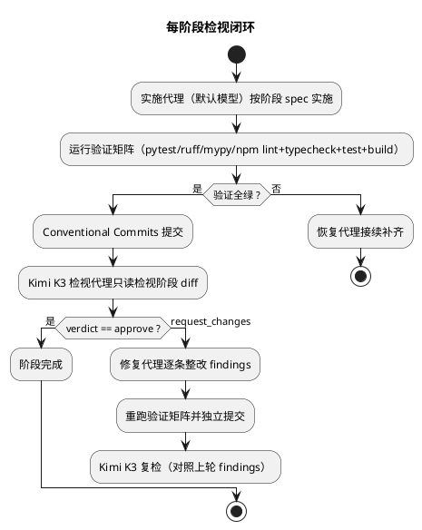

# 管理端 Web 重构 workflow 实施与检视闭环报告

> 运行时间：2026-08-16 
> 分支：`feat/admin-web-refactor`（基线 `main`，29 个提交） 
> 设计基线：[admin_web_refactor_design.md](./admin_web_refactor_design.md)　编排脚本：[admin_web_refactor_workflow.js](./admin_web_refactor_workflow.js)

## 1. 闭环机制

workflow 按 `实施 → 验证 → Kimi K3 检视 → 修复 → 复检` 循环推进 8 个实施阶段（对应设计 §12 步骤 1–6），每阶段检视由 provider `kimi-coding` 的 **Kimi K3（k3）子代理**独立执行（只读对抗性检视，禁止改动仓库）；`request_changes` 触发修复代理整改并回到 Kimi 复检，直至 `approve` 或达每阶段 3 轮上限；全部阶段结束后由 Kimi K3 对 `main..HEAD` 全量 diff 做终审（§2.1 目标 / §8.5 API 清单 / §11 门禁逐项核对），终审意见同样进入修复闭环。

## 2. 各阶段结果（Kimi K3 裁决）

| # | 阶段 | 提交数 | 检视轮数 | 裁决 | 关键产出 |
|---|---|---|---|---|---|
| P1 | 前端脚手架 | 2 | 1 | approve | `admin_frontend` 工程（Vite 7 + React 19 + TS strict + Tailwind 4 + shadcn 源码入仓 + ESLint 9/Vitest）、设计文档入库 |
| P2 | 后端 API 增补 | 4 | 1 | approve | `progress.py` 进度派生、SSE 端点 + JobEventBroker 共享轮询、jobs 增补 progress、structure-report、dashboard/summary、openapi-typescript 接线（pytest 222→256） |
| P3 | SPA 框架页与托管 | 2+1 fix | 2 | approve | AppShell/ThemeProvider/路由、FastAPI `/assets` immutable + SPA fallback no-cache + `/api` 404 穿透、`/legacy` 过渡、hermetic webui 测试 fixture |
| P4 | 任务列表与详情页 | 4 | 1 | approve | Stepper + 进度纯函数、`useJobStream` SSE 断连降级轮询、译文/表格/音频审阅面板（前端测试 77） |
| P5 | 文章录入与结构编辑器 | 7 | 1 | approve | CodeMirror 6 GFM 编辑器、`htmlToMarkdown` 富文本粘贴（Word/Docs/网页样本单测）、zod 同构结构化块编辑器替换 JSON textarea |
| P6 | 工作台与声音配置页 | 3 | 1 | approve | dashboard summary 单往返工作台 + 发布器面板、voices 三页、DeleteArticleDialog 输入门控（前端测试 135） |
| P7 | 构建与打包集成 | 2 | 1 | approve | hatch 钩子 npm 构建 + 哈希缓存 + `ENGIRDLE_SKIP_WEB_BUILD` 逃生门、sdist 含前端源码且 sdist→wheel 可二次构建、README 构建链文档 |
| P8 | 页面层退役清理 | 1 | 1 | approve | 删除 `pages.py`/`templates/`/`static/`/`view_models.py`/jinja2 依赖/`/legacy`，测试迁移为 API 等价覆盖 |

**终审（Kimi K3，全量 diff）**：第 1 轮 3 条 findings（验证桩徽标硬编码 major、占位组件死代码、过期注释）→ 修复提交 `e22cc30`/`45b2b4c` → 第 2 轮 **approve**。结转未决 findings：无。

## 3. 独立复核验证矩阵（workflow 结束后人工复跑）

| 检查 | 命令 | 结果 |
|---|---|---|
| 后端测试 | `uv run pytest -q` | 266 passed（基线 222 → 净增 44） |
| Lint | `uv run ruff check hatch_build.py src tests` | All checks passed |
| 类型 | `uv run mypy src` | 143 files, no issues（strict） |
| 前端 Lint | `npm run lint` | 0 error / 0 warning |
| 前端类型 | `npm run typecheck` | 双 tsconfig 通过 |
| 前端测试 | `npm run test` | 20 文件 / 136 tests passed |
| 前端构建 | `npm run build` | 成功（hashed 产物） |
| 打包 | `uv build` | wheel 含 `admin_web/webui/index.html` + assets、contracts 5 项完好、无页面层残留 |
| sdist | 解包检查 | 102 个前端源条目（含 lockfile/src），零 node_modules/dist/.scratch 泄漏 |

已知遗留（终审 minor，非阻塞）：设计 §11 提到的 CI 门禁在本仓库无 CI 配置可落点，相关检查均已本地验证并通过。

## 4. 运行口径

- 实施与修复代理使用会话默认模型；**全部检视（8 阶段 + 终审）由 Kimi K3 子代理执行**，检视代理被明确禁止修改仓库状态。
- 每阶段 diff 以实施者报告的 baseCommit 为基线；终审范围为 `main..HEAD` 全量。
- workflow 共消耗 21 个子代理调用；中断兜底：实施失败自动进入恢复代理，Kimi 调用失败自动重试一次。
