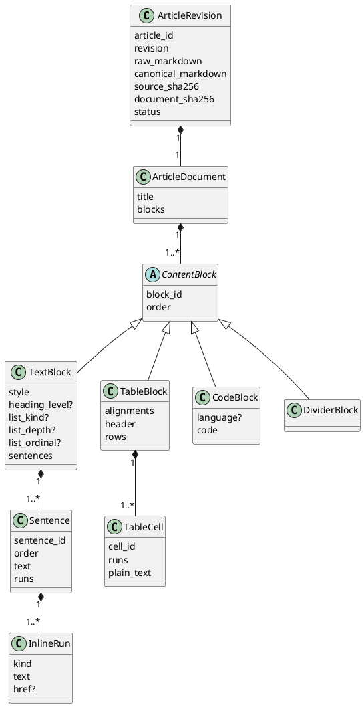
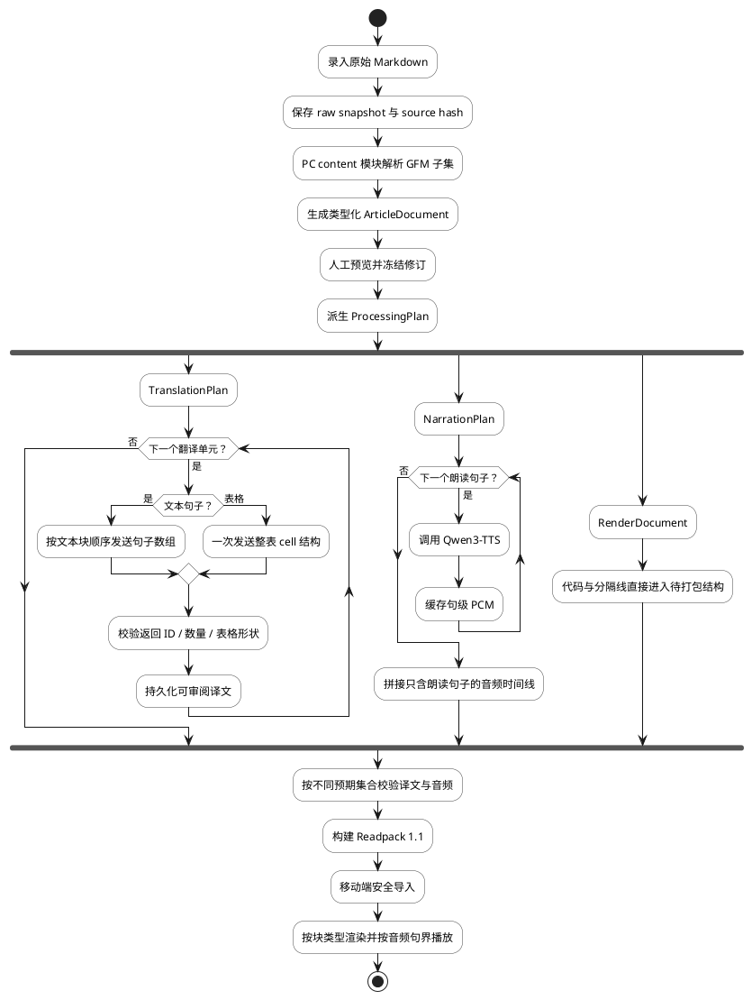
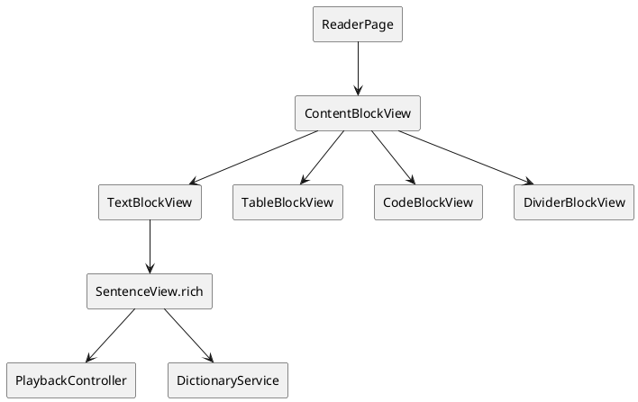

# Engirdle Markdown 文章处理与移动端渲染方案

> 文档状态：已实施（PC content 解析、翻译/朗读计划分流、Readpack 1.1、移动端导入与渲染及配套测试已落地）<br>
> 更新时间：2026-08-14<br>
> 适用范围：PC 文章录入、结构化、DeepSeek 翻译、Qwen3-TTS、Readpack 和 Flutter Android 阅读器<br>
> 总体设计：[mvp_design.md](./mvp_design.md)<br>
> 模块架构：[mvp_module_architecture.md](./mvp_module_architecture.md)<br>
> 翻译模块：[translation_module_design.md](./translation_module_design.md)

## 1. 决策摘要

本方案可行，且现有稳定文章修订、块 ID、句子 ID、翻译 Adapter、语音 Adapter 和版本化 Readpack 为改造提供了良好基础。它不是单纯在 Flutter 页面中加入一个 Markdown Widget，而是一次从 PC 内容解析到移动端展示的跨端协议升级。

MVP 决策如下：

- 输入格式从“纯文本或近似 Markdown”冻结为受限的 GitHub Flavored Markdown（GFM）子集；
- Markdown 在 PC `content` 模块中只解析一次，移动端消费类型化文档，不重新推断句界或业务处理策略；
- Markdown 标题、段落、列表项和引用继续按句翻译、按句生成英文语音；
- GFM 表格作为一个完整翻译单元，一次发送给 LLM，返回相同形状的译文表格，不发送 TTS；
- fenced code block 和 indented code block 原样保留并渲染，不进入任何 LLM 请求、翻译历史或 TTS 调用；
- 分隔线只渲染，不翻译、不朗读；
- Readpack 升级为 `1.1`，声明 `markdown-blocks` 必需能力；新版移动端继续导入现有 `1.0` 包；
- 首期保持 Readpack 固定音频文件布局，因此每篇文章至少需要一个可朗读句子；纯表格或纯代码文章在冻结修订前明确拒绝；
- 移动端继续使用结构化 Flutter Widget 和句级交互，不使用 WebView，也不把整篇文章交给一个通用 Markdown Widget。

本文中的“代码段”特指 fenced 或 indented code block。行内代码仍属于所在文本句或表格单元格，但作为不可翻译字面量保护：LLM 只看到稳定占位符，返回后恢复原文；TTS 默认朗读其可见字面量。若未来要求行内代码也完全不发送 TTS，需要单独增加句内朗读片段语义，不在本次范围内。

## 2. 目标与非目标

### 2.1 目标

1. 用户在 PC 端粘贴基础 Markdown 后，移动端能够离线、确定性地展示其结构和行内样式。
2. 代码内容不因完整文章上下文、重试历史或日志而泄漏给 LLM，也不触发 TTS。
3. 表格在同一次 LLM 请求中获得完整行列上下文，同时严格保持原始行数、列数、顺序和对齐。
4. 原有句级点击、选词、查词、译文抽屉、播放和当前句高亮继续工作。
5. Readpack 校验能够从块类型推导合法字段，拒绝不一致状态。
6. 已发布 v1.0 包、现有移动端文章和生词快照继续可用。
7. 解析器、提示词、结构哈希和处理策略均可追溯、可重建、可测试。

### 2.2 非目标

- 任意 HTML、JavaScript、CSS 或 WebView 内容；
- 网络图片、内嵌二进制图片、视频、音频或 iframe；
- Mermaid、PlantUML、LaTeX、脚注、目录、可交互任务列表；
- 在移动端重新分句、翻译或生成语音；
- 对任意第三方 Markdown 方言实现完全兼容；
- 首期支持没有任何可朗读句子的无音频 Readpack；
- 让 LLM 重写 Markdown 源码或直接产出完整 Markdown 表格；
- 跨句文本选择、跨块批注或富文本编辑。

## 3. 当前实现基线与差距

当前录入页已经提示可以粘贴 simple Markdown，但后端仍按纯文本处理。主要差距如下。

| 环节 | 当前行为 | 与目标的冲突 |
|---|---|---|
| 文本规范化 | `normalize_text` 折叠每行空白、去除缩进、替换智能字符 | 代码缩进、尾随空格和部分 Markdown 语义在解析前丢失 |
| 块识别 | 仅识别 `paragraph`、`list_item`、`quote` | 标题、表格、代码和分隔线退化成普通段落 |
| 领域模型 | 每个 `Block` 必须含一个或多个 `Sentence` | 表格和代码无法表达为非句子内容 |
| 翻译上下文 | 完整上下文序列化每个块的全部句子 | 即使跳过代码块翻译调用，代码仍会被发给 LLM |
| Worker | 顺序翻译所有块，再为所有句子调用 TTS | 无法按内容类型分流 |
| 翻译存储 | 结果只以 `sentence_id` 存储纯文本 | 无法存储整表、相同行列结构的译文 |
| 音频构建 | 要求 PCM ID 与冻结结构中的全部句子 ID 完全一致 | 无法自然表达无语音内容 |
| 打包 | 译文 ID、时间边界 ID 和全部句子 ID 必须相等 | 翻译集合与朗读集合不能不同 |
| Readpack v1.0 | 只有三种块；发布 profile 要求每句有译文和音频 | 表格/代码没有协议表达 |
| 移动导入 | 数据库存储块和句子，校验每句译文与音频 | 不能导入非句子块 |
| 阅读器 | `_BlockView` 不按 `kind` 分支，`SentenceView` 使用普通字符串 | 已有列表和引用也没有真正的结构化样式 |

相关实现位置：

- [content/domain/structure.py](../../apps/pc/src/engirdle_pc/modules/content/domain/structure.py)
- [content/domain/entities.py](../../apps/pc/src/engirdle_pc/modules/content/domain/entities.py)
- [production/application/worker.py](../../apps/pc/src/engirdle_pc/modules/production/application/worker.py)
- [translation/application/dto.py](../../apps/pc/src/engirdle_pc/modules/translation/application/dto.py)
- [packaging/application/service.py](../../apps/pc/src/engirdle_pc/modules/packaging/application/service.py)
- [contracts/readpack/v1/schema/article.schema.json](../../contracts/readpack/v1/schema/article.schema.json)
- [mobile readpack article.dart](../../apps/mobile/lib/contracts/readpack_v1/article.dart)
- [mobile reader_page.dart](../../apps/mobile/lib/features/reader/presentation/reader_page.dart)

当前算法处理一份包含标题、链接、表格和 fenced code 的样例时，会产生以下结果：

| Markdown 输入 | 当前结构 |
|---|---|
| `# Heading` | 普通段落 |
| 多行 GFM 表格 | 管道符和各行被拼接成段落，并可能错误分句 |
| fenced code | fence、函数和缩进被拼成普通单行文本 |
| 强调、链接 | Markdown 标记直接进入 LLM 与 TTS 文本 |

因此移动端即使立即加入 Markdown Widget，也只能渲染已经被上游破坏的内容，无法满足分流规则。

## 4. Markdown 方言与产品语义

### 4.1 支持的 GFM 子集

表格属于 GFM 扩展，因此不能只声明“支持 Markdown”，必须冻结确切子集。

| 语法 | MVP 行为 |
|---|---|
| ATX / Setext heading | 转为 `TextBlock`，保存 1–6 级语义；按句翻译和朗读 |
| paragraph | 转为 `TextBlock`；按句翻译和朗读 |
| unordered / ordered list | 转为带列表类型、层级和序号的文本块；首期最大嵌套深度 4 |
| blockquote | 保存引用层级；其中的文本按句翻译和朗读 |
| emphasis / strong / strikethrough | 保存为行内 run，移动端使用富文本样式 |
| link / autolink | 保存展示文字和 URI；LLM 只翻译展示文字，不翻译 URI |
| inline code | 保存为行内 code run；LLM 使用占位符保护，TTS 朗读可见字面量 |
| soft / hard line break | 保存行内换行语义，不依赖移动端重新解析 |
| thematic break | 转为 `DividerBlock`，只渲染 |
| GFM table | 转为 `TableBlock`，整表翻译、不朗读 |
| fenced / indented code block | 转为 `CodeBlock`，原样保存、不翻译、不朗读 |

### 4.2 不支持内容的处理

| 内容 | 处理 |
|---|---|
| raw HTML | 冻结修订前报 `unsupported_markdown`，不得透传或静默执行 |
| image | 首期只显示经过转义的 alt text 和“图片未包含”提示，不下载 URI |
| task list | 按普通列表展示不可交互标记；不保存勾选状态 |
| footnote / math / diagram fence | 若语法可安全退化则显示原始文本，否则在预览中报不支持 |
| 非 HTTP(S) 链接 | 可以展示文字，但不允许移动端打开 |
| 超过资源上限的表格或代码 | 冻结修订前拒绝并给出块位置及限制 |

### 4.3 解析错误与宽容语法

Markdown 解析器通常对未闭合 fence、错误表格分隔线等输入采取宽容解析。Engirdle 不应猜测作者意图：

- 解析结果必须在 PC 结构确认页提供预览；
- 未闭合代码 fence 产生吞掉后续正文的代码块时显示明确警告；
- 不满足 GFM 表格规则的管道文本按普通段落展示，不自动修复；
- 不支持节点必须阻止冻结，不能在发布后才由移动端发现；
- 人工修改 Markdown 源必须创建或保持在可编辑修订中，冻结后仍不可原地改变。

### 4.4 候选资源上限

以下值作为阶段 0 的测试基线，真机和真实 LLM 验证后只能通过明确的协议评审调整，不能由 PC 与移动端分别设置不同语义：

| 项目 | 候选上限 |
|---|---:|
| 单文档块数 | 10,000 |
| 列表/引用嵌套深度 | 4 |
| 单表列数 | 32 |
| 单表数据行数 | 256 |
| 单个 table cell 可见字符 | 4,000 |
| 单表全部可见字符 | 200,000 |
| 单个代码块 UTF-8 字节 | 512 KiB |
| 单文档全部代码 UTF-8 字节 | 2 MiB |
| 单句 inline runs | 2,048 |

资源上限在 PC 冻结、PC Readpack 校验和移动导入三个位置使用同一契约值。LLM Adapter 可以因模型上下文限制给出更严格的明确失败，但不得把整表静默拆成逐 cell 请求。

## 5. 领域模型

### 5.1 类型化文档

现有 `Block(kind, sentences)` 会允许“代码块却带句译”“表格却带音频”等非法组合。目标模型采用判别联合，让块类型决定其合法数据。



Python 领域对象继续使用冻结 `dataclass` 和 `Enum`；HTTP、JSON Schema、LLM 响应等系统边界使用 Pydantic。模块间不得传递未约束 `dict` 或包含多个不同语义字段的长 tuple。

### 5.2 核心不变量

1. `block_id` 在文章修订内唯一；`sentence_id` 和 `cell_id` 各自在修订内唯一。
2. 块顺序、句子顺序、表格行列顺序都由显式字段和数组位置共同校验。
3. `TextBlock` 至少有一个非空句子；`TableBlock` 至少有一列和一个表头；`CodeBlock.code` 非空。
4. `Sentence.text` 是可见纯文本投影，不包含 Markdown 标记或链接目标。
5. `Sentence.runs` 拼接后的可见文本必须严格等于 `Sentence.text`。
6. `CodeBlock.code` 保留缩进、换行和字符；canonical 文档只把 CRLF/CR 统一为 LF，原始快照仍保存用户输入。
7. 表格译文必须与原表具有完全相同的 cell ID 集合、行数和列数。
8. 内容类型不保存可独立修改的 `send_to_llm` / `send_to_tts` 布尔值；处理资格由类型推导，避免状态漂移。
9. 结构哈希覆盖块类型、类型专属字段、句子、行内 runs、表格结构和代码内容。
10. 移动端不得从 Markdown 源、字符偏移或数组下标重新猜测句子、表格或播放关系。

### 5.3 行内格式与分句

分句不能在原始 Markdown 字符串上直接进行，否则强调、链接或行内代码可能跨越句界。目标算法如下：

1. Markdown 解析器先产生块级和行内 AST；
2. 对可朗读文本块生成可见纯文本及 run 到文本区间的映射；
3. 英文分句器只处理可见纯文本；
4. 按句界切分 runs；跨句的强调或链接 run 在两个句子中各保留对应片段；
5. 为每句分配稳定 ID；
6. 验证每句 runs 拼接结果与纯文本一致。

分句器仍由 `content` 模块拥有并记录版本，但不需要为唯一 Markdown 解析器创建一个只有生产实现的 Adapter。解析器属于进程内依赖，测试应通过 `content` 模块接口验证可观察结果。

## 6. 深模块与处理 seam

`content` 深化为“原始 Markdown → 已确认类型化文章”的唯一模块。调用方不学习 Markdown token、解析库 AST、源码偏移或修复规则。

对外接口保持小而明确：

| 接口项 | 语义 |
|---|---|
| `create(command)` / `create_revision(...)` | 保存原始 Markdown，解析并生成候选文档 |
| `edit_document(...)` | 在可编辑修订上应用类型化结构修改并重新计算哈希 |
| `approve(ref)` | 校验所有块、资源限制和至少一个朗读单元后冻结 |
| `get(ref)` | 返回不可变 `ArticleRevision` |
| `processing_plan(ref)` | 返回同一文档派生的翻译计划、朗读计划和渲染结构 |

`ProcessingPlan` 使用明确的数据结构：

| 投影 | 包含 | 排除 | 消费者 |
|---|---|---|---|
| `TranslationPlan` | 文本句子、整张表 | 代码、分隔线、链接 URI | translation |
| `NarrationPlan` | 按文章顺序排列的文本句子与停顿语义 | 表格、代码、分隔线 | speech、audio |
| `RenderDocument` | 所有块及行内结构 | 生产私有配置 | packaging、移动端 |

三个投影必须从同一个冻结文档一次派生。Worker、Adapter、打包器和移动端不得重复实现块类型策略。

## 7. 端到端流程



代码块不出现在 `TranslationPlan` 或 `NarrationPlan` 中。LLM 的首轮完整上下文也必须由 `TranslationPlan` 构建，而不是从 `ArticleRevision.blocks` 直接遍历。

## 8. PC 端设计

### 8.1 输入、解析与规范化

当前“先全局规范化、再识别块”的顺序改为：

1. 保存用户原始输入和原始 SHA-256；
2. 仅统一解析所需的换行形式，不能折叠缩进或尾随空格；
3. 使用固定版本的 GFM 解析器构建 AST；
4. 根据节点类型做规范化：
   - 普通文本允许 NFKC、控制字符过滤和项目既有智能标点策略；
   - 代码内容、链接 URI 和行内代码不得做智能标点替换；
   - 表格 cell 只规范化可见文本，不改变列结构或对齐；
5. 生成 `ArticleDocument`、文档哈希和解析警告；
6. 在管理页同时展示原始 Markdown、结构树和渲染预览。

解析器版本建议冻结为类似 `engirdle-gfm@1` 的标识，并写入任务配置和 manifest pipeline。底层库升级、启用新 extension 或改变 AST 投影规则时必须增加该版本。

### 8.2 翻译计划

翻译模块从“只理解块内句子”升级为“顺序处理类型化翻译单元”。

翻译单元判别联合：

| 类型 | 稳定身份 | 请求内容 | 返回内容 |
|---|---|---|---|
| `SentenceBatchTranslationUnit` | `block_id` + 有序 `sentence_id` | 同一文本块全部可见句子 | 相同长度的译文数组 |
| `TableTranslationUnit` | `block_id` + 全部 `cell_id` | 表头、所有行、对齐和受保护行内 token | 相同 cell ID 集合和相同行列形状 |

表格请求采用结构化数据，不发送 Markdown delimiter row，也不要求模型返回 Markdown。概念性结构为：

| 字段 | 语义 |
|---|---|
| `block_id` | 当前表格身份 |
| `columns` | 列数和对齐 |
| `header` | 有序 cell ID 与可翻译文本 |
| `rows` | 有序二维 cell |

行内代码和链接 URI 的 `ProtectedTokenMap` 只保留在 PC 进程和持久化 checkpoint 中，不进入 LLM wire payload；`header` / `rows` 只含不可逆的稳定占位符。LLM 返回后必须校验：

- block ID 一致；
- cell ID 集合一致且无重复；
- header、行数和每行列数一致；
- 每个可翻译 cell 都有非空结果；
- 受保护 token 原样存在且只出现预期次数；
- 不包含多余 Markdown fence、解释文字或额外字段。

协议错误进入现有有界重试；重试耗尽后任务以 `table_translation_shape_mismatch` 等结构化错误失败，不能回退为逐 cell 请求，因为这会违反“整表上下文”语义。

### 8.3 完整文章上下文与代码隔离

完整上下文只包含：

- 标题和作者；
- 按文章顺序排列的可翻译文本句子；
- 表格的全部可翻译 cells；
- 可选的无内容标记，说明当前位置存在被省略的 code block。

无内容标记不得携带语言、代码摘要、哈希、首行或任何可恢复代码的信息。以下位置均不得出现代码正文：

- 首轮完整文章 user message；
- 当前单元请求；
- 先前已接受 history；
- session journal；
- LLM 请求重试日志、错误信息和观测字段；
- 翻译数据库 generated/edited 字段。

结构哈希、原始快照和最终 Readpack 仍可在本地包含代码；“不发送 LLM”不等于“不在用户授权的本地制品中保存”。

### 8.4 翻译存储与审阅

现有 `translations(job_id, sentence_id, generated_text, edited_text)` 无法表达表格。建议迁移为通用翻译结果记录：

| 字段 | 语义 |
|---|---|
| `job_id` | 构建任务 |
| `unit_id` | 文本句或表格块的稳定身份 |
| `unit_kind` | `sentence` 或 `table` |
| `generated_payload` | 系统边界 JSON；仓储外解析为类型化结果 |
| `edited_payload` | 可选人工修正，类型必须与 generated 相同 |
| `adapter_name` | 生成 Adapter |

数据库 JSON 只存在于持久化 seam；应用和领域模块使用 `SentenceTranslation`、`TableTranslation` 等 dataclass，不传递裸 dict。

审阅页面按类型渲染：

- 句子继续显示原句、机器译文和人工修正文本；
- 表格显示原表和译表，允许按 cell 编辑但一次保存完整 `TableTranslation`；
- 代码不出现在翻译审阅列表；
- 发布前再次校验人工修改后的表格形状和受保护 token。

### 8.5 Worker 与 checkpoint

`ProductionCheckpoint` 从 `accepted_block_ids` / `synthesized_sentence_ids` 明确化为：

- `accepted_translation_unit_ids`；
- `synthesized_narration_unit_ids`。

Worker 只遍历 `TranslationPlan.units` 和 `NarrationPlan.units`。恢复任务时分别验证：

- checkpoint 声明完成的翻译单元在翻译仓储中存在且类型匹配；
- checkpoint 声明完成的朗读单元有同一 Adapter 和配置快照生成的可复用 PCM；
- 跳过的代码、表格或分隔线不需要伪 checkpoint；
- 修改解析器、提示词、处理策略或声音配置后不得复用不兼容缓存。

### 8.6 Speech 与音频

Speech 模块接口继续按句生成 PCM，但调用者只能传入 `NarrationUnit`。代码和表格没有构造该对象的路径。

Audio 模块不再从 `ArticleRevision.blocks` 猜测全部句子，而是接收有序 `NarrationPlan`：

| 字段 | 用途 |
|---|---|
| `sentence_id` | 时间边界和移动播放身份 |
| `text` | 审计及错误定位，不进入编码器 |
| `pause_after` | 句内、块末或文章末停顿 |
| `source_block_id` | 结构检查和人工审阅定位 |

表格和代码不占用音频区间，也不生成零长度 timing。连续朗读从前一个可朗读句子直接过渡到下一个可朗读句子，并应用前一个文本块的块末停顿。首期不为表格或代码额外插入长静音。

若 `NarrationPlan` 为空，`approve` 返回 `no_narratable_content`；不得创建静音占位音频或伪造 TTS metadata。

### 8.7 打包校验

当前打包器使用一个 `expected_ids` 同时校验译文和音频。目标校验拆为：

| 集合 | 必须匹配 |
|---|---|
| 文本翻译 ID | 所有可翻译文本 sentence ID |
| 表格翻译 ID | 所有 TableBlock ID，并校验 cell 形状 |
| 音频 timing ID | 所有 NarrationPlan sentence ID |
| 不处理块 ID | 不得出现在翻译或 timing 结果 |

打包器只负责把已验证结果投影到协议模型，不重新决定处理资格。

## 9. Readpack 1.1 协议

### 9.1 版本选择

本功能保持现有四文件布局和音频格式，不删除 v1.0 字段，因此采用 `1.1`，而不是立即升级主版本。新包声明：

```json
{
  "format_version": "1.1",
  "required_capabilities": ["markdown-blocks"]
}
```

现有 v1.0 客户端会因未知必需能力而明确拒绝，不会把代码或表格错误显示为普通句子。新客户端：

- 完整支持 v1.0；
- 只接受自己认识的 v1.1 capabilities；
- 对未知 capability 继续拒绝；
- 不依据 pipeline metadata 分支业务渲染。

### 9.2 块判别联合

`article.json.blocks[]` 使用 `kind` 判别合法字段。

| kind | 必需内容 | 译文 | 音频 |
|---|---|---|---|
| `paragraph` | sentences | 每句必需 | 每句必需 |
| `heading` | level、sentences | 每句必需 | 每句必需 |
| `list_item` | list kind、depth、ordinal、sentences | 每句必需 | 每句必需 |
| `quote` | depth、sentences | 每句必需 | 每句必需 |
| `table` | alignments、header、rows | 整表必需且形状一致 | 禁止 |
| `code` | language 可选、code | 禁止 | 禁止 |
| `divider` | 无类型专属内容 | 禁止 | 禁止 |

v1.1 文本句子必须包含非空 `runs`；没有特殊格式的句子也使用一个 plain run。每个 run 至少包含 kind 和 text；link 额外包含 URI。v1.0 句子没有该要求。消费者可以用 sentence 的 plain `text` 做查词、翻译快照和无障碍标签，用 runs 做富文本渲染。

表格协议保存：

- 列对齐；
- 表头和有序数据行；
- 每个 cell 的稳定 ID、plain text 和 runs；
- 同形状的 `translation_zh` cells；
- 不保存 Markdown delimiter row。

代码协议保存：

- 可选 language info string；
- LF 规范化后的代码正文；
- 不包含译文、音频边界或处理 flags。

### 9.3 语义校验

PC 和移动端必须使用相同黄金 fixtures 验证：

1. kind 与类型专属字段匹配，禁止跨类型字段；
2. 文本句子仍有完整译文和非空、有序音频区间；
3. 表格原文/译文 cell ID、行列和顺序一致；
4. 代码没有 `translation_zh` 或任何 audio 字段；
5. 全文至少有一个带合法音频区间的文本句子；
6. 全部 timing 只覆盖 NarrationPlan，按音频顺序单调、不重叠；
7. Markdown capability、format minor 与实际块类型一致；
8. v1.0 包不得携带 v1.1 专属块；
9. 未知 kind 或 capability 在写入正式目录前拒绝。

### 9.4 何时升级 v2

出现以下任一需求时升级 Readpack v2，不继续挤压 v1.1：

- 允许音频文件、manifest audio 或 TTS pipeline 完全缺省；
- 在包中加入图片或其他媒体文件；
- 改变固定四文件布局；
- 表格、列表或富文本身份规则发生不兼容变化；
- 一个文章包含多条可选音轨或多语言 TTS。

## 10. 移动端设计

### 10.1 导入和持久化

移动端 contract parser 先按 format/capability 选择已知协议，再解析块判别联合。类型化对象进入 Library 模块后，UI 不再处理 JSON map。

现有 `blocks` 和 `sentences` 表继续保存通用查询字段，建议增加：

| 存储字段 | 用途 |
|---|---|
| `blocks.payload_json` | 表格、代码、标题级别、列表信息等类型专属数据 |
| `sentences.render_json` | 行内 runs |

JSON 只在 DAO 持久化 seam 使用；DAO 读出后立即解析为 `InstalledTextBlock`、`InstalledTableBlock`、`InstalledCodeBlock` 等类型。索引、文章身份、块顺序、句子身份和音频边界仍使用明确列。

导入事务继续遵守“文件先验证和移动、数据库原子切换、失败保留旧版本”的既有流程。数据库迁移完成后：

- 旧 v1.0 行的 `payload_json` / `render_json` 使用明确默认值；
- 已安装 v1.0 文章映射为普通文本块；
- 不改写生词表中的原句、译文和句子引用快照。

### 10.2 Reader 深化

阅读器按块类型分派 Widget，而不是先还原 Markdown 字符串。



Widget 语义：

| Widget | 行为 |
|---|---|
| `TextBlockView` | 标题、段落、列表和引用的外层排版 |
| `SentenceView.rich` | 使用 `SelectableText.rich` 或等价结构，保留句级点击、选词、查词和播放高亮 |
| `TableBlockView` | 水平滚动、单元格换行和选择；不显示播放菜单 |
| `CodeBlockView` | 等宽字体、水平滚动、整块选择和复制；可显示语言标签；不显示翻译/播放菜单 |
| `DividerBlockView` | 主题化分隔线，无交互 |

现成 Flutter Markdown renderer 可以作为表格/代码渲染原型或内部实现参考，但不能成为整页外部 seam。应用特有的句子身份、播放和词典行为必须保留在自己的类型化 Widget 中。

### 10.3 三种阅读模式

| 块类型 | 仅英文 | 英中对照 | 仅中文 |
|---|---|---|---|
| 文本块 | 原文 runs | 每句原文 + 译文 | 句译 |
| 表格 | 原表 | 同一 cell 内原文在上、译文在下 | 同形状译表 |
| 代码 | 原代码 | 原代码，只显示一次 | 原代码，只显示一次 |
| 分隔线 | 显示 | 显示 | 显示 |

代码在仅中文模式仍显示，因为它是不可翻译的原始内容，不能用空白替代。表格双语模式在同一个网格中组合原译文，避免上下两张表横向滚动位置失配。

### 10.4 播放语义

- 只有 `InstalledSentence.hasAudio` 为真时才创建句子播放菜单；
- 表格和代码没有 `InstalledSentence`，因此无法构造 `PlaybackRequest`；
- 连续播放 ranges 只来自 NarrationPlan timing；
- 当前句高亮只作用于文本句子；
- 播放通知的句子 ordinal 按可朗读句子顺序计算，不把表格或代码计为无声句子；
- 文章显示标签可以继续使用块/句位置，但不得解析 opaque ID。

现有 `LibraryPlaybackSourceAdapter` 已过滤没有音频的句子，可保留作为防御；新协议仍应在导入阶段保证文本句子完整 timing，不能依赖过滤来掩盖损坏包。

### 10.5 安全与离线约束

- raw HTML 永不渲染；
- 链接只允许 `http` 和 `https`，打开前使用平台安全适配器；`file`、`content`、`javascript` 等 scheme 禁止；
- 图片不触发网络请求，避免离线失败、隐私泄漏和跟踪像素；
- 代码和表格内容按纯文本渲染，不把内容解释为 HTML；
- 表格行数、列数、cell 字符数、代码字符数和嵌套深度在 contract 中设上限；
- 超宽表格使用横向滚动，不能通过无限 intrinsic measurement 阻塞主线程；
- 超长代码块使用可滚动容器，语法高亮不属于首期，避免大文件逐 token 高亮卡顿。

## 11. 管理界面

### 11.1 文章录入与结构确认

录入页将“英文正文”明确标为“英文 Markdown”，并链接支持语法说明。提交后结构确认页至少显示：

- 原始 Markdown；
- 按块类型展示的结构树；
- 与移动端语义接近的 HTML 安全预览；
- 解析警告和不支持语法错误；
- 每个文本块的候选句界；
- 表格行列和代码语言；
- 每个块是否翻译、是否朗读的派生结果。

“是否翻译/朗读”只读展示，不提供可手工切换的 checkbox。否则同一种块可能因人工误操作违反协议语义。

### 11.2 结构编辑

现有整页结构 JSON textarea 可以在首个纵向切片继续使用，但请求模型必须改成判别联合。编辑规则：

- 文本块允许修改句界、文本和块样式；
- 表格允许修改 cell 文本、行列和对齐；
- 代码允许编辑 language 和 code，保存时保持缩进；
- Divider 只有位置可编辑；
- 改变块类型需要提供目标类型的完整合法 payload；
- ID 留空时由 Content 模块分配，不允许入口层自行生成。

后续若增加可视化编辑器，也必须调用同一个 `edit_document` 接口，不能形成第二套结构规则。

### 11.3 翻译与音频审阅

- 翻译审阅同时支持句子结果和整表结果；
- 表格人工修正后进行同形状校验；
- 代码不出现在翻译列表；
- 音频审阅只列 NarrationPlan 句子，表格和代码不显示“缺失音频”；
- 页面明确显示处理计数，例如“42 个句子已翻译、2 张表已翻译、3 个代码块已跳过、42 个句子已生成语音”。

## 12. 数据库与迁移

### 12.1 PC Alembic

建议以一条新迁移完成以下结构调整：

1. `content_blocks` 增加类型专属 payload；
2. `content_sentences` 增加行内 render payload；
3. 翻译记录迁移为通用 unit identity 和 payload；
4. checkpoint JSON 由领域模型兼容读取旧字段并写出新字段；
5. 原有 paragraph/list_item/quote 行转换为合法 TextBlock；
6. 旧任务和已发布制品保持只读可追溯，不在迁移中重写包文件。

迁移必须先在旧 baseline 数据库副本上验证。若通用翻译表替换现有表，采用“新表 → 转换 → 校验行数/主键 → 替换”的事务流程。

### 12.2 Mobile SQLite

移动迁移增加块 payload 和 sentence render payload，并为旧数据写入明确默认值。导入新包仍采用整篇文章替换事务，不需要对已安装文章做增量块更新。

迁移测试至少覆盖：

- 空数据库直接迁移到最新版；
- 含 v1.0 文章、阅读模式和生词的数据库升级；
- 升级后旧文章阅读、播放和生词详情不变；
- 安装 v1.1 包后再安装其新 artifact revision；
- 失败回滚不留下半写入 table/code payload。

## 13. 错误模型

| 错误码 | 阶段 | 语义 |
|---|---|---|
| `unsupported_markdown` | 解析/冻结 | 存在不允许发布的节点 |
| `markdown_resource_limit` | 解析/冻结 | 表格、代码或嵌套超过限制 |
| `unclosed_code_fence` | 结构确认 | fence 疑似吞掉后续内容，需要人工确认或修正 |
| `no_narratable_content` | 冻结 | 首期固定音频布局无法构建 |
| `translation_unit_mismatch` | 翻译 | 返回单元身份集合不一致 |
| `table_translation_shape_mismatch` | 翻译 | 表格行列或 cell ID 改变 |
| `protected_token_mismatch` | 翻译 | 行内代码或 URI 占位符丢失/篡改 |
| `narration_result_mismatch` | Speech/Audio | PCM 结果与 NarrationPlan 不一致 |
| `markdown_capability_unsupported` | 移动导入 | 客户端不认识包的必需能力 |
| `invalid_markdown_block` | PC/移动校验 | kind 与 payload、译文或音频字段不一致 |

错误日志记录文章 ID、修订、任务 ID、block/unit ID、错误码和模型 request ID；默认不记录正文、代码、译文、URI 或模型 reasoning。

## 14. 测试策略

### 14.1 Content 模块

通过 Content 模块接口验证解析结果，不为底层解析库复制一套脆弱 token 测试。

| 用例 | 断言 |
|---|---|
| 标题、段落、强调和链接 | 块类型、plain text 和 runs 一致 |
| 强调跨句 | 两句保持样式且拼接文本正确 |
| 简单/嵌套列表和引用 | 类型、深度、序号和句界稳定 |
| GFM 表格 | 表头、行列、对齐和 cell ID 稳定 |
| fenced/indented code | 缩进、换行、语言和字符保持 |
| 代码内伪 Markdown | 不产生标题、表格或句子 |
| 未闭合 fence、raw HTML、超限输入 | 产生明确警告或错误 |
| 结构人工编辑 | ID 唯一、哈希改变、冻结后不可编辑 |

### 14.2 路由隔离测试

使用包含唯一哨兵字符串的 fake Adapter 记录全部输入：

- 代码哨兵不得出现在 LLM 首轮上下文、当前请求、历史、journal 或重试错误中；
- 代码哨兵不得出现在任何 Speech Adapter 调用中；
- 一张表严格产生一次 LLM 请求；
- 表格不产生 Speech 调用；
- 文本句子仍按顺序进入两个 Adapter；
- 重试和 checkpoint 恢复不改变以上计数。

不能只断言最终没有代码译文或音频，因为代码可能已经被发送后又丢弃。

### 14.3 Contract fixtures

新增 v1.1 fixtures：

| fixture | 预期 |
|---|---|
| valid mixed markdown | PC 和移动端都接受 |
| valid inline styles | runs 与 plain text 一致 |
| invalid unknown capability | 拒绝 |
| invalid kind payload | 拒绝 |
| invalid table shape | 拒绝 |
| invalid table audio | 拒绝 |
| invalid code translation | 拒绝 |
| invalid code audio | 拒绝 |
| invalid no narration | 拒绝 |
| invalid duplicate cell ID | 拒绝 |
| legacy v1.0 minimal | 新实现继续接受 |

### 14.4 PC 集成与验收

- 真实 SQLite 迁移、翻译持久化和 checkpoint 恢复；
- 管理页录入、预览、结构修改、冻结、审阅和发布；
- 混合 Markdown 从 fake 翻译/TTS 构建 Readpack；
- DeepSeek Adapter 对表格响应 shape/token 的协议校验与重试；
- Qwen3 Adapter 调用计数只等于 NarrationPlan 数量；
- 最终包重新打开后通过同一校验器；
- 旧 v1.0 包和当前发布生命周期不回归。

### 14.5 移动测试

- contract parser 和数据库迁移；
- Text/Table/Code/Divider Widget golden test；
- 三阅读模式下表格和代码行为；
- 富文本句子的选择、查词、复制和播放菜单；
- 表格/代码没有播放菜单且无法构造 PlaybackRequest；
- 连续播放跨越表格/代码时当前句映射正确；
- 深色/浅色/纸张主题、字号、边距和横向滚动；
- TalkBack 朗读标签、表头语义和代码复制；
- 最大允许表格与代码块的帧耗时和内存门槛；
- 飞行模式下不产生图片或链接网络请求。

## 15. 实施计划

采用纵向切片，每个切片保持主分支可测试、旧包可用。

### 阶段 0：协议与渲染原型

目标：

- 冻结 GFM 子集、行内代码策略、资源上限和 v1.1 capability；
- 用当前锁定 Flutter SDK 验证 `SelectableText.rich`、表格横向滚动、代码选择和现有手势共存；
- 生成手写的 v1.1 混合 Markdown fixture，不接真实 LLM/TTS。

完成门槛：

- Android 真机能够显示段落、标题、表格和代码；
- 句级选择/菜单不回归；
- 表格和代码无播放入口；
- schema 草案在 PC 与 Dart 测试中给出相同结论。

### 阶段 1：Content 深模块

目标：

- 引入固定版本 GFM 解析器；
- 实现类型化 `ArticleDocument`、runs、表格和代码；
- 改为节点感知规范化与分句；
- 更新结构确认和人工编辑请求；
- 实现 `ProcessingPlan`。

完成门槛：

- Content 接口测试覆盖支持语法和错误；
- 代码保持测试通过；
- 旧纯文本输入产生与当前语义等价的 TextBlock；
- 解析器实现细节不泄漏到其他模块接口。

### 阶段 2：生产分流

目标：

- Worker 改用 TranslationPlan/NarrationPlan；
- 翻译端支持 sentence batch 和 table unit；
- 完整上下文排除代码；
- 翻译仓储、审阅和 checkpoint 支持通用单元；
- Audio 接收 NarrationPlan。

完成门槛：

- 哨兵隔离测试证明代码从未进入 LLM/TTS；
- 每表一次 LLM 调用、零 TTS 调用；
- checkpoint 中断恢复不重复已接受表格或语音；
- 无朗读内容在冻结时失败。

### 阶段 3：Readpack 1.1

目标：

- 增加 v1.1 schema、兼容性说明、黄金包和无效 fixtures；
- Packaging 输出判别联合；
- PC validator 按类型校验；
- catalog 继续发布 format minor。

完成门槛：

- PC contract suite 同时通过 v1.0 和 v1.1；
- 新包重开校验；
- 旧 validator/客户端面对 capability 时安全拒绝；
- 代码块协议中不存在译文或 timing。

### 阶段 4：移动导入与阅读器

目标：

- capability/version 分派；
- SQLite 迁移和类型化 InstalledBlock；
- ContentBlockView 与四种专用 Widget；
- 三阅读模式和安全链接处理；
- 播放范围只包含可朗读句子。

完成门槛：

- 旧已安装文章和 v1.0 包正常；
- v1.1 混合包离线完整展示；
- 表格、代码、选词和连续播放通过真机验收；
- 大表格和长代码不出现明显卡顿或布局溢出。

### 阶段 5：真实 Adapter 与发布门槛

目标：

- 用代表性技术文章验证 DeepSeek 整表质量与 token 保护；
- 用真实 Qwen3-TTS 验证调用集合和文章时间线；
- 完成管理页表格审阅；
- 更新总体设计、模块架构、PRD 验收和用户支持语法说明。

完成门槛：

- 固定语料的表格术语和行列正确；
- 人工修正不会破坏 shape；
- 代码隐私审计通过；
- v1.0/v1.1 升级、删除、重建和重新发布回归通过。

## 16. 预计改动位置

| 区域 | 主要改动 |
|---|---|
| `modules/content` | 领域判别联合、Markdown 解析、节点规范化、runs、ProcessingPlan、持久化 |
| `entrypoints/admin_web` | 输入说明、结构判别联合、预览、表格审阅 |
| `modules/production` | unit checkpoint 和计划驱动 Worker |
| `modules/translation` | 通用翻译单元、表格 DTO、上下文过滤、仓储迁移 |
| `modules/speech` | 接受 NarrationUnit，调用集合测试 |
| `modules/audio` | NarrationPlan、停顿和 timing 集合 |
| `modules/packaging` | v1.1 contract model、分集合校验和 payload |
| `contracts/readpack` | 1.1 schema、兼容性、examples、fixtures |
| `mobile/contracts` | capability 分派和块判别联合 |
| `mobile/library` | SQLite 迁移、DAO 和 InstalledBlock 联合 |
| `mobile/reader` | rich sentence、table/code/divider Widget |
| `mobile/playback` | 无音频内容防御、ordinal 和跨块回归测试 |

## 17. 风险与缓解

| 风险 | 影响 | 缓解 |
|---|---|---|
| PC 与移动端各自解析 Markdown | 方言差异导致显示和句界漂移 | PC 解析一次，协议传类型化文档 |
| 全文上下文泄漏代码 | 违反明确隐私/成本规则 | 上下文从 TranslationPlan 构建；哨兵检查所有请求和 journal |
| LLM 改坏 Markdown 表格 | 行列错位、无法校验 | 发送结构化 cells，返回同形状数据，不让模型产 Markdown |
| 富文本跨句切分复杂 | 样式丢失、选择错位 | AST → plain text ranges → 切 runs；通过 Content 接口测试 |
| 通用 Markdown Widget 破坏句级交互 | 查词、播放、高亮回归 | 自有 ContentBlockView 和 SentenceView.rich |
| 表格在小屏幕性能差 | 横向溢出、主线程卡顿 | 尺寸上限、水平滚动、避免无限 intrinsic、高负载真机测试 |
| 纯代码文章没有音频 | 与 v1 固定布局冲突 | 首期冻结前拒绝；需要时通过 v2 支持可选音频 |
| 协议 minor 被旧客户端误解 | 静默丢内容 | required capability 使旧客户端安全拒绝 |
| 数据库通用 JSON 失去类型安全 | 运行时错误扩散 | JSON 仅限仓储 seam，离开 DAO 立即解析为类型化对象 |
| Markdown 解析器升级改变 AST | 重建不一致 | 固定依赖和 `engirdle-gfm@N` 版本，升级需 fixtures 审核 |

## 18. 最终验收

实现完成必须同时满足：

1. 一篇包含标题、强调、链接、列表、引用、表格、代码和分隔线的文章可以从 PC 录入，经翻译/TTS/打包/发布，在 Android 飞行模式下正确阅读与播放。
2. 每个表格只进行一次 LLM 调用，返回译表与原表严格同形状，且没有任何 TTS 调用。
3. fenced/indented code 正文未出现在 LLM 请求、历史、journal、日志或 TTS 调用中。
4. 文本句子继续支持选择、词典、译文、单句播放、连续播放和当前句高亮。
5. 连续播放跳过表格、代码和分隔线，句界与通知状态一致。
6. v1.0 黄金包和已安装旧文章保持兼容；未知 capability 和损坏 v1.1 包在提交导入前拒绝。
7. PC 与移动 contract suite 对所有共享 fixtures 结论一致。
8. 原始 Markdown、解析器版本、结构哈希、提示词版本、模型、声音和最终制品保持可追溯。
9. raw HTML、危险 URI、网络图片和超限内容不能绕过冻结或移动导入校验。
10. 文档、Schema、实现、迁移和测试在同一发布变更中完成，不以移动端临时解析作为过渡生产路径。

## 19. 参考资料

- [CommonMark Specification](https://spec.commonmark.org/current/)
- [GitHub Flavored Markdown Specification](https://github.github.com/gfm/)
- [flutter_markdown package documentation](https://pub.dev/documentation/flutter_markdown/latest/flutter_markdown/)
- [Readpack v1 契约](../../contracts/readpack/v1/README.md)
- [Engirdle MVP 总体设计](./mvp_design.md)
- [Engirdle MVP 模块架构](./mvp_module_architecture.md)
