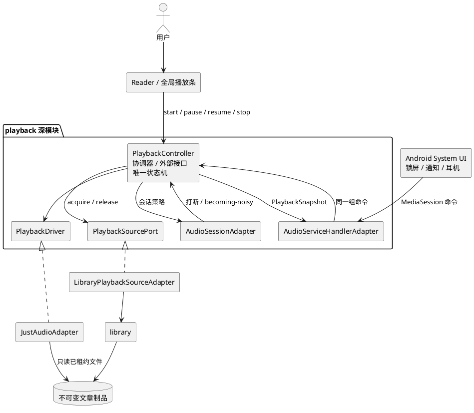
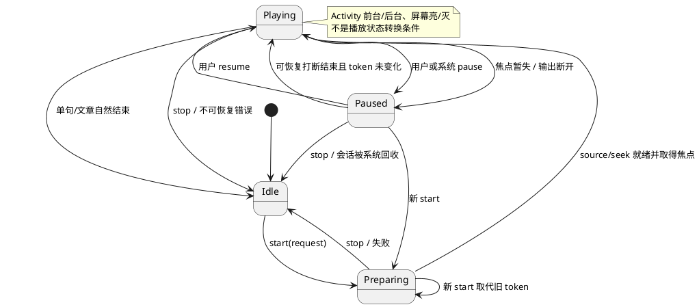
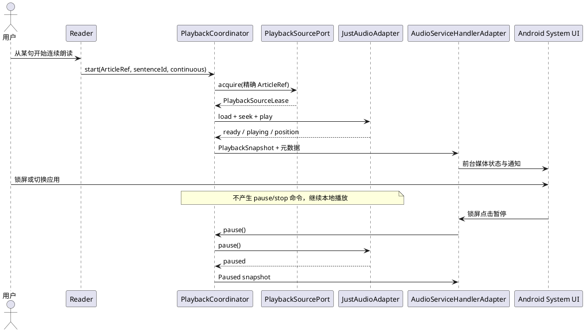
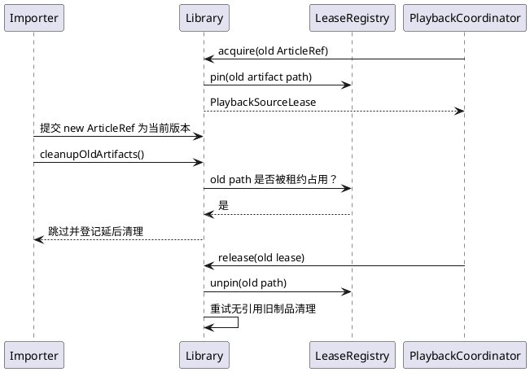

# Engirdle MVP 移动端息屏与后台音频播放设计

> 文档状态：MVP 目标设计基线候选，不代表当前代码已经实现 
> 更新时间：2026-08-08 
> MVP 验收平台：Android；iOS 仅保留复用 seam，不纳入本次发布验收 
> 需求基线：[mvp_prd.md](./mvp_prd.md) 
> 总体设计：[mvp_design.md](./mvp_design.md) 
> 模块架构：[mvp_module_architecture.md](./mvp_module_architecture.md) 
> 官方资料核验：[mobile_background_audio_research.md](./mobile_background_audio_research.md)

## 1. 决策摘要

MVP 将息屏和后台播放纳入 Android 必须能力。用户从阅读器主动开始单句或连续播放后，锁屏、按 Home、切换到其他应用或移除最近任务中的 Activity 都不得仅因界面生命周期变化而暂停播放。播放仍然只使用已导入的本地 M4A，不增加网络流媒体或移动端 TTS。

目标实现采用以下组合：

- `just_audio` 继续作为本地 M4A 解码、seek 和 clip 的播放器适配器；
- `audio_session` 作为显式依赖，按有声读物语义配置音频焦点、打断和音频路由；
- `audio_service` 提供 Android 前台媒体 Service、MediaSession、媒体通知、锁屏和耳机媒体键适配器；
- 现有 `PlaybackController` 深化为唯一播放协调器和状态源。阅读器、应用内控制条和系统媒体控制都通过同一接口进入该模块；
- `library` 通过 `PlaybackSourcePort` 向播放模块交付带租约的不可变音频制品，避免文章更新或删除时移除正在播放的文件。

MVP 不保存播放进度，也不在进程被杀、应用被强制停止或设备重启后自动续播。倍速、循环、播放列表、上一首/下一首、可拖动进度和跨重启媒体恢复仍不属于 MVP。

## 2. 当前实现基线与差距

当前 `apps/mobile` 已具备可复用的单播放器基础，但生命周期策略与后台播放目标相反。

| 位置 | 当前能力 | 后台播放差距 |
|---|---|---|
| `app/dependencies.dart` | 在组合根创建一个全局 `PlaybackController` 和一个 `JustAudioEngine` | 尚未初始化系统媒体会话；播放对象的销毁责任仍按前台应用理解 |
| `playback_controller.dart` | 维护单句/连续模式、session token、命令竞争和自然结束 | 只接收 App UI 命令；没有系统媒体命令、音频焦点、路由事件和播放器错误的统一状态 |
| `just_audio_engine.dart` | 本地 M4A clip、从指定位置连续播放、位置与完成事件 | 中途解码错误只写日志；系统打断可能直接改变播放器而绕过控制器 |
| `reader_page.dart` | 进入页面时把文件路径和句界附加到控制器 | 离开阅读页会 `stop`；App 非 `resumed` 会 `pause`，锁屏和切后台因此必停 |
| `playback_bar.dart` | 展示当前模式并提供暂停、继续和停止 | 只存在于阅读页；不消费系统媒体状态 |
| Android Manifest / `MainActivity.kt` | 只有 LAN 所需 `INTERNET` 权限；Activity 继承 `FlutterActivity` | 没有媒体前台 Service、MediaSession receiver、wake lock 和 media playback 类型声明 |
| `pubspec.yaml` | 直接依赖 `just_audio`，`audio_session` 仅为传递依赖 | 没有后台媒体模块；应用不能稳定配置自身的有声读物音频会话 |
| `library_service.dart` | 更新后清理旧制品，删除文章时递归删除文件 | 没有活动文件租约，更新或删除可能移除后台播放器仍在使用的 M4A |

因此本需求不是简单删除两个生命周期回调。若只允许 `just_audio` 或一个便捷后台插件直接处理系统按钮，系统与 `PlaybackController` 会各自修改状态，现有 session token 也无法覆盖打断、远程暂停和错误事件。

## 3. MVP 产品语义

### 3.1 必须支持

| 场景 | 预期行为 |
|---|---|
| 单句播放中息屏或切到其他应用 | 继续播放到当前句排他结束位置，然后自然停止并移除活动媒体状态 |
| 连续播放中息屏、按 Home 或切到其他应用 | 从当前句继续播放到文章末尾，句间/段间停顿保持不变 |
| 播放中从最近任务移除 Engirdle Activity | Android 前台媒体 Service 继续承载正在发声的会话；重新打开应用后接回同一状态 |
| 通知栏、锁屏或耳机主媒体键操作 | 通知的播放/暂停/停止与锁屏、耳机主键的播放/暂停都进入应用内同一状态机，界面和系统显示一致 |
| 电话、其他媒体或导航造成音频焦点变化 | 按 §6.2 的规则暂停或恢复，不与其他语音同时播放 |
| 拔出有线耳机或活动蓝牙输出断开 | 立即暂停且不自动恢复，避免声音突然切到扬声器 |
| 播放期间安装文章新制品 | 当前会话继续使用启动时锁定的旧制品；新打开的阅读器使用新制品；会话结束后清理旧文件 |
| 删除正在播放的文章 | 明确停止并释放会话后再删除；不得留下僵尸通知或在删除后继续显示播放中 |
| 播放完成、用户停止或不可恢复错误 | 释放音频焦点和制品租约，结束前台状态并清除媒体通知 |

### 3.2 明确不保证

- 进程被系统终止、应用被强制停止或设备重启后的会话恢复；
- 从开机广播、定时任务或后台业务逻辑自动启动媒体前台 Service；
- 暂停状态在系统回收进程后仍可恢复；
- 厂商系统违反 Android 前台 Service 语义时的无限期存活；MVP 不申请忽略电池优化；
- 系统进度条拖动、上一/下一、双击耳机键切换项目、倍速、循环和播放列表；
- iOS 发布、App Store 审核和 iOS 实机验收。

## 4. 架构决策

### 4.1 方案比较

| 方案 | 优点 | 与 Engirdle 的冲突 | 结论 |
|---|---|---|---|
| 仅删除前后台暂停逻辑 | 改动最少 | Android 没有合规的前台媒体 Service 和媒体通知，系统控制不可用 | 拒绝 |
| `just_audio_background` | 适合单个 `AudioPlayer` 的常规队列，接入较快 | 系统按钮可直接操作播放器；难以让现有 token、单句/连续模式、打断策略和文件租约保持唯一状态源 | 拒绝 |
| 原生 Media3 + MethodChannel | Android 控制力最强 | 在 Kotlin 和 Dart 两侧复制播放状态与业务规则，扩大当前 Flutter MVP 的实现面 | 不作为 MVP 基线 |
| 自定义 `audio_service` handler + `audio_session` + `just_audio` | 系统控制可适配到自有状态机，保留当前播放器和跨平台 seam | 需要重构播放模块与启动装配 | 采用 |

`audio_service` 官方定位就是把既有音频实现封装进 `AudioHandler`，统一接收通知、锁屏、耳机等来源的播放请求；其状态流同时供系统客户端和 Flutter UI 消费。`just_audio` 官方也把 `audio_service` 定位为超出 `just_audio_background` 简单能力时的方案。核验链接见研究笔记。

Android 官方的 Media3 `MediaSessionService` 在本设计中是职责参考，不是实现声明。MVP 实际注册 `audio_service` 提供的 Android Service，并在 Dart 层实现自定义 `AudioHandler`；不会同时再注册一套原生 Media3 Service。若插件在目标 SDK 或系统媒体界面上无法通过纵向验证，保留 `PlaybackController` 外部接口、仅替换系统媒体适配器，而不把领域状态复制到 Kotlin。

### 4.2 深模块与外部 seam

`playback` 是一个深模块。现有 `PlaybackController` 直接深化为 `PlaybackCoordinator` 角色；下文的“协调器”均指这个同一实例，不要求再增加第二个有状态类。调用方只学习一个播放请求、四个会话命令和一个不可变状态流；本地文件解析、句界裁剪、焦点、前台 Service、系统元数据、打断恢复、token 和制品租约都留在模块实现内。

外部接口语义如下：

| 接口项 | 语义 |
|---|---|
| `start(request)` | 以完整 `ArticleRef`、`sentence_id` 和 `sentence/continuous` 模式启动；新请求取代旧请求 |
| `pause()` | 暂停当前会话；重复调用幂等 |
| `resume()` | 只恢复仍存在的暂停会话；Idle 时不从历史记录创建会话 |
| `stop()` | 终止会话、清除媒体状态并释放制品租约；重复调用幂等 |
| `states` | 发出 UI 与系统共同使用的不可变 `PlaybackSnapshot` |
| `events` | 发出一次性错误或“连续会话被取代”等展示事件，不承载持久状态 |

`request` 不接受文件路径、毫秒边界或插件对象。阅读器传入当前显示内容的完整 `ArticleRef` 和稳定句子 ID；播放模块通过内部 `PlaybackSourcePort` 取得精确制品和句界。这使界面无法绕过租约和版本规则。

### 4.3 模块关系

这里存在两个真实的内部 seam：

- `PlaybackDriver` 有 `JustAudioAdapter` 与可控 fake，负责播放器调用和驱动事件；
- `PlaybackSourcePort` 有 `LibraryPlaybackSourceAdapter` 与内存 fake，负责精确版本解析、元数据、句界和制品租约。

`AudioServiceHandlerAdapter` 是 Android/iOS 系统媒体协议的适配器，不拥有第二套业务状态机。它把系统命令交给协调器，再把同一个 `PlaybackSnapshot` 映射成 `MediaItem` 和 `PlaybackState`。

## 5. 会话模型与状态机

### 5.1 结构化对象

| 对象 | 必需字段 | 约束 |
|---|---|---|
| `PlaybackRequest` | `ArticleRef`、`sentence_id`、`mode` | 不含文件路径和句界；完整文章身份防止升级竞态 |
| `PlaybackSourceLease` | 精确 `ArticleRef`、标题、可选作者、M4A 路径、总时长、有序句界、释放句柄 | 生命周期覆盖 Preparing、Playing 和 Paused；路径不离开播放模块 |
| `PlaybackSnapshot` | session token、精确 `ArticleRef`、mode、phase、当前句 ID/标签、位置、可播放时长 | UI 和系统媒体适配器的唯一状态输入 |
| `InterruptionIntent` | 打断类型、是否允许结束后恢复、关联 token | 仅模块内部使用；用户命令或新 session 会使旧恢复意图失效 |

句界必须按开始位置严格递增。连续播放的位置到当前句映射应建立有序索引并使用二分定位，避免长文章在高频位置事件上逐句线性扫描。

### 5.2 状态机

所有异步动作继续使用单调递增 session token。加载、seek、暂停、恢复、完成、错误和打断结束在写状态前都要重新核对 token；失效命令取得的租约必须立即释放。播放器的 `playing/processing/error/position` 事件都回到协调器，不能只在底层适配器写日志。

### 5.3 UI 与系统控制映射

| 来源 | 命令 | 协调器行为 |
|---|---|---|
| 阅读器句子菜单 | 单句/从此连续播放 | 构造 `PlaybackRequest` 并 `start` |
| 应用内播放条 | 播放/暂停/停止 | `resume` / `pause` / `stop` |
| 通知、锁屏、耳机主键 | 播放/暂停 | 与应用内命令完全相同 |
| 通知停止/清除 | 停止 | `stop`，释放 Service、焦点和租约 |
| 通知点击 | 打开 Engirdle Activity | 不创建新 session；UI 从状态流接回现有会话 |
| 系统上一/下一、seek、倍速 | 未声明为可用 action | 不改变播放器；不伪造支持 |

系统媒体元数据只发布文章标题、可选作者、播放模式和当前句序号。不得发布正文、译文、绝对文件路径、局域网地址或 readpack 内部 JSON。`MediaItem.id` 使用不含路径的逻辑会话 ID。

## 6. 关键流程

### 6.1 从阅读器开始并进入息屏

`ReaderPage.dispose` 不再停止会话，`didChangeAppLifecycleState` 不再用前后台状态控制音频。阅读器只订阅状态用于高亮；离开页面后取消 UI 订阅不会影响协调器。

### 6.2 音频打断和路由变化

音频会话按 speech/audiobook 语义配置，不在导航语音上继续低音量朗读：

- `JustAudioAdapter` 保留播放器的自动 audio-session activation，使真正开始播放时按已配置的 speech 属性申请焦点；
- 关闭播放器自身的 interruption handling，`audio_session` 的 interruption 与 becoming-noisy 事件全部先进入协调器，避免播放器和协调器各自暂停或自动恢复一次；
- 暂时失去焦点时，若当时正在播放，则暂停并记录与当前 token 绑定的“可恢复打断”；
- 对允许恢复的暂时打断，仅在打断结束、token 未变化且期间没有用户 pause/stop/start 时恢复；
- 永久焦点丢失或未知打断结束后保持暂停，不自动抢回焦点；
- 耳机拔出或活动蓝牙输出断开时暂停，永不自动恢复；
- 用户在打断期间主动暂停、停止或开始另一会话后，旧恢复意图失效；
- 取得音频焦点失败时不发声，回到可理解的失败/暂停状态并记录分类错误。

### 6.3 制品升级、删除与租约

正式规则如下：

- 播放启动锁定精确 `ArticleRef`，文章升级不能把活动会话静默切到新音频；
- `cleanupOldArtifacts` 必须跳过有活动租约的路径，并在最后一个租约释放后重试；
- 删除当前播放文章的用例先 `stopIfActive(article_id)` 并等待租约释放，再删除数据库行与文件；
- `library` 删除实现仍必须以租约注册表作最后保护，遇到竞态时拒绝或延后删除，不能只相信页面调用顺序；
- 进程结束时播放器与内存租约同时消失；下次启动的一致性清理可删除不再被数据库引用的遗留制品。

## 7. 平台设计

### 7.1 Flutter 启动与所有权

启动顺序调整为：

1. 初始化 Flutter binding、应用目录和 SQLite；
2. 构建 `LibraryPlaybackSourceAdapter`、`PlaybackDriver` 和承担协调器角色的 `PlaybackController`；
3. 在所有音频插件加载后用 `AudioSessionConfiguration.speech()` 配置全局音频会话；
4. 通过 `AudioService.init` 注册唯一的 `AudioServiceHandlerAdapter`；
5. 把这一个 `PlaybackController` 实例和状态流注入 `AppScope`，再恢复导入并启动 UI。

Activity 销毁不拥有播放器销毁权。播放驱动、系统媒体 handler、流订阅和数据库读取能力由应用/媒体会话生命周期管理；显式 `stop` 只结束当前 session，进程最终终止时才 dispose 模块实现。

测试构建不启动真实 Android Service：组合根继续允许注入 fake `PlaybackDriver`、fake `PlaybackSourcePort` 和 fake 系统媒体适配器。

### 7.2 Android 声明与运行规则

Android 目标配置至少包括：

| 配置 | MVP 要求 |
|---|---|
| 权限 | `WAKE_LOCK`、`FOREGROUND_SERVICE`；目标 API 34+ 时声明 `FOREGROUND_SERVICE_MEDIA_PLAYBACK` |
| Service | 注册 `audio_service` 的媒体 Service，声明 `foregroundServiceType="mediaPlayback"` 和媒体浏览 intent |
| receiver | 注册媒体按钮 receiver，使耳机/蓝牙主媒体键进入 MediaSession |
| Activity | 由 `AudioServiceActivity`（或对应 fragment activity 变体）承载 Flutter UI，保留现有 `singleTop` 等配置 |
| 通知 channel | 固定稳定 ID 与“朗读播放”名称；无声音、无振动，不创建重复 channel |
| 通知内容 | 文章标题、作者或 Engirdle、单句/连续模式、当前句序号；播放/暂停与停止 |
| 前台时机 | 只由用户发起的实际播放进入 media playback 前台状态；不从 boot receiver 或后台定时任务启动 |
| 最近任务移除 | handler 的 `onTaskRemoved` 在 Preparing/Playing 时不停止会话；Paused/Idle 时可以停止并释放资源 |
| 暂停策略 | 基线保持 `audio_service` 的 `androidStopForegroundOnPause=true`；暂停时退出前台优先级，进程仍存活时保留会话，系统回收后不承诺恢复 |
| 通知被清除 | 仅在系统允许清除的非活跃状态发生；`onNotificationDeleted` 统一映射为 `stop` |
| 完成/停止 | 结束前台状态、清除通知、释放音频焦点和 wake lock |

Android 13 起媒体会话通知属于通知运行时权限的豁免场景，因此 MVP 不应仅为该媒体通知索取 `POST_NOTIFICATIONS`；未来增加普通通知时再按其用途独立申请。目标 Android 14+ 发布时还需在 Play Console 声明 media playback 前台 Service 用途。

Android 15+ 只有顶层应用或正在运行的前台 Service 才能取得音频焦点。Engirdle 的首次播放始终来自可见阅读器，随后由 media playback 前台 Service 承载，不设计从任意后台业务代码冷启动播放。

Android 12+ 对后台重新提升前台 Service 有额外限制。因此，“应用已在后台且会话暂停时，从通知或耳机恢复”必须在 API 31、35、36 真机单独过门槛，并确认没有 `ForegroundServiceStartNotAllowedException`。若默认暂停策略在受支持设备上失败，发布前必须记录新决策并启用有界回退：暂停期间继续保留 media playback 前台状态最多 10 分钟，超时统一 `stop`、清除通知并释放租约；不得无限保活或申请电池优化豁免。

### 7.3 iOS 延伸 seam（非 MVP 验收）

Flutter 播放接口、协调器、`audio_service` handler 和 `audio_session` 配置保持平台无关；将来增加 iOS 工程时复用同一状态机，并在 iOS 适配层补充：

- Background Modes 的 `audio` 能力；
- `AVAudioSession` playback/spoken-audio 语义；
- Now Playing 元数据与 Remote Command Center 控制；
- iOS 打断和输出路由实机测试；
- App Store 对后台音频用途和用户可见功能的审核材料。

这些准备不改变当前“Android 首发、iOS 不验收”的产品边界，也不允许以 Android 测试代替 iOS 验收。

## 8. 对当前代码的目标改造

| 当前位置 | 目标改造 |
|---|---|
| `features/playback/domain/playback_models.dart` | 增加完整 `PlaybackRequest`、精确内容身份、Preparing/错误语义和不可变 snapshot；区分文件绝对位置与单句相对位置 |
| `features/playback/application/playback_controller.dart` | 深化为唯一协调器；`start(request)` 内部获取 source lease，统一处理 UI、系统、driver、打断和 token |
| `features/playback/application/playback_engine.dart` | 演进为 `PlaybackDriver`，合并 position/playing/processing/completion/error 等可观察事件 |
| `features/playback/infrastructure/just_audio_engine.dart` | 只实现 driver；保留 audio-session activation，关闭自身 interruption handling；playing/processing/error 等事件全部交给协调器 |
| 新增 `audio_service_handler_adapter.dart` | 把 MediaSession 命令和元数据映射到协调器，不含文章查询或第二状态机 |
| 新增 `audio_session_adapter.dart` | 配置 speech 会话并把焦点、打断、becoming-noisy 事件转为领域事件 |
| `features/library` | 实现 `PlaybackSourcePort` 与进程内制品租约注册表；清理/删除尊重租约 |
| `reader_page.dart` | 发送 `ArticleRef + sentence_id + mode`；删除生命周期 pause/stop；只负责订阅和高亮 |
| `playback_bar.dart` / `app.dart` | 控制条读取全局 snapshot；至少在阅读页重新进入后可接回会话，推荐通过 `MaterialApp.builder` 提供跨路由迷你控制条 |
| `main.dart` / `app/dependencies.dart` | 按 §7.1 装配并初始化媒体 handler；测试仍可替换所有内部适配器 |
| `pubspec.yaml` | 保留 `just_audio`，新增直接依赖 `audio_service` 与 `audio_session`，锁定解析版本 |
| Android Manifest / Activity | 增加 §7.2 的最小权限、Service、receiver 和 Activity 基类 |

不改变 readpack v1：后台播放所需的文章标题、作者、总时长、句界和音频路径都已存在于导入后的本地模型。系统媒体信息是移动端运行时投影，不写回包协议。

## 9. 测试与验收

### 9.1 自动测试

- UI 命令和系统命令进入同一个 token 序列，不会产生双会话或僵尸状态；
- Preparing、pause、resume、stop 与新 start 的所有异步交错保持最新命令获胜；
- 自然完成和中途 driver 错误都会清理状态、媒体通知语义和 source lease；
- 暂时打断只在允许恢复且无用户干预时恢复；永久/未知打断不自动恢复；
- becoming-noisy 永远暂停且不自动恢复；
- MediaSession 只公布 MVP 支持的 play/pause/stop action；
- 媒体元数据不含正文、译文、绝对路径或局域网地址；
- 文章升级时旧租约阻止清理，释放后清理；删除活动文章先停播且删除竞态安全；
- 单句位置与时长使用 clip 相对坐标，连续模式使用文件绝对坐标，通知进度与应用内状态一致；
- Idle 状态收到远程 play 不会从历史或磁盘自动创建 session。

### 9.2 Android 集成与人工矩阵

版本行为矩阵覆盖当前最低 API 24、API 26、31、33、34/35 和当前 target API 36；息屏、音频路由、蓝牙和厂商电池策略不得只用模拟器。其中后台暂停后的系统恢复必须在 API 31、35、36 真机验证。至少执行：

1. 从文章开头、中部、结尾分别开始单句与连续播放；
2. 连续播放分别在息屏和切换到其他应用后保持至少 30 分钟，飞行模式下结果相同；
3. 从最近任务移除 Activity 后正在播放的会话继续，重新打开应用能接回状态；
4. 通知栏、锁屏、有线耳机和蓝牙设备的播放/暂停进入同一状态；
5. 应用已在后台时先从通知或耳机暂停，再从同一入口恢复；恢复成功且日志中没有前台 Service 启动限制异常；
6. 拔耳机、断开蓝牙、来电/模拟音频焦点暂失时立即暂停，恢复规则符合 §6.2；
7. 单句在息屏状态到达句末后停止，通知和前台 Service 不残留；
8. 暂停、完成、用户停止、解码错误和应用强制停止后没有僵尸通知或 wake lock；
9. 播放旧制品时安装新制品，旧会话不中断且旧文件在结束后清理；
10. 删除活动文章时先结束会话，重新打开应用后文章、通知和文件状态一致；
11. 通过 Android Doze/待机测试工具和目标厂商设备执行长音频检查，不依赖申请忽略电池优化。

MVP 发布不以模拟器成功代替真机息屏、音频路由和媒体键验收。测试记录必须包含设备、Android 版本、应用构建、开始/结束时间以及观察到的系统状态。

## 10. 实施切片

1. **状态源切片**：把 `PlaybackController` 深化为接收 `PlaybackRequest` 的协调器，增加 driver 统一事件并保持现有单句/连续测试全绿。
2. **系统媒体切片**：接入 `audio_session` 和 `audio_service`，完成通知/锁屏 play-pause-stop，删除 Reader 生命周期停播逻辑。
3. **制品租约切片**：引入 `PlaybackSourcePort`、完整 `ArticleRef` 和租约保护，覆盖升级/删除竞态。
4. **体验切片**：全局或可重连控制条、媒体元数据、通知点击与错误提示。
5. **设备门槛**：完成 §9.2 的 Android 矩阵并关闭相关风险，之后才把需求标为完成。

每个切片都以真实的纵向行为和该 seam 上的测试为完成条件。旧 `JustAudioEngine` 的局部测试在新的 `PlaybackDriver` 接口测试覆盖同一行为后替换，不保留两套互相矛盾的状态测试。

## 11. 风险与回退

| 风险 | 影响 | 设计缓解 | 回退条件 |
|---|---|---|---|
| Flutter 媒体插件与当前 Flutter/AGP/target SDK 不兼容 | 无法构建或系统控制异常 | 锁定版本；先做最小真机纵向切片；检查 manifest merge | 若维护中的 `audio_service` 无法支持目标 SDK，记录新决策后评估原生 Media3 适配器 |
| 系统命令与异步 player 事件竞争 | UI、通知或声音状态不一致 | 单一协调器、token、串行命令与 driver 事件回流 | 不允许回退为系统直接操作播放器 |
| 后台暂停后无法重新提升前台 Service | 通知或耳机无法恢复，或抛出平台异常 | API 31/35/36 真机门槛；必要时采用最长 10 分钟的 paused-FGS 有界回退 | 不允许无限保留前台 Service；仍失败则缩小支持范围或阻塞发布 |
| 暂停状态被系统回收 | 用户无法稍后从通知继续 | MVP 只承诺活跃播放；暂停不做跨进程持久化 | 若真实使用必须跨进程恢复，另立播放进度与恢复设计 |
| 厂商电池策略终止 Service | 长音频中断 | 代表设备/Doze 验收，不申请电池优化豁免 | 记录受影响设备和系统设置说明；不宣称无限期存活 |
| 升级/删除移除活动文件 | 播放报错、通知僵死 | 精确 ArticleRef + source lease + 删除保护 | 不允许通过复制整篇音频到临时目录规避数据所有权 |
| 锁屏元数据泄露不必要内容 | 用户隐私体验下降 | 只发布标题、作者、模式和句序，不发布正文/路径 | 若用户反馈敏感，增加“锁屏隐藏文章信息”偏好，不改播放 seam |

## 12. 官方依据

详细事实、版本差异和一手来源集中记录在 [mobile_background_audio_research.md](./mobile_background_audio_research.md)。实现前至少复核以下官方入口：

- [audio_service 官方包说明](https://pub.dev/packages/audio_service)
- [just_audio 官方包说明](https://pub.dev/packages/just_audio)
- [audio_session 官方包说明](https://pub.dev/packages/audio_session)
- [Android：使用 MediaSessionService 进行后台播放](https://developer.android.com/media/media3/session/background-playback)
- [Android：前台 Service 类型](https://developer.android.com/develop/background-work/services/fgs/service-types)
- [Android：通知运行时权限与媒体会话豁免](https://developer.android.com/develop/ui/views/notifications/notification-permission)
- [Android：管理音频焦点](https://developer.android.com/media/optimize/audio-focus)
