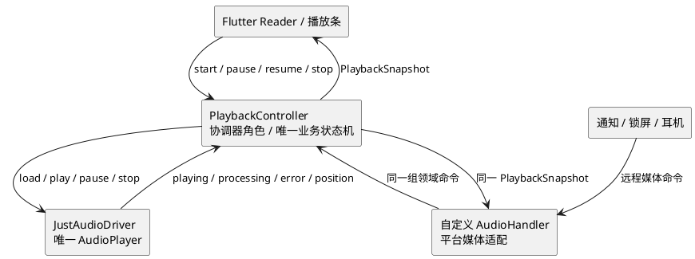

# Engirdle MVP 移动端息屏与后台音频官方资料核验

> 文档状态：研究结论，供设计与实现核对，不代表当前代码已经实现 
> 核验日期：2026-08-08 
> 资料范围：Apple、Android / Google 官方文档，以及 `audio_service`、`just_audio_background`、`just_audio`、`audio_session` 的官方 pub.dev 文档和维护者仓库 
> 设计落点：[mobile_background_audio_design.md](./mobile_background_audio_design.md) 
> MVP 基线：[mvp_prd.md](./mvp_prd.md) · [mvp_design.md](./mvp_design.md)

## 1. 结论

建议 MVP 保留现有 `just_audio` 作为唯一底层播放器，新增直接依赖 `audio_service` 与 `audio_session`，并实现自定义 `AudioHandler`。应用 UI、系统通知、锁屏和耳机按钮都必须把命令送入 Engirdle 自有的单一播放协调器，再由协调器驱动 `just_audio`；协调器的同一份 snapshot 再投影为应用 UI 状态和平台媒体状态。

不建议使用 `just_audio_background`。它的官方定位是“单个 `AudioPlayer` 的简单用例”，复杂行为应直接使用 `audio_service`；`just_audio` 官方还明确说明，使用 `just_audio_background` 时，通知上的播放/暂停按钮会自动调用播放器的 `play` / `pause`。这会绕过当前 `PlaybackController` 的 session token、单句/连续模式、打断恢复意图和制品租约，无法自然满足“UI 与系统控制共用同一状态机”。[just_audio_background 官方说明](https://pub.dev/packages/just_audio_background)、[just_audio 状态模型](https://pub.dev/packages/just_audio#the-state-model)

Android 的平台参考架构是把 player 和 media session 放进前台 `MediaSessionService`；系统控制、通知和 UI controller 都连接同一个 session。[Android 官方后台播放指南](https://developer.android.com/media/media3/session/background-playback) `audio_service` 在 Flutter 层提供相同职责边界，但它公布的是自己的 `AudioService` / `AudioHandler` 集成，而不是 Engirdle 直接实现的原生 Media3 `MediaSessionService`。因此 MVP 可以采用插件方案，但必须把 manifest merge、target SDK 36、通知、媒体键、移除最近任务与进程生命周期列入真机门槛，不能仅凭 Media3 文档推断插件行为。

iOS 官方能力完整支持后台音频、锁屏 / Control Center 元数据与远程控制；但当前仓库没有 iOS runner，MVP 基线也是 Android 发布验收。因此本研究给出可复用 iOS seam，不把它误写成已具备的发布能力。若产品改为双平台 MVP，必须另加 iOS 工程、签名能力、实机矩阵与 App Store 审核验收。

## 2. 当前仓库事实与约束

| 项目 | 当前事实 | 对方案的约束 |
|---|---|---|
| 依赖 | `apps/mobile/pubspec.yaml` 直接依赖 `just_audio ^0.10.6`；锁文件解析到 `just_audio 0.10.6` 与传递依赖 `audio_session 0.2.4` | `audio_session` 应改为直接依赖，避免靠传递依赖表达产品语义；新增 `audio_service` 后锁定解析版本 |
| 播放所有权 | `PlaybackController` 持有一个 `PlaybackEngine`、session token、单句 / 连续状态 | 应深化该状态机，不另建第二个系统媒体状态机 |
| 可观察事件 | 当前仅监听 position 与 completed；中途播放器错误只在 `JustAudioEngine` 记录日志 | 后台方案至少还要回流 playing、processing、error、interruption、becoming-noisy |
| 页面生命周期 | `ReaderPage` 在非 resumed 生命周期暂停，在 dispose 时停止 | 锁屏和切后台正好会触发错误行为；Activity / page 生命周期不能再决定播放状态 |
| 内容生命周期 | 阅读页把裸文件路径与句界附加到全局 controller；旧制品清理不认识活动播放器 | 后台会话必须锁定精确文章修订，并持有文件租约直到 stop / complete / error |
| Android 声明 | Manifest 目前只有 `INTERNET`；`MainActivity` 继承 `FlutterActivity`；构建解析为 minSdk 24、targetSdk 36 | 需补齐媒体 FGS、wake lock、service、receiver 和 audio_service Activity 集成；版本差异不能回避 |
| iOS | `apps/mobile` 下没有 `ios/` | iOS 内容是设计 seam，不是当前可构建能力 |

文档边界目前一致：[mvp_prd.md](./mvp_prd.md) 已把 Android 息屏 / 后台播放列入 MOB-AUD-005～009，[mvp_module_architecture.md](./mvp_module_architecture.md) 也要求阅读器与系统控制进入同一协调器；跨进程 / 重启恢复、跨设备同步和 iOS 正式验收仍是需要新决策的后续能力。

## 3. iOS 官方约束

### 3.1 音频会话与后台能力

- 默认 iOS audio session 在静音开关开启或设备锁定时会让应用音频静音；媒体应用应选择适合的 category。[AVAudioSession 概览](https://developer.apple.com/documentation/avfaudio/avaudiosession)
- `.playback` category 表示音频播放是应用核心能力，在静音开关开启和锁屏时仍可发声；要在应用进入后台后继续播放，还必须在 `Info.plist` 的 `UIBackgroundModes` 中启用 `audio`，对应 Xcode 的 Audio、AirPlay and Picture in Picture Background Mode。[Apple `.playback` 文档](https://developer.apple.com/documentation/avfaudio/avaudiosession/category-swift.struct/playback)、[后台执行模式配置](https://developer.apple.com/documentation/xcode/configuring-background-execution-modes)
- Engirdle 播放的是连续口语 / 有声读物，`.spokenAudio` mode 正是 Apple 为 podcast 与 audiobook 定义的语义；短语音提示到来时应暂停而非 duck，提示结束后才可能恢复。[Apple `.spokenAudio` 文档](https://developer.apple.com/documentation/avfaudio/avaudiosession/mode-swift.struct/spokenaudio)
- Apple 建议把 audio session 的激活延迟到真正开始播放；会话终止时再停播并反激活，反激活可使用 `notifyOthersOnDeactivation` 通知被本应用打断的其他音频恢复。[AVAudioSession 文档](https://developer.apple.com/documentation/avfaudio/avaudiosession)、[`notifyOthersOnDeactivation`](https://developer.apple.com/documentation/avfaudio/avaudiosession/setactiveoptions/notifyothersondeactivation)

对应 Flutter 配置应在所有音频插件加载后执行 `AudioSessionConfiguration.speech()`。`audio_session` 官方说明 iOS 的 audio session 是应用级单例，多个音频插件可能互相覆盖设置，因此推荐最后重新应用应用自己的配置。[audio_session 官方说明](https://pub.dev/packages/audio_session#configuring-the-audio-session)

### 3.2 锁屏、Control Center 与远程命令

- `MPNowPlayingInfoCenter` 发布的 Now Playing 信息会显示在锁屏和 Control Center，也可能显示在 AirPlay 电视或车载配件上。[MPNowPlayingInfoCenter](https://developer.apple.com/documentation/mediaplayer/mpnowplayinginfocenter)
- MVP 应发布逻辑媒体 ID、文章标题、可选作者、时长、elapsed time、playback rate 和可选 artwork。系统会结合上次 elapsed time 与 playback rate 外推位置，不需要按高频 position tick 重写元数据。[Elapsed Playback Time](https://developer.apple.com/documentation/mediaplayer/mpnowplayinginfopropertyelapsedplaybacktime)
- `MPRemoteCommandCenter.shared` 接收系统与外部配件的远程事件。只注册 / 启用 Engirdle 确实支持的 play、pause、stop；seek、next、previous、rate、repeat 和 shuffle 继续禁用，避免系统显示虚假能力。[MPRemoteCommandCenter](https://developer.apple.com/documentation/mediaplayer/mpremotecommandcenter)、[MPRemoteCommand](https://developer.apple.com/documentation/mediaplayer/mpremotecommand)
- 远程回调不能直接操作 `AVPlayer` / `just_audio`；它必须调用与 Flutter UI 相同的协调器命令。`audio_service` 官方定义的 `AudioHandler` 就是统一处理不同请求来源并广播媒体与播放状态的入口。[audio_service 官方说明](https://pub.dev/packages/audio_service)

单句模式的公开 duration / elapsed time 应使用 clip 相对坐标；连续模式使用文章音频绝对坐标。单句到达排他结束边界后，应把 processing state 置为 completed / idle 并清除 Now Playing，而不是留下可“继续”但已经没有有效 session 的条目。

### 3.3 打断与音频路由

Apple 要求观察 audio-session interruption 通知并更新播放器与 UI；播放器可能自行因系统打断暂停，因此应用还必须观察实际播放状态，而不能只相信自己最后发送的命令。[Handling audio interruptions](https://developer.apple.com/documentation/avfaudio/handling-audio-interruptions)

建议状态规则：

| 事件 | MVP 行为 |
|---|---|
| interruption began，播放中 | 暂停；记录“因打断暂停”、当前 token 和开始前是否 playing |
| interruption ended 且系统提供 should-resume 语义 | 仅当 token 未变化、期间无用户 pause / stop / 新 start 时恢复 |
| interruption ended，但无恢复建议或类型未知 | 保持暂停，等待用户显式播放 |
| 输出 route 原设备不可用，例如耳机拔出 / 活动蓝牙断开 | 立即暂停，绝不自动恢复，避免突然外放 |
| 新设备接入 | 不自动开始，也不替用户改变 paused / idle 意图 |

Apple 的路由指南明确要求根据 route-change reason 选择行为，典型的 `oldDeviceUnavailable` 场景是耳机断开后暂停；并非每次 route change 都应暂停。[Responding to audio route changes](https://developer.apple.com/documentation/avfaudio/responding-to-audio-route-changes)

### 3.4 能力声明与审核

`UIBackgroundModes=audio` 只应用于真实、用户可感知的音频播放。Apple App Review Guideline 2.5.4 规定后台服务只能用于其预期用途；不得用静音音频、空转 timer 或无用户播放意图的后台任务维持进程。[App Review Guidelines §2.5.4](https://developer.apple.com/app-store/review/guidelines/)

因此 iOS seam 的发布门槛至少包括：

- Xcode Background Modes 启用 Audio；生成的 `Info.plist` 只声明 `audio`；
- 真机验证静音开关、锁屏、Control Center、有线 / 蓝牙、电话与 Siri / 导航打断；
- stop、自然完成和错误后清空 Now Playing，释放 session；
- App Review Notes 说明这是用户主动发起的离线文章朗读，展示锁屏控制的可复现步骤；
- 不宣称暂停后无限存活，不做开机 / 冷启动自动续播。

## 4. Android 官方约束

### 4.1 平台参考架构

Android Media3 官方方案是：把 `Player` 与 `MediaSession` 放入独立的 `MediaSessionService`，UI 通过 `MediaController` 发命令，系统媒体控件、Assistant、耳机和 Wear OS 等外部客户端也连接同一个 session。这样 Activity 销毁后，service 仍能承载正在播放的媒体。[Media3 后台播放](https://developer.android.com/media/media3/session/background-playback)、[用 MediaSession 控制播放](https://developer.android.com/media/media3/session/control-playback)

`MediaSessionService` 默认基于 session / player 状态创建并更新 `MediaStyle` 通知；API 33 起 System UI 主要从 media session 数据生成媒体控件，因此应更新媒体 metadata 与可用 command，而不是只定制旧式通知 UI。[Media3 后台播放：Notification](https://developer.android.com/media/media3/session/background-playback#notification)

MVP 的命令与状态流应是：

移除最近任务不等于用户 stop。Media3 文档说明，默认 `MediaSessionService` 在 playback ongoing 时继续运行；只有产品明确决定“划掉即停止”时才应在 `onTaskRemoved` 主动 pause / stop。[Media3 service lifecycle](https://developer.android.com/media/media3/session/background-playback#service-lifecycle) Engirdle 的要求是活动播放继续，因此 audio-service adapter 不应在 Activity / page 销毁时停止。

### 4.2 Foreground Service、权限与通知

对于当前 targetSdk 36，Android 配置至少需要：

| 配置 | 官方要求 / 本项目落点 |
|---|---|
| `WAKE_LOCK` | `audio_service` 官方 Android setup 要求；用于息屏下持续播放，但必须在停止、完成和错误后由服务释放。[audio_service Android setup](https://pub.dev/packages/audio_service#android-setup) |
| `FOREGROUND_SERVICE` | 运行 playback FGS 的基础 manifest 权限。[Media3 后台播放](https://developer.android.com/media/media3/session/background-playback#manifest) |
| `FOREGROUND_SERVICE_MEDIA_PLAYBACK` | target API 34+ 必须声明；这是 normal permission，无运行时弹窗，FGS 类型为 `mediaPlayback`。[Android 14 FGS 类型要求](https://developer.android.com/about/versions/14/changes/fgs-types-required) |
| media service | 按 `audio_service` 的官方 class、media browser intent、`foregroundServiceType="mediaPlayback"` 和 exported 要求注册，不把原生 Media3 示例 class 混填进插件配置。[audio_service Android setup](https://pub.dev/packages/audio_service#android-setup) |
| media button receiver | 注册 `audio_service` 的 `MediaButtonReceiver`，让有线 / 蓝牙主媒体键进入同一个 handler。[audio_service Android setup](https://pub.dev/packages/audio_service#android-setup) |
| Activity | `MainActivity` 继承 `AudioServiceActivity`，或按插件说明提供等价的共享 FlutterEngine 接线。[audio_service custom Activity](https://pub.dev/packages/audio_service#custom-android-activity) |
| notification channel | 使用稳定且用户可理解的媒体 channel ID / 名称；API 26 起所有通知都必须属于 channel，创建后其重要性由用户控制，朗读 channel 不应发声或振动。[Android notification channels](https://developer.android.com/develop/ui/views/notifications/channels) |

Android 13 引入 `POST_NOTIFICATIONS`，但与 media session 关联的媒体通知属于豁免；Engirdle 当前只有这一类通知时，不应为此新增运行时通知权限。即使用户拒绝普通通知权限，FGS 仍需按系统规则向 Task Manager 暴露状态。[Android 通知权限：Media sessions 豁免](https://developer.android.com/develop/ui/views/notifications/notification-permission#exemptions)

前台 Service 必须由用户可感知的播放动作触发。Android 12+ 一般禁止应用从后台启动 FGS，但用户与通知交互等情形属于例外；不可从导入任务、timer 或不可见后台逻辑冷启动播放。[后台启动 FGS 限制](https://developer.android.com/develop/background-work/services/fgs/restrictions-bg-start)

`audio_service` 默认 `androidStopForegroundOnPause=true`，符合暂停时退出前台的通常最佳实践，但它也警告 Android 12+ 从后台重新进入前台可能抛出 `ForegroundServiceStartNotAllowedException`。MVP 建议先保持默认值，并把“应用在后台时从通知 / 耳机恢复”纳入 API 31、35、36 真机验收；MVP 本就不承诺暂停状态被进程回收后的恢复。若代表设备确实失败，再把 `androidStopForegroundOnPause=false` 作为有界回退：暂停保留前台最多约 10 分钟，超时显式 stop，而不是无限保活或申请电池优化豁免。[audio_service Android setup](https://pub.dev/packages/audio_service#android-setup)、[Media3 的 10 分钟非活动默认](https://developer.android.com/media/media3/session/background-playback#notification)

Google Play 对 target Android 14+ 的应用要求在 Play Console 声明每个 FGS 类型，包含功能描述、任务被延迟 / 中断的用户影响以及演示触发步骤的视频；`mediaPlayback` 是允许的“后台继续音视频播放”类型。[Play Console FGS 声明](https://support.google.com/googleplay/android-developer/answer/13392821)、[Device and Network Abuse policy](https://support.google.com/googleplay/android-developer/answer/16559646)

### 4.3 音频焦点

Android 官方要求播放前取得 audio focus，失去焦点时暂停、停止或 duck；停止后放弃焦点。对于 speech，应使用 `USAGE_MEDIA + CONTENT_TYPE_SPEECH`，有声读物在“may duck”场景更适合暂停，以免用户漏听内容；API 26+ 可通过 `willPauseWhenDucked=true` 请求回调而不是系统自动 duck。[Android 音频焦点指南](https://developer.android.com/media/optimize/audio-focus)

`AudioSessionConfiguration.speech()` 是 `audio_session` 为 podcast / audiobook 提供的预设；其 Android 配置包含 speech 属性与 pause-when-ducked 语义，其 iOS 配置对应 playback / spoken audio。[audio_session 官方文档](https://pub.dev/packages/audio_session#configuring-the-audio-session)

实现上不能让 `just_audio` 和协调器各自处理一次打断。`AudioPlayer` 默认 `handleInterruptions=true`，会自行暂停 / duck，并在部分结束事件上自行恢复；官方构造器明确允许设为 `false` 后直接消费 `audio_session` 事件。[just_audio `AudioPlayer` 构造器](https://pub.dev/documentation/just_audio/latest/just_audio/AudioPlayer/AudioPlayer.html) Engirdle 应使用：

- `handleInterruptions: false`：`interruptionEventStream` 与 `becomingNoisyEventStream` 全部进入协调器；
- 保留 `handleAudioSessionActivation: true` 与 Android audio attributes 应用，让播放器在真正 play 时按全局 speech 配置请求焦点；
- 协调器用 token + pause reason 判定能否自动恢复，用户 pause、stop 或新 start 使旧恢复意图失效；
- 焦点请求失败时不得先发声再修状态，而应停留在可理解的 paused / error 状态。

Android 各版本的行为差异如下：

| 版本 | 需要覆盖的差异 |
|---|---|
| API 24～25（当前 minSdk 24） | 系统不强制执行 audio focus，应用 / 插件必须正确 request、abandon 并响应 callback。[Android 7.1 及以下](https://developer.android.com/media/optimize/audio-focus#audio-focus-7) |
| API 26～27 | 使用 `AudioFocusRequest`；系统支持自动 duck，但 speech 应声明 `willPauseWhenDucked`，由应用暂停。API 26 起媒体通知必须使用 notification channel。[Android 8～11 audio focus](https://developer.android.com/media/optimize/audio-focus#audio-focus-8-11)、[notification channels](https://developer.android.com/develop/ui/views/notifications/channels) |
| API 28～30 | 继续遵循上述焦点行为；API 28 起使用 FGS 的应用必须声明 normal permission `FOREGROUND_SERVICE`，否则启动会抛出 `SecurityException`。[FGS 版本变化](https://developer.android.com/develop/background-work/services/fgs/changes) |
| API 31～32 | Android 12 起系统会强制 fade / mute 某些失焦播放，同时限制后台启动 FGS；仍需保持领域状态与实际播放器一致。[Android 12+ audio focus](https://developer.android.com/media/optimize/audio-focus#audio-focus-12)、[FGS 限制](https://developer.android.com/develop/background-work/services/fgs/restrictions-bg-start) |
| API 33 | 系统媒体控件从 media session 的 PlaybackState / metadata 推导；media-session 通知免 `POST_NOTIFICATIONS`。[Android 媒体控件](https://developer.android.com/media/implement/surfaces/mobile)、[通知豁免](https://developer.android.com/develop/ui/views/notifications/notification-permission#exemptions) |
| API 34 | 每个 FGS 必须声明准确类型及对应 specific permission；错误会导致异常。[Android 14 FGS 类型](https://developer.android.com/about/versions/14/changes/fgs-types-required) |
| API 35 | target 35+ 只有顶层应用或正在运行的 FGS 才能请求 audio focus；并禁止从 `BOOT_COMPLETED` 启动 media-playback FGS。[Android 15 audio focus](https://developer.android.com/media/optimize/audio-focus#audio-focus-12)、[Android 15 FGS 类型变化](https://developer.android.com/about/versions/15/changes/foreground-service-types) |
| API 36 | 未发现新增的 media-playback 专属限制，但继承 31～35 的全部要求；当前 targetSdk 36 仍需在 API 36 真机验证。[Android 16 target 行为变化](https://developer.android.com/about/versions/16/behavior-changes-16) |

### 4.4 Doze、电池与本地文件

Doze 会延后后台网络、job、sync 与普通 alarm；App Standby 不会把拥有 foreground service 的进程视作 idle。官方明确把“应用不在前台仍播放音乐”列为用户预期的 FGS 用例，但也要求不要仅为逃避 idle 而启动 FGS。[Doze 与 App Standby](https://developer.android.com/training/monitoring-device-state/doze-standby)

Engirdle 播放的是已经导入的 app-specific 本地 M4A，因此正常播放不依赖 Doze 维护窗口或网络，也不需要 `READ_MEDIA_AUDIO` / `READ_EXTERNAL_STORAGE`；应用自己的内部与 app-specific 外部目录无需存储权限。[Android app-specific storage](https://developer.android.com/training/data-storage/app-specific)

MVP 不应请求 `REQUEST_IGNORE_BATTERY_OPTIMIZATIONS`。Google Play 原则上禁止直接请求 Doze / App Standby 豁免，除非核心功能确实受到不利影响；先使用合规 mediaPlayback FGS 并做代表厂商测试。[Doze 豁免与 Play policy](https://developer.android.com/training/monitoring-device-state/doze-standby#support_for_other_use_cases)

测试至少执行官方 Doze 命令并在恢复后检查状态：`adb shell dumpsys deviceidle force-idle`、`adb shell dumpsys deviceidle unforce`、`adb shell dumpsys battery reset`；同时在最低 API、API 33 与 API 36 代表真机做至少 30 分钟息屏和切应用播放。[官方 Doze 测试步骤](https://developer.android.com/training/monitoring-device-state/doze-standby#testing_doze)

## 5. Flutter 插件选型核验

核验时 pub.dev 的相关版本为 `audio_service 0.18.19`、`just_audio_background 0.0.1-beta.17`、`just_audio 0.10.6`、`audio_session 0.2.4`。版本号必须以实际 `pub get` 结果锁定，升级时重新执行本节的兼容性与真机测试。[audio_service versions](https://pub.dev/packages/audio_service/versions)、[just_audio API](https://pub.dev/documentation/just_audio/latest/)、[audio_session](https://pub.dev/packages/audio_session)

| 选项 | 官方定位 | 与 Engirdle 状态机的匹配 | 决策 |
|---|---|---|---|
| 仅 `just_audio` | 专注播放；后台控制、媒体 session 与 audio session 由配套插件承担。[just_audio：Mixing and matching](https://pub.dev/packages/just_audio#mixing-and-matching-audio-plugins) | 保留为底层 driver，不能单独完成后台需求 | 保留 |
| `just_audio_background` | 给单个 `AudioPlayer` 的简单后台 / 通知 / 锁屏用例；内部建立在 `audio_service` 上。[官方说明](https://pub.dev/packages/just_audio_background) | 通知 play / pause 自动调用 player；不能保证先经过 Engirdle token、模式、租约与恢复策略 | 不采用 |
| 自定义 `audio_service` handler | 把任意播放器封装为统一系统回调；handler 广播的状态同时被系统客户端与 Flutter UI 消费，官方称其为所有客户端的 single source of truth。[audio_service](https://pub.dev/packages/audio_service#broadcasting-state-changes) | 远程命令可显式转给自有协调器；controls、metadata、stop 与错误都可按 MVP 语义投影 | 采用 |
| `audio_session` | 统一配置 iOS AVAudioSession 与 Android AudioManager，并暴露 interruption / becoming-noisy streams。[audio_session](https://pub.dev/packages/audio_session) | 可把所有打断事件送进同一 token 状态机 | 直接依赖并采用 |

### 5.1 “同一状态机”的准确边界

不要把 `AudioHandler` 自己再写成第二套领域状态机。推荐职责是：

| 层 | 拥有的状态 / 行为 |
|---|---|
| `PlaybackController`（协调器角色） | session token、精确 ArticleRef、source lease、sentence / continuous mode、phase、pause reason、resume intent、当前位置与当前句 |
| `AudioServiceHandlerAdapter` | 把平台 play / pause / stop 回调转发给 coordinator；把 coordinator snapshot 映射成 `PlaybackState` 与 `MediaItem` |
| `JustAudioDriver` | 一个 `AudioPlayer`；本地 M4A load / clip / seek / play / pause / stop；把 player 事件原样上报 |
| Flutter UI | 发领域命令并渲染 snapshot；不持有插件对象或裸文件路径 |
| Android / iOS System UI | 只消费 handler 发布的媒体状态并发送已声明的远程命令 |

`audio_service` 要求 handler 广播 current media item 与 playback state，Flutter UI 也能监听这些流；它还明确建议不要持续高频广播可外推的位置。[audio_service 状态广播](https://pub.dev/packages/audio_service#broadcasting-state-changes) Engirdle 可由 coordinator snapshot 生成这两类流，但不能反过来把插件 `PlaybackState` 当成包含文章修订、句子边界与租约的完整领域模型。

### 5.2 Media3 与 Flutter 插件的兼容风险

Google 推荐的原生新实现是 Media3 `MediaSessionService`。[Android Media3 概览](https://developer.android.com/media/media3) 当前 `just_audio` Android 实现使用 ExoPlayer，而 `audio_service` 官方 setup 注册的是 `com.ryanheise.audioservice.AudioService` 与 legacy-compatible `android.media.browse.MediaBrowserService` action，并没有要求应用直接声明 `androidx.media3.session.MediaSessionService`。[just_audio 官方仓库](https://github.com/ryanheise/just_audio/tree/minor/just_audio)、[audio_service Android setup](https://pub.dev/packages/audio_service#android-setup)

这不构成 MVP 的功能性否决：Android 系统仍能通过标准 media session / browser 协议控制，且插件跨平台成本显著低于自写 Kotlin + MethodChannel。但这是一个真实的升级 seam，不能写成“Engirdle 已原生采用 Media3 MediaSessionService”。若出现 target SDK、System UI 或 Android Auto 不兼容，应先升级已维护插件并验证；仍无法满足时，再以单一 coordinator 接口替换为原生 Media3 adapter，而不是把领域逻辑复制到 Kotlin。

## 6. 系统媒体投影建议

| 领域数据 | Android / iOS 媒体投影 | 说明 |
|---|---|---|
| session identity | 不含路径的逻辑 `MediaItem.id`，建议由 article_id + revision + artifact revision / token 组成 | 不暴露文件系统路径 |
| 标题 | 文章标题 | 锁屏可见，属于用户主动播放内容 |
| artist / album | 可选作者或来源；album 可固定为 Engirdle | 无作者时不要伪造 |
| subtitle | “单句 · 第 N 句”或“连续 · 第 N 句” | 不发布正文与译文，降低锁屏泄露 |
| duration / elapsed | 单句使用 clip 相对坐标；连续使用整篇绝对坐标 | 两种模式不可混用 |
| playback rate | Playing 为 1.0，Paused 为 0；MVP 不允许改速 | 便于系统正确外推 elapsed |
| controls | play / pause、stop | 不公布 seek、next、previous、rate、repeat、shuffle |
| content intent | 打开当前文章 reader；只携带逻辑 ArticleRef | 点击通知不创建第二个 session |

停止、自然完成、不可恢复错误和删除活动文章都必须经过同一终止路径：使 token 失效、停止 driver、释放焦点、释放 source lease、发布 idle / stopped、退出前台并清除媒体条目。应用强制停止属于系统边界；不承诺在此后保留会话。

## 7. 建议验收矩阵

### 7.1 自动测试

- UI 与 handler 的 play / pause / resume / stop 进入相同串行命令与 token；任意异步交错保持最后命令获胜；
- player 的 playing、processing、completed 与 error 事件都回流，不能产生声音停止但 UI / 通知仍显示 Playing 的状态；
- interruption 的暂时恢复只在 token、resume intent 和用户意图均未变化时发生；unknown / permanent loss 不恢复；
- becoming-noisy 总是暂停且不自动恢复；
- 单句自然结束与连续文末都清理通知、焦点、wake lock 和 lease；
- 系统只公布 play / pause / stop，远程 seek / next / previous 被拒绝且不改变播放器；
- Idle 收到远程 play 不从历史或磁盘偷偷创建 session；
- 文章升级不删除活动旧制品；删除活动文章先 stop 并等待 lease 释放。

### 7.2 Android 真机

| 维度 | 最小验收 |
|---|---|
| 系统版本 | API 24、26、31、33、34 / 35、36；至少覆盖最低版本、媒体控件变化点、FGS 类型点与当前 target |
| 生命周期 | 息屏 30 分钟、切其他应用 30 分钟、划掉最近任务；播放继续，重开 UI 接回同一 session |
| 系统控制 | 通知、锁屏、有线耳机、蓝牙主键分别 play / pause；stop 后无僵尸通知 |
| 暂停恢复 | 应用处于后台并已暂停时，从通知和耳机恢复；验证无 `ForegroundServiceStartNotAllowedException` |
| 打断 | 电话 / 音频焦点永久与暂时丢失、导航 may-duck；speech 采用 pause 语义，恢复条件正确 |
| 路由 | 拔有线耳机、断活动蓝牙后暂停且不外放；接入设备不自动播放 |
| 异常 | 文件不可读、解码错误、文章删除、系统强制停止；均无残留 FGS、通知或 wake lock |
| 电池 | 官方 Doze / App Standby 命令、飞行模式、至少一个有代表性的厂商系统；不授予电池优化豁免 |
| 发布 | 检查 merged manifest、`dumpsys media_session`、通知 channel 与 Play Console mediaPlayback FGS 声明材料 |

### 7.3 iOS（未来平台门槛）

- 真机静音开关、锁屏 / Control Center、耳机与蓝牙；
- 来电、Siri / 导航、route change；
- 后台长时间本地播放、单句边界完成、stop / error 清理；
- App 重新前台后 UI 接回同一 snapshot；
- `UIBackgroundModes=audio`、签名 capability 与 App Review Notes 完整；
- 不以模拟器或 Android 结果代替以上验收。

## 8. 必须在实现前关闭的风险

| 风险 / 决策 | 建议 |
|---|---|
| `audio_service 0.18.19` 与当前 Flutter / AGP / targetSdk 36 的组合尚未在仓库构建 | 先做“一个本地 M4A + 通知 play / pause / stop”的纵向 spike，检查 merged manifest 与 API 36 真机 |
| paused 时退出 FGS 后的后台恢复 | 先按默认设置做 API 31 / 35 / 36 通知和蓝牙恢复；失败才启用有界 paused-FGS 回退，不申请电池豁免 |
| 当前 `JustAudioEngine` 默认自动处理打断 | 改为 `handleInterruptions:false`，所有 session 事件归 coordinator；保留自动 activation |
| 当前只监听 position / completed | 扩展 driver 事件契约，覆盖 playing / processing / error；否则系统强制暂停会造成状态漂移 |
| 旧制品被后台会话持有 | 用精确 ArticleRef + source lease；不能靠页面调用顺序或临时复制规避 |
| iOS 暂无工程 | 只保留无插件领域接口与 handler seam；若进入发布范围，另立实施与验收任务 |

## 9. 一手资料索引

### Apple

- [AVAudioSession](https://developer.apple.com/documentation/avfaudio/avaudiosession)
- [Playback category](https://developer.apple.com/documentation/avfaudio/avaudiosession/category-swift.struct/playback)
- [Spoken audio mode](https://developer.apple.com/documentation/avfaudio/avaudiosession/mode-swift.struct/spokenaudio)
- [Configuring background execution modes](https://developer.apple.com/documentation/xcode/configuring-background-execution-modes)
- [MPNowPlayingInfoCenter](https://developer.apple.com/documentation/mediaplayer/mpnowplayinginfocenter)
- [MPRemoteCommandCenter](https://developer.apple.com/documentation/mediaplayer/mpremotecommandcenter)
- [Handling audio interruptions](https://developer.apple.com/documentation/avfaudio/handling-audio-interruptions)
- [Responding to audio route changes](https://developer.apple.com/documentation/avfaudio/responding-to-audio-route-changes)
- [App Review Guidelines](https://developer.apple.com/app-store/review/guidelines/)

### Android / Google

- [Background playback with a MediaSessionService](https://developer.android.com/media/media3/session/background-playback)
- [Control playback using a MediaSession](https://developer.android.com/media/media3/session/control-playback)
- [Manage audio focus](https://developer.android.com/media/optimize/audio-focus)
- [Foreground service types](https://developer.android.com/develop/background-work/services/fgs/service-types)
- [Android 14 foreground service type requirements](https://developer.android.com/about/versions/14/changes/fgs-types-required)
- [Restrictions on background foreground-service starts](https://developer.android.com/develop/background-work/services/fgs/restrictions-bg-start)
- [Notification runtime permission](https://developer.android.com/develop/ui/views/notifications/notification-permission)
- [Doze and App Standby](https://developer.android.com/training/monitoring-device-state/doze-standby)
- [Play Console foreground-service declaration](https://support.google.com/googleplay/android-developer/answer/13392821)

### Flutter 音频插件

- [audio_service](https://pub.dev/packages/audio_service)
- [audio_service 官方仓库](https://github.com/ryanheise/audio_service/tree/minor/audio_service)
- [just_audio_background](https://pub.dev/packages/just_audio_background)
- [just_audio](https://pub.dev/packages/just_audio)
- [just_audio 官方仓库](https://github.com/ryanheise/just_audio/tree/minor/just_audio)
- [audio_session](https://pub.dev/packages/audio_session)
