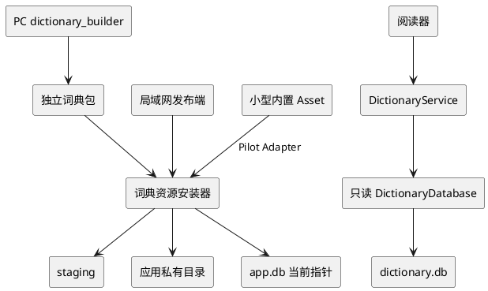

# 移动端离线词典加载方案

> 状态：正式方案（数据源已冻结）
>
> 依据：`.scratch/mvp/mvp_design.md`、当前 `apps/mobile` 实现，以及词典查询专项测试。

## 1. 结论

当前移动端已经完成“词典安装后的查询链路”，尚未完成“词典资源进入设备、校验、激活和升级”的链路。

正式 MVP 采用独立、版本化的 `.dictpack` 词典资源包，通过现有 PC 局域网发布服务下载；正式包不把词典作为 APK asset 固定进去。阶段 0 可以内置一个很小的测试词典，但必须复用正式安装流程。运行时不把整个数据库加载到内存，而是从应用私有目录以只读方式打开 SQLite，按索引查询。

正式数据源冻结为两个来源，并在同一个双语资源包中保留来源边界：

- `oewn-2025`：Open English WordNet 2025，提供英英释义、词性、词形/义项关系和 synset 关系；
- `freedict-eng-zho-2025.11.23`：FreeDict English–中文，提供英文释义、中文翻译、词性和发音。

ECDICT、CC-CEDICT 和 Wiktionary/Wiktextract 不属于正式 MVP 资源；它们只能用于后续覆盖率或质量对照实验，不能无记录地混入正式包。

这个选择同时满足以下约束：

- 词典可以独立于文章和应用升级；
- 文章包不依赖词典存在；
- 正式词典的许可、来源和体积不会被 APK 构建流程隐式固定；
- 失败的下载或升级不会影响已安装文章、旧词典和生词快照。

## 2. 设计稿要求与当前实现

设计稿规定了应用私有目录、独立只读 SQLite、版本和许可元数据，以及原样短语 → 规范化形式 → lemma 的查询顺序，见 [mvp_design.md](/home/mort/engirdle/.scratch/mvp/mvp_design.md:636) 和 [mvp_design.md](/home/mort/engirdle/.scratch/mvp/mvp_design.md:734)。正式交付方式冻结为“独立资源包导入”；应用内置 asset 仅保留为测试 adapter，不作为正式词典发布方式。

当前代码的完成度如下：

| 环节 | 当前状态 |
|---|---|
| 私有目录 | 已支持 `dictionaries/{dictionary_id}/{revision}/dictionary.db`，见 [app_directories.dart](/home/mort/engirdle/apps/mobile/lib/platform/filesystem/app_directories.dart:49) |
| 安装记录 | `app.db` 已有 `dictionary_manifest` 表，见 [migrations.dart](/home/mort/engirdle/apps/mobile/lib/platform/database/migrations.dart:121) |
| SQLite 访问 | 已使用 `OpenMode.readOnly`，见 [dictionary_database.dart](/home/mort/engirdle/apps/mobile/lib/features/dictionary/infrastructure/dictionary_database.dart:29) |
| 查询 | 已实现原样、大小写规范化、词形表和 lemma 查询，见 [dictionary_service.dart](/home/mort/engirdle/apps/mobile/lib/features/dictionary/application/dictionary_service.dart:49) |
| UI 与生词本 | 查词抽屉、义项保存、词典版本快照已经接通 |
| 启动加载 | 启动只装配依赖并恢复文章导入，没有词典资源初始化，见 [main.dart](/home/mort/engirdle/apps/mobile/lib/main.dart:27) |
| 内置资源 | `pubspec.yaml` 没有词典 asset 声明 |
| 独立安装 | 没有词典包契约、构建器、安装器或更新页面 |
| 设置入口 | 阅读器提示“设置 › 词典资源”，但当前路由中没有对应页面 |

现有词典专项测试覆盖查询顺序、词形、无资源和未知 schema 的降级；当前工作树中该专项测试 9 个用例全部通过。它尚未覆盖资源下载、哈希校验、原子更新、崩溃恢复和真实 Android 文件系统。

## 3. 推荐的模块关系

词典模块应成为一个有深度的模块：阅读器只知道查词和资源状态，不知道文件路径、压缩包、哈希或 SQLite 表结构。安装器和查询数据库可以是模块内部的实现，网络下载和测试文件来源位于内部 seam 后的 Adapter。



建议对外只保留以下能力：

| 能力 | 语义 |
|---|---|
| `status` | 未安装、安装中、可用、不兼容或损坏 |
| `install(resource)` | 下载/复制、校验、验证、原子激活和清理 |
| `lookup(selection)` | 返回明确的 unavailable、not-found、found 或 resource-error 结果 |
| `dispose()` | 关闭当前只读连接 |

现有 `DictionaryService.lookup()` 返回 `null` 表示未安装，而 `DictionaryDatabase` 对部分 schema 错误直接按“无词条”处理。正式实现应区分“没有匹配”和“资源不可用”，否则用户会把损坏词典误认为生词不存在。

## 4. 资源包契约

新增 `contracts/dictionary/v1`，资源包扩展名冻结为 `.dictpack`；`.dictpack` 是 ZIP 容器，不作为移动端运行时数据库格式。

包内至少包含：

```text
manifest.json
dictionary.db
licenses/
```

`manifest.json` 至少声明：

- `format_version`、`dictionary_id`、`revision`、`schema_version`；
- 数据库文件大小和 SHA-256；
- 展示名称；
- 每个数据源的 ID、版本、许可和归属地址；
- 修改、裁剪和规范化说明；
- 构建器版本及资源生成时间。

`licenses/` 至少携带正式数据源需要的许可证文本或稳定链接。包不能用一个笼统的 `license` 字段覆盖多个来源；来源许可、版权归属和修改说明必须按 `source_id` 分别记录。

SQLite 结构建议包含：

- `entries`：词头、规范化词头、词性、命名空间限定的 `sense_id`、英英释义、可选英中释义、`source_id`、展示用来源名称和排序权重；
- `forms`：词形、规范化词形到 lemma 的映射，并保留可选的 `source_id` / 词性限定；
- `dictionary_meta`：词典 ID、revision、schema version 和规范化算法版本。

构建器必须预计算规范化键，并创建词头、规范化词头和词形索引。候选义项排序应使用明确的 `pos_rank`、`source_rank` 和 `ord`，不要依赖 SQLite 的字典序偶然得到稳定顺序。

### 4.1 正式数据源与构建边界

正式 MVP 的一个资源包包含两个来源，资源包自身使用稳定的产品级 ID，来源版本不通过文件名猜测：

| source_id | 方向 | 固定输入 | 许可与归属 | 构建职责 |
|---|---|---|---|---|
| `oewn-2025` | 英英 | Open English WordNet 2025 官方 JSON 或 GWN-LMF 发布文件 | Open English WordNet CC BY 4.0；同时保留 Princeton WordNet 归属及底层 WordNet 许可说明 | 抽取 lemma、POS、synset/sense ID、英英释义、例句和必要关系；为词形查询生成 `forms` |
| `freedict-eng-zho-2025.11.23` | 英汉 | FreeDict `eng-zho` 2025.11.23 官方 TEI 源包 | CC BY-SA 3.0；保留 FreeDict、WikDict、DBnary、Wiktionary 来源和版本 | 抽取英文词头、POS、发音、英文定义和中文翻译；为每个义项生成稳定的命名空间 `sense_id` |

来源地址固定记录在 manifest 中：

- [Open English WordNet 官方仓库与发布](https://github.com/globalwordnet/english-wordnet)；
- [Open English WordNet 许可证](https://github.com/globalwordnet/english-wordnet/blob/main/LICENSE.md)；
- [FreeDict `eng-zho` 下载页](https://freedict.org/zh_cn/downloads/)；
- [FreeDict `eng-zho` 2025.11.23 源包](https://download.freedict.org/dictionaries/eng-zho/2025.11.23/freedict-eng-zho-2025.11.23.src.tar.xz)。

构建边界冻结如下：

1. `oewn-2025` 是英英主源，选择官方 2025 核心版本，不引入 `Open English WordNet Plus` 或 `Open English Namenet` 的额外 proper nouns。
2. `freedict-eng-zho-2025.11.23` 是英汉主源；官方源包原始规模约为 26,660 个 headwords，构建器必须同时记录原始数量、过滤数量、最终词头数量和输入 SHA-256。
3. 两个来源可以写入同一个 `dictionary.db`，但不得在规范化或去重时抹掉来源。`entries` 和 `forms` 至少保留 `source_id`，`sense_id` 必须使用来源命名空间；相同英文词头的义项不跨来源强行合并。
4. 英英释义和中文翻译都属于可选来源字段，但每个输出义项至少要有一个非空释义字段；英英结果在 UI 中先展示，中文翻译作为补充。
5. 构建器必须把裁剪、去重、字段清洗、HTML/标记转换、词形生成和排序规则写入 `modifications` / `extraction_note`，不得只写“converted to SQLite”。
6. ECDICT、CC-CEDICT、Wiktionary/Wiktextract、商业词典或未经许可的 StarDict/MDX 文件均不进入正式包；实验数据必须使用不同的 `dictionary_id`，避免被移动端误认为正式版本。

正式 MVP 资源包建议使用：

```text
dictionary_id: engirdle-en-zh
revision: 1
sources:
  - oewn-2025
  - freedict-eng-zho-2025.11.23
```

`revision` 是 Engirdle 资源包的单调递增版本，不等同于上游版本号；上游版本和构建器版本必须在 `manifest.json` 中单独记录。

## 5. 安装与更新流程

### 5.1 下载或复制

正式 MVP 沿用现有 LAN HTTP 客户端，给 `catalog.json` 增加 dictionary 条目，并提供受允许列表约束的 `/dictionaries/{opaque}.dictpack` 路由。旧客户端忽略该可选字段，文章导入不依赖词典；发布目录中的正式包必须是由固定上游快照构建并带完整 manifest 的 `engirdle-en-zh` 资源。

Pilot 的内置 Asset 只作为测试来源 Adapter：asset 不能直接作为当前 `sqlite3.open(path)` 所需的文件路径，必须先复制到 staging。正式词典不使用 `rootBundle.load()`，避免 APK 保留一份资源、应用私有目录再保留一份。

### 5.2 校验

安装器在切换当前指针前必须完成：

1. 外层文件大小和 SHA-256 校验；
2. ZIP 路径允许列表、条目数量、单条目和总展开大小校验；
3. manifest 版本、词典 ID、revision 和数据库哈希校验；
4. SQLite 只读打开、`quick_check`、必需表/索引和 schema version 校验；
5. 数据库内部元数据与 manifest 一致性校验。

校验失败只能清理 staging 并报告错误，不能修改当前资源。

### 5.3 原子激活

推荐顺序：

1. 写入唯一 staging 目录；
2. 通过验证后移动到不可变目录 `dictionaries/{id}/{revision}/`；
3. 关闭旧的数据库连接；
4. 在 `app.db` 短事务中切换当前资源指针；
5. 后台删除不再引用的旧版本和孤儿 staging。

当前 `DictionaryManifestDao.current()` 使用最近 `installed_at` 推断当前资源。正式版本应使用显式的 active pointer，或将 `(dictionary_id, revision)` 安装记录与单独的当前指针分开，避免时钟、多个词典 ID 或重启恢复造成歧义。

由于词典只涉及一个不可变文件，启动时可以按“目录是否被当前指针引用”清理孤儿，不必直接复制文章导入器的全部状态机。若以后需要断点续传，再增加独立的词典安装恢复记录。

## 6. 运行时加载与查询

启动时只读取 manifest 和当前指针，不必立即打开整个数据库。第一次查词时：

1. 检查当前文件仍存在；
2. 以只读模式打开 SQLite；
3. 设置查询只读约束，并缓存当前连接和路径；
4. 按索引执行原样短语、规范化形式、词形和 lemma 查询；
5. 更新版本后关闭旧连接，下一次查询重新打开新路径。

当前的路径版本化设计使“同一路径被原地替换”不会发生，因此 `_openPath` 缓存策略可以保留。不要在阅读器中自行拼接路径或直接访问 SQLite；更新、错误和连接生命周期都应由 `DictionaryService` 隐藏。

如果真实词典体积导致首次查词明显阻塞 UI，再把查询实现移到专用 isolate；在没有实机基准之前，不应提前引入第二套有状态查询协调器。

## 7. 需要补齐的代码模块

建议按纵向切片实施：

1. **词典契约与构建器**：新增 `contracts/dictionary/v1`、PC `dictionary_builder` 和两个正式源的黄金数据；固定 `engirdle-en-zh`、`oewn-2025`、`freedict-eng-zho-2025.11.23`，输出 manifest、SQLite 索引、逐义项 `source_id` 和归属信息。
2. **移动安装器**：在 `features/dictionary` 内实现 staging、哈希、包校验、SQLite 预检、原子激活和孤儿清理；复用现有 HTTP、ZIP、SHA-256 平台 Adapter。
3. **显式资源状态**：扩展 `DictionaryResource` 和 `dictionary_manifest`，增加 schema/manifest 信息及 active pointer；将损坏资源与无结果分开。
4. **设置页面与发布路由**：增加词典资源状态、安装/更新、失败重试和归属信息入口；文章目录和文章导入保持独立。
5. **查询数据质量**：补充规范化列、索引、来源排序、多词短语和常见词形数据；用两个正式源的真实 fixture 验证多义、词形、英汉双解和来源显示。

## 8. 验收与测试

必须在模块接口上测试可观察结果，而不是测试数据库内部实现。以下条件是正式 MVP 的验收门槛。

### 8.1 数据源与构建验收

- **DIC-SRC-001**：构建器只接受并记录 `oewn-2025` 与 `freedict-eng-zho-2025.11.23` 两个正式 `source_id`；manifest 的来源数组不能缺项、重复或出现未登记来源。
- **DIC-SRC-002**：`oewn-2025` 必须来自官方 2025 核心发布，输出英英词头、POS、英英释义、稳定的 synset/sense ID，并在归属信息中同时列出 Open English WordNet CC BY 4.0 与 Princeton WordNet/WordNet 许可说明。
- **DIC-SRC-003**：`freedict-eng-zho-2025.11.23` 必须来自固定官方 TEI 源包；构建日志和 manifest 记录原始约 26,660 headwords、过滤数、最终词头数、输入 URL 和 SHA-256，并保留 CC BY-SA 3.0 及 WikDict/DBnary/Wiktionary 归属。
- **DIC-SRC-004**：同一输入快照、构建器版本和配置重复构建时，规范化输出/结构哈希一致；排序、`sense_id` 和 `forms` 不得依赖文件遍历或 SQLite 偶然顺序。
- **DIC-SRC-005**：每个义项至少保留一个非空 `gloss_en` 或 `gloss_zh`；每个义项和词形都能追溯到 `source_id`，相同词头的两个来源不被无来源地合并。
- **DIC-SRC-006**：真实 fixture 覆盖英英多义词、两个 POS、规则和不规则词形、FreeDict 英汉双解、发音、至少一个多词短语、无结果词，以及同一词头来自两个来源时的稳定排序。
- **DIC-SRC-007**：ECDICT、CC-CEDICT、Wiktionary/Wiktextract 和商业词典数据不出现在正式包、正式 manifest 或正式归属页中。

### 8.2 资源包与安装验收

- **DIC-PACK-001**：构建器生成一个 ZIP 形式的 `.dictpack`，`dictionary_id` 为 `engirdle-en-zh`，首个 `revision` 为 `1`，至少包含 `manifest.json`、`dictionary.db` 和 `licenses/`。
- **DIC-PACK-002**：manifest 中的资源大小、SHA-256、数据库哈希、格式版本、schema 版本、构建器版本、来源版本、许可证、归属 URL、裁剪和修改说明均非空且相互一致。
- **DIC-PACK-003**：安装器拒绝路径穿越、未知包路径、重复条目、大小超限、哈希不符、来源/版本不允许、schema 不兼容和 SQLite `quick_check` 失败的包；失败只清理 staging，不改变当前资源。
- **DIC-PACK-004**：合法包安装到 `dictionaries/engirdle-en-zh/1/` 后，数据库可用只读模式打开，必需表、索引和 `dictionary_meta` 均通过预检；安装过程中不把整个数据库加载到内存。
- **DIC-PACK-005**：同一 `dictionary_id`/`revision` 的不同内容不能覆盖已安装文件；新版本必须进入新目录，并在短事务中切换显式 active pointer。

### 8.3 离线查询与产品行为验收

- **DIC-LOOKUP-001**：未安装词典时，阅读、翻译、播放和生词本仍可用；查词返回明确的 unavailable，不显示为“无此词”。
- **DIC-LOOKUP-002**：合法资源安装后，在飞行模式下可完成原样短语、大小写/标点规范化、词形到 lemma、英英释义、英汉翻译、多词短语和无结果词查询。
- **DIC-LOOKUP-003**：英英释义优先展示，中文翻译作为补充；同一词头的候选义项显示稳定，不因 SQLite 默认字典序改变。
- **DIC-LOOKUP-004**：数据库文件缺失、被替换、不可读或 schema 损坏时返回 resource-error；正常“没有匹配”仍返回 not-found，两者不能混淆。
- **DIC-LOOKUP-005**：保存生词时记录 `engirdle-en-zh` 与当前 revision；文章更新/删除不影响已保存的义项、原句、译文和词典版本快照。

### 8.4 更新、恢复与归属验收

- **DIC-RECOVERY-001**：下载、解包、校验、数据库预检和激活任一步失败，旧词典仍可查；staging 和孤儿目录可在重启后安全清理。
- **DIC-RECOVERY-002**：更新过程中进程终止后，启动能够恢复到旧版本或完整的新版本，不能出现“当前指针指向半成品”。
- **DIC-RECOVERY-003**：设置 › 词典资源页面显示 `dictionary_id`、revision、大小、包哈希、两个上游名称和版本、许可名称/链接、来源/归属链接、原始/最终词头数量及修改说明。
- **DIC-RECOVERY-004**：目标 Android 设备记录冷启动查词、首次打开数据库、重复查询、安装时峰值磁盘空间和升级后旧版本清理结果；记录结果随资源 revision 保存，便于后续比较。

数据源选择已冻结；后续变化必须通过新的 `source_id` 或资源 revision 进入，并重新完成来源、许可、构建哈希和上述验收，不得静默替换正式数据。
