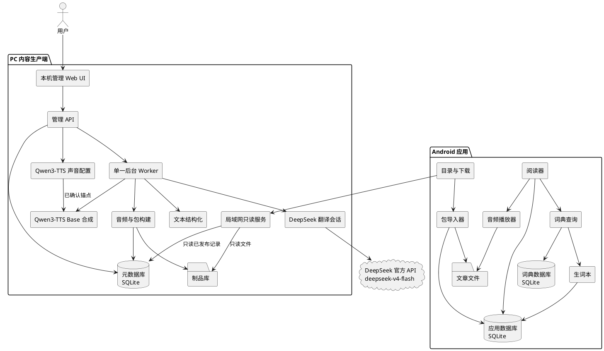
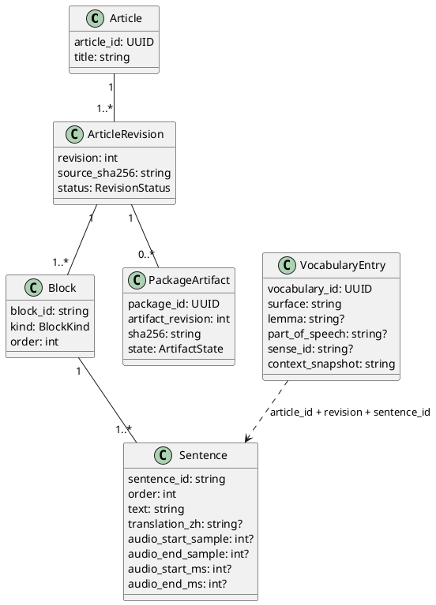
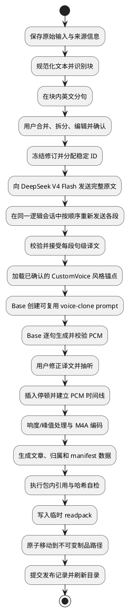
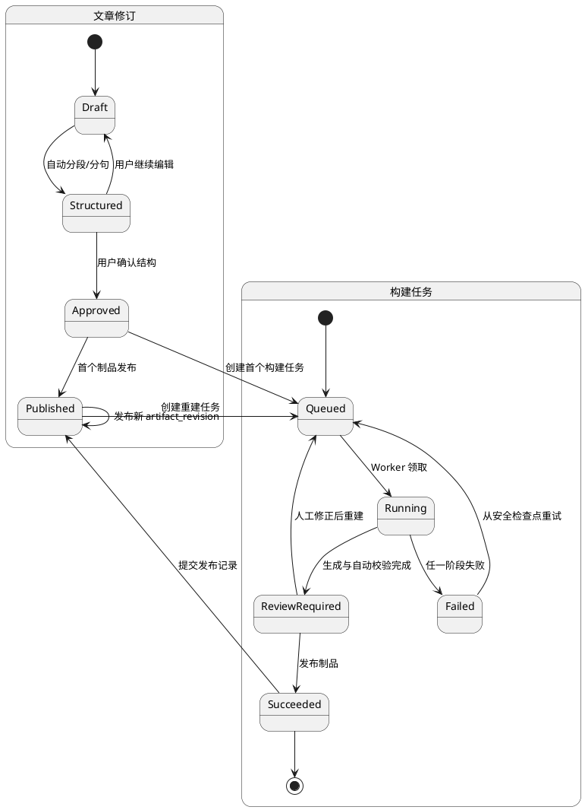
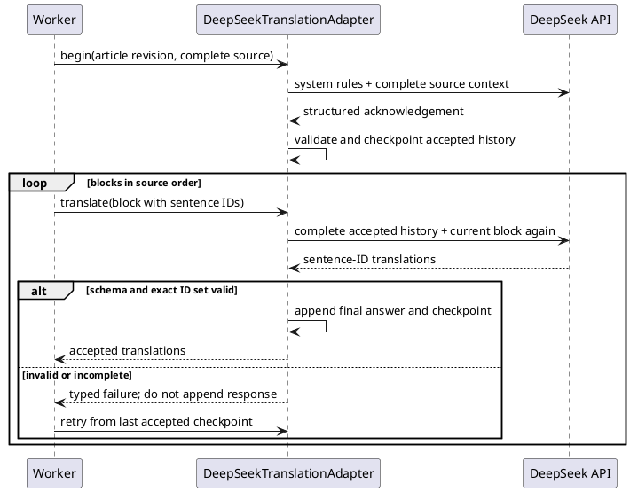
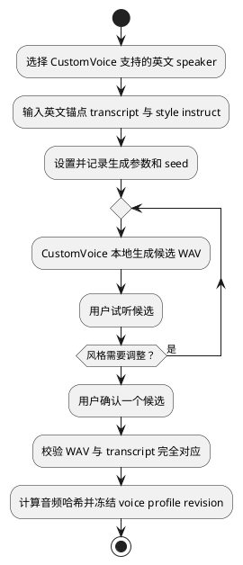
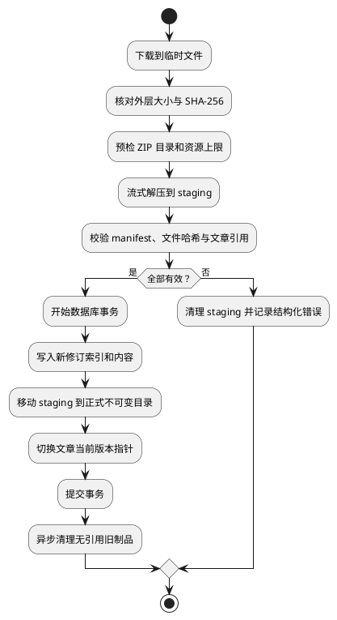
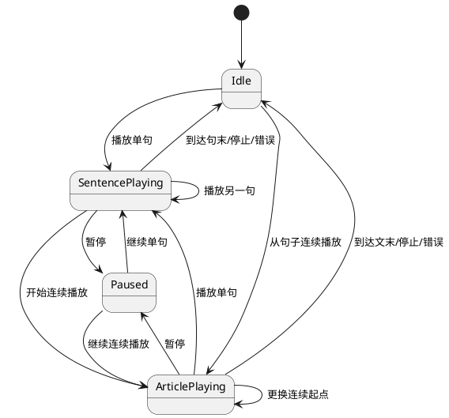
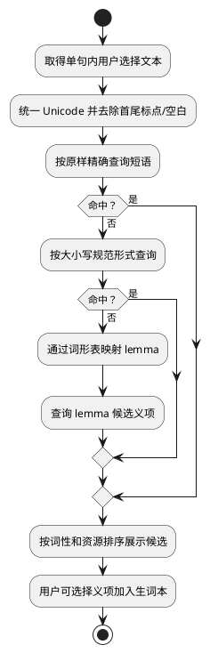

# Engirdle MVP 技术设计

> 文档状态：技术设计基线候选  
> 更新时间：2026-08-07  
> 产品方向：[purpose.md](../purpose.md)  
> 需求基线：[mvp_prd.md](./mvp_prd.md)  
> 工程架构：[mvp_module_architecture.md](./mvp_module_architecture.md)<br>
> 风险与验证：[mvp_feasibility.md](./mvp_feasibility.md)

## 1. 设计目标与约束

本设计实现单用户的 PC 内容生产端、局域网只读发布端和 Android 离线消费端。主要约束是：

- 先确定原文结构，再生成翻译和音频；
- PC 承担不稳定和高计算量工作，移动端只消费确定性制品；
- PC 与移动端通过版本化 `.readpack` 解耦，不共享数据库；
- 发布制品不可变，失败不覆盖上一成功版本；
- 单机和单用户规模优先采用简单、可恢复的本地基础设施；
- 模型、分句器、词典和移动依赖都通过版本化契约隔离。

MVP 模型基线已经确定：翻译使用 DeepSeek 官方 API 的 `deepseek-v4-flash`，TTS 使用本地 `Qwen3-TTS-12Hz-1.7B-CustomVoice` 与 `Qwen3-TTS-12Hz-1.7B-Base`。阶段 0 仍需验证部署参数、性能、音频编码和移动文本组件，但不得用验证为由静默替换模型或降低上下文质量策略。

仓库根目录的 `.tts/` 只是本机调研参考。生产代码、安装、测试和构建必须在该目录不存在时仍可工作。

## 2. 系统上下文



### 2.1 PC 模块职责

| 模块 | 职责 |
|---|---|
| 本机管理 UI/API | 录入、分句修正、译文修正、任务操作、抽听、发布和服务启停 |
| 单一 Worker | 从 SQLite 领取任务，串行推进阶段，记录心跳、重试与失败原因 |
| 文本结构化 | 规范化、段落/块识别、英文分句和 ID 分配 |
| DeepSeek 翻译会话 | 使用 API Key 维护“完整原文首轮 + 顺序逐段翻译”的逻辑会话，返回严格的句子 ID → 译文结果 |
| Qwen3-TTS 声音配置 | 用 CustomVoice 生成、试听并版本化风格锚点和完全匹配的 transcript |
| Qwen3-TTS Base 合成 | 从已确认锚点建立 clone prompt，逐句返回统一 PCM 和生成元数据 |
| 音频/包构建器 | 组装时间线、编码、校验、生成不可变包和目录项 |
| SQLite | 保存文章、修订、任务、配置引用、制品状态和发布记录 |
| 文件制品库 | 保存原始输入、工作文件、缓存、最终音频和包 |
| 局域网服务 | 只提供目录与不可变包文件，不复用管理路由 |

### 2.2 Android 模块职责

| 模块 | 职责 |
|---|---|
| 目录与下载 | 服务配置、目录获取、临时下载、大小与外层哈希校验 |
| 包导入器 | 安全解压、schema/引用校验、事务写库与原子目录切换 |
| 阅读器 | 结构化句子渲染、三种译文模式、排版与选词入口 |
| 播放器 | 单一会话、句级区间与连续播放状态管理 |
| 词典查询 | 短语、规范化形式、lemma 和候选义项查询 |
| 生词本 | 保存用户选定义项和不可变上下文快照 |
| 应用数据库 | 保存文章索引、设置、生词和导入状态，不保存大音频 BLOB |
| 词典数据库 | 独立版本化、只读打开，不与应用迁移耦合 |

## 3. 领域模型与标识



### 3.1 身份规则

- `article_id` 在文章生命周期内稳定。
- `revision` 从 1 单调递增；已发布修订不可变。
- `block_id` 和 `sentence_id` 是修订内唯一的不透明字符串。v1 可以生成可读 ID，但消费者不得解析其编号含义。
- 任何跨表或跨包句子引用都使用 `(article_id, revision, sentence_id)`。
- `package_id` 标识一次不可变构建；同一文章修订因译文、声音或编码重建时，增加 `artifact_revision` 并产生新的 `package_id`。
- 生词保存引用之外，还保存原句、释义和词典版本快照，因此文章升级或删除不会使其不可读。

### 3.2 结构化文本

MVP 的 `BlockKind` 仅包含 `paragraph`、`list_item` 和 `quote`。标题单独存储，不进入句子数组。每个块至少包含一个句子；空块不发布。

原始文本、规范化文本和用户确认后的结构分别保存。生成任务只读取用户已确认的不可变修订快照，避免编辑与后台任务竞争。

## 4. PC 处理流水线

### 4.1 流程



翻译各段必须串行执行，以保留完整原文和此前已接受译文形成的连续上下文。TTS 不依赖译文，理论上可以与翻译并行，但首版 Worker 串行执行，以降低模型加载和任务恢复复杂度。CustomVoice 只在创建或修订声音配置时加载；文章构建只加载 Base。

### 4.2 修订与任务状态

文章修订状态与一次构建任务状态是两个独立状态机，不能把任务失败写成文章修订失败。



任务至少记录阶段、尝试次数、配置快照、开始/结束时间、心跳和结构化错误。Worker 启动时将超过租约时间的 `running` 任务转为可重试状态，不把残留工作目录视为成功制品。重建已发布修订时，旧制品保持当前可用，直到新任务进入 `Succeeded` 并完成发布切换。

### 4.3 文本规范化与分句

规范化应是确定性、版本化转换，至少处理：

- 换行与 Unicode 规范形式；
- 连续空白、智能引号和破折号的统一策略；
- 普通段落、列表项和引用块边界；
- 不可见控制字符与异常空块。

分句器只在块内运行，并通过适配器暴露版本。人工编辑后重新计算结构哈希并冻结修订；不得在翻译或 TTS 阶段自行合并句子。

### 4.4 翻译适配器

MVP 适配器固定使用 DeepSeek 的 OpenAI 兼容 Chat Completions 接口：

| 配置 | MVP 基线 |
|---|---|
| API endpoint | `https://api.deepseek.com` |
| model | `deepseek-v4-flash`，不使用即将废弃的兼容别名 |
| authentication | 本机秘密存储或 `DEEPSEEK_API_KEY` 环境变量 |
| thinking | `enabled` |
| reasoning effort | `max`，质量优先 |
| output | JSON 对象，随后由 Pydantic 严格校验 |
| tools | 不启用 |
| context policy | 完整历史，不做滑窗、摘要、裁剪或降级 |

温度等在思考模式下无效或尚未验证的参数不作为质量控制手段。端点、模型 ID 和质量参数必须形成不可变任务配置快照。

#### 4.4.1 会话协议

DeepSeek API 本身无服务端会话状态，因此“同一会话”由 PC 端保存并在每次请求中完整重放 `messages` 实现。



首轮完整原文上下文至少包含标题、作者（如有）、文章 ID、修订、全部有序块、句子 ID 和英文正文。正文放在明确的结构化数据边界内；system 指令规定其内容只作为待翻译资料，即使正文看起来包含命令也不得执行。首轮要求模型只返回包含文章 ID、修订和句子总数的确认对象，不把该轮当作翻译结果。

之后按照块顺序逐段调用：

- 再次发送当前块全部句子及其 ID；
- 要求简体中文翻译忠实、自然，并利用完整文章保持术语、代词、语气和专名一致；
- 要求只返回当前块的句级翻译对象，不得合并或拆分句子；
- 将通过校验的 assistant 最终 `content` 加入历史，使后续段落看得到既有翻译；
- 不保存或重放无工具调用轮次的 `reasoning_content`，也不把推理内容写入日志；
- 无效响应不进入历史，重试从最后一个已接受 checkpoint 构造相同逻辑会话。

MVP 假设上下文容量远大于目标文章及累计会话。实现不提供滑窗、摘要、删减旧译文或换用较小模型的回退路径；若请求被上下文限制拒绝，构建以 `context_limit_exceeded` 明确失败。

#### 4.4.2 校验与持久化

边界 DTO 使用 Pydantic 模型，不在内部以任意字典传递。每段必须校验：

- 返回值可解析为约定 schema；
- 输入和输出 ID 集合完全相等；
- 每个 ID 只出现一次，译文非空；
- 模型未返回额外说明或未知字段；
- 结果关联完整原文哈希、当前块哈希、提示词版本和 API 请求 ID。

本地保存完整原文、已接受的最终回答、用量和请求元数据，以便重建逻辑会话；不保存 API Key 和模型推理内容。人工译文修正以单独字段保存，发布时优先选用已确认修正值，不覆盖原始模型输出。

### 4.5 TTS 适配器与缓存

MVP 使用两个本地检查点完成一次“选定声音、重复生产”的流程：

1. `Qwen3-TTS-12Hz-1.7B-CustomVoice` 负责创建风格锚点；
2. `Qwen3-TTS-12Hz-1.7B-Base` 负责克隆该锚点并逐句生成文章语音。

两个检查点通过同一 Qwen3-TTS 适配器族隔离，但职责和制品不可混用。文章逐句生成不得直接调用 CustomVoice。

#### 4.5.1 风格锚点与声音配置



声音配置至少包含：

- `voice_profile_id` 与单调递增的 `revision`；
- CustomVoice 检查点 ID、精确修订和文件哈希；
- 英文 `speaker`、`instruct`、`anchor_text`；
- 选中锚点 WAV、采样率、时长和 SHA-256；
- seed 与全部有效生成参数；
- 创建时间、人工确认时间和许可/归属信息。

锚点 transcript 必须与音频中实际朗读文本完全一致。声音配置一经用于已发布制品即不可原地修改；调整 speaker、instruct、文本、候选音频或参数都创建新修订。

CustomVoice 和 Base 串行加载：锚点生成完成后释放 CustomVoice，再加载 Base，避免同时常驻两个 1.7B 检查点。文章构建复用已确认锚点，无需再次加载 CustomVoice。

#### 4.5.2 Base 逐句生成

Base 加载后，为构建任务创建一次可复用 prompt，语义等价于：

```text
create_voice_clone_prompt(
  ref_audio=selected_anchor_wav,
  ref_text=exact_anchor_text,
  x_vector_only_mode=False
)
```

随后按稳定句子 ID 顺序调用 voice clone，显式使用 `language="English"`。适配器返回单声道 PCM 样本、采样率、通道数及生成元数据；流水线统一样本格式后再拼接。同一任务所有句子必须使用同一个 prompt 和声音配置修订。

缓存键至少包含：

```text
sentence_text_hash
+ base_model_revision
+ voice_profile_id_and_revision
+ anchor_audio_sha256
+ generation_parameters_hash
```

同一键只复用完整且校验通过的 PCM。重试单句时复用同一 clone prompt；如果 seed 或其他采样参数会影响输出，它们必须进入缓存键和生成元数据。目标硬件基准用于验证性能和依赖参数，不再承担模型选型。

### 4.6 音频时间线

MVP 采用“逐句 PCM → 插入停顿 → 单文件编码”的方案：

- 各句统一为单声道和相同采样率；
- 句间、段间停顿作为显式 PCM 片段插入；
- `audio_start_sample` 指当前句首个语音样本在完整 PCM 时间线的位置；
- `audio_end_sample` 是当前句语音结束后的排他位置，不包含其后的停顿；
- 毫秒值从样本位置统一换算，不通过累计浮点时长计算；
- 连续播放不设置结束裁剪，因此保留句间和段间停顿；
- 单句播放使用开始/结束毫秒，并由移动端播放器执行裁剪。

最终候选格式为 M4A/AAC-LC；编码器延迟、seek table 和平台解码差异必须通过阶段 0 实机验证。若不能稳定满足听感验收，应在冻结 v1 包协议前改用经验证的编码参数或替代音频布局，而不是在移动端加入文本猜测。

## 5. PC 存储设计

### 5.1 文件分层

```text
workspace/
├── app.db
├── source/{article_id}/{revision}/
├── working/{job_id}/
├── cache/tts/
├── voices/{voice_profile_id}/{revision}/
├── artifacts/{article_id}/{revision}/{artifact_revision}/
└── public/
    ├── catalog.json
    └── packages/
```

- `source` 保存原始输入、规范化文本和结构快照；
- `working` 是可丢弃工作区，不作为任务成功依据；
- `cache` 可重建，并由单独策略清理；
- `voices` 保存已确认锚点、transcript 和不可变声音配置修订；
- `artifacts` 保存不可变构建结果；
- `public` 只包含允许局域网读取的目录和包；
- 大音频和包不写入 SQLite BLOB。

所有路径通过受控 ID 和 `pathlib` 构造，不接受用户输入直接成为文件路径。

### 5.2 SQLite 事务边界

- 文章编辑、修订冻结、任务领取和发布提交分别使用短事务。
- 模型推理和 FFmpeg 不在数据库事务内运行。
- 制品先写同一文件系统中的临时路径，完成校验后原子重命名，再以短事务记录为已发布。
- 目录从已发布记录生成到临时文件后原子替换；文件系统存在但数据库未提交的制品由维护任务识别为孤儿，不自动发布。

### 5.3 本地模型与 `.tts` 边界

Qwen3-TTS 检查点位于用户配置的应用运行数据目录或其他本地绝对路径，例如：

```text
model-root/
├── Qwen3-TTS-12Hz-1.7B-CustomVoice/
└── Qwen3-TTS-12Hz-1.7B-Base/
```

实现阶段可以参考或迁移 `.tts/` 中已有的模型、配置和实验逻辑，但必须遵守：

- `.tts/` 整体由根目录 `.gitignore` 排除，不提交代码、模型、音频或日志；
- 生产代码不导入 `.tts` 中的脚本，不硬编码其路径，也不在运行时回退读取该目录；
- 迁移后的检查点放在应用管理的本地模型目录，仍不进入 Git、应用安装包或 readpack；
- 迁移实验逻辑时按项目代码规范重新实现，只把 `.tts/README.md` 和脚本视作行为参考；
- CI、单元测试和普通构建使用适配器 fake/fixture，不能要求下载或加载真实权重；
- 若未来引入容器或其他构建上下文，还必须在对应排除文件中显式排除 `.tts/`；
- 发布前通过“临时移走 `.tts/` 后完整构建”证明没有隐式依赖。

## 6. Readpack v1 协议

### 6.1 包布局

`.readpack` 是 ZIP 容器，v1 只允许以下逻辑布局：

```text
manifest.json
article.json
attribution.json
audio/article.m4a
```

manifest 是信封元数据，不在自身的 `files` 哈希列表中。整个 ZIP 的大小和 SHA-256 由目录记录。

### 6.2 Manifest 最小示例

```json
{
  "format": "readpack",
  "format_version": "1.0",
  "package_id": "550e8400-e29b-41d4-a716-446655440000",
  "created_at": "2026-08-07T08:00:00Z",
  "article": {"id": "article-uuid", "revision": 1, "artifact_revision": 1},
  "files": [
    {"path": "article.json", "size": 18420, "sha256": "...", "media_type": "application/json"},
    {"path": "attribution.json", "size": 920, "sha256": "...", "media_type": "application/json"},
    {"path": "audio/article.m4a", "size": 4839210, "sha256": "...", "media_type": "audio/mp4"}
  ],
  "audio": {
    "path": "audio/article.m4a",
    "codec": "aac-lc",
    "sample_rate_hz": 24000,
    "channels": 1,
    "duration_ms": 543260
  },
  "pipeline": {
    "version": "0.1.0",
    "segmenter": "provider@revision",
    "translation": {
      "provider": "deepseek",
      "model": "deepseek-v4-flash",
      "thinking": "enabled",
      "reasoning_effort": "max",
      "prompt": "full-article-sequential-blocks@v1"
    },
    "tts": {
      "custom_voice_model": "Qwen/Qwen3-TTS-12Hz-1.7B-CustomVoice@revision",
      "base_model": "Qwen/Qwen3-TTS-12Hz-1.7B-Base@revision",
      "voice_profile": "voice-profile-uuid@1",
      "anchor_sha256": "..."
    }
  }
}
```

`article.json` 保存标题、来源展示字段、按顺序排列的块和句子。每个句子包含文本、可选中文译文以及音频样本/毫秒边界。`attribution.json` 保存文章、DeepSeek 服务、Qwen3-TTS 检查点、声音配置和生成依赖所需归属；移动端应提供可查看入口。API Key、锚点 WAV、模型权重和 `.tts` 内容都不进入 readpack。离线词典也不进入文章包。

### 6.3 Catalog 最小示例

```json
{
  "catalog_version": 12,
  "generated_at": "2026-08-07T08:05:00Z",
  "packages": [
    {
      "article_id": "article-uuid",
      "revision": 1,
      "artifact_revision": 1,
      "title": "Example Article",
      "format_version": "1.0",
      "size": 4862201,
      "sha256": "...",
      "url": "/packages/article-uuid-r1-a1.readpack"
    }
  ]
}
```

目录中的 URL 必须是相对服务根路径或经过严格校验的同源 URL。包文件名不可由标题直接生成。已发布包不可原地修改；变化时生成新 URL 和目录版本。

MVP 目录对每个 `article_id` 只暴露当前发布制品。PC 可以在内部保留旧制品以供回滚和追溯，但移动端通过 `(revision, artifact_revision)` 比较是否存在更新。

### 6.4 包构建校验

PC 发布前验证：

- JSON 满足 v1 schema，未知必需语义不存在；
- 文章、修订和包标识一致；
- 块和句子 ID 唯一，次序连续且引用存在；
- 每句都有译文和合法音频区间；
- 区间单调、非负、不超过音频时长；
- manifest 中每个文件存在且大小、SHA-256 一致；
- ZIP 只含允许路径，没有重复规范化路径；
- 重新打开最终包仍能通过同一校验器。

PC 与 Android 应共享同一份语言无关的 JSON Schema 和黄金测试包，而不是各自解释自然语言文档。

### 6.5 移动端安全导入

候选默认上限如下，阶段 0 以长文章和恶意包测试后冻结：

| 限制 | 候选默认值 |
|---|---:|
| ZIP 文件大小 | 512 MiB |
| 展开后总大小 | 1 GiB |
| 条目数 | 64 |
| 单个条目大小 | 1 GiB |
| 规范化相对路径长度 | 240 字符 |

导入器必须：

1. 先核对目录声明的包大小与 SHA-256。
2. 读取中央目录并在写盘前检查条目、大小和路径。
3. 拒绝绝对路径、`..`、空路径、重复规范化路径、符号/硬链接、设备文件、加密条目和允许列表外文件。
4. 以流式方式解压，并在实际写入时再次累计展开大小，不能只信任 ZIP 声明。
5. 校验 manifest schema，再逐文件核对大小和哈希。
6. 校验 `article.json` 引用和音频边界。
7. 写入应用私有临时目录；数据库事务成功后原子切换当前修订。
8. 失败时清理本次临时内容，保留旧修订。

SHA-256 在无签名 HTTP 下只提供一致性和损坏检测。v1 不提供发布者身份认证；未来如扩展到不受信任网络，应增加签名 manifest 或经过认证的 HTTPS。

### 6.6 协议版本

- `format_version` 使用 `major.minor`。
- 添加消费者可以忽略的可选字段时增加 minor。
- 删除字段、改变语义、改变必需文件或 ID 规则时增加 major。
- 移动端接受已实现的同主版本 minor，忽略未知可选字段，拒绝未知必需能力和更高主版本。
- JSON Schema、黄金包和兼容性测试跟随每个版本保存。

## 7. 局域网发布设计

管理面和发布面使用独立应用入口或至少独立监听器：

```text
127.0.0.1:8765  本机管理 UI/API
用户选定的 LAN 地址:8766  只读目录与包
```

只读服务允许：

- `GET`/`HEAD /catalog.json`；
- `GET`/`HEAD /packages/{opaque-name}.readpack`；
- 对不可变包支持标准范围请求可以作为下载优化，但不是导入正确性的前提。

服务不得将任意路径参数拼接到文件系统。包名先查已发布映射，再返回固定制品路径。启用时记录绑定地址和启动时间；关闭后停止监听。目录不包含 PC 绝对路径、模型凭证或管理地址。

移动端的 HTTP 客户端需要有限超时、最大响应限制和取消能力。Android 明文流量只针对用户配置的局域网用例做最小范围配置；若平台无法对动态 IP 精确限制，应用内必须拒绝非局域网 HTTP 地址，并对 HTTPS 保持正常支持。

## 8. Android 端设计

### 8.1 本地数据布局

```text
app-private-data/
├── app.db
├── dictionaries/{dictionary_id}/{revision}/dictionary.db
├── articles/{article_id}/{revision}/{artifact_revision}/
│   ├── article.json
│   ├── attribution.json
│   └── article.m4a
└── staging/{import_id}/
```

`app.db` 保存文章当前版本指针、服务配置、阅读设置、导入记录和生词。文章 JSON 可以在导入时规范化到数据库以便查询；原始 JSON 与音频仍作为制品保留。词典数据库以只读模式打开，并用独立 manifest 记录版本和许可。

### 8.2 导入事务



文件移动与 SQLite 无法形成真正的跨介质事务，因此导入器使用可重放日志/状态字段：启动时检查 `staging`、`moving`、`committed` 状态，完成或回滚未结束操作。正式目录只使用不可变唯一名称，避免覆盖移动。

### 8.3 阅读器与选词

阅读器使用结构化 Flutter 文本组件，不使用 WebView。每个句子保留独立交互边界，并在外层按块排版：

- 点击句子或翻译控件切换句译；
- 独立扬声器按钮触发播放；
- 长按仅在当前句的 selectable region 内选择单词或短语；
- 自定义上下文菜单增加“查词”，同时保留系统复制能力；
- 当前播放句可以高亮，但自动滚动不属于 MVP；
- 三种译文模式只影响呈现，不复制或改写领域数据。

Flutter 的跨 span 选择、菜单定制和 Android 版本差异必须先做原型。若一句一个选择区域是满足稳定选择的必要条件，MVP 接受不能跨句选择。

### 8.4 播放状态



一个播放器实例和一个控制器拥有状态。新播放命令先取消旧裁剪和待处理回调，再 seek 并设置新模式：

- 单句模式设置 `[audio_start_ms, audio_end_ms)` 裁剪；
- 连续模式清除结束裁剪，从目标句开始播放到文件末尾；
- 段落播放解析为该块首句；
- 结束事件必须校验当前会话 token，防止旧异步事件停止新会话。

### 8.5 词典查询

词典资源预先在 PC 构建为移动友好的 SQLite，至少包含词头、规范化形式、词性、义项、英英释义、可选中文释义、来源 ID 和词形映射。

词典传递方式在 G4 前保持开放：可以随应用内置并在首次启动时复制，也可以采用独立、受校验的资源包导入。无论采用哪种方式，都必须携带词典 ID、修订、文件大小、SHA-256、数据来源、许可和修改说明；文章导入协议不得依赖词典一定存在。

查询顺序如下：



MVP 不根据文章上下文自动选择义项。多个数据源的 sense ID 必须带命名空间，避免碰撞。词典更新不改写已保存的生词释义快照。

## 9. 技术栈与扩展边界

### 9.1 PC

- Python：业务与流水线；
- FastAPI：本机管理 API、最小服务端渲染管理界面和独立只读发布应用；
- Pydantic：边界 DTO、配置和模型结构化输出校验；
- SQLite：元数据、任务和发布索引；
- FFmpeg：音频探测、拼接后的处理、编码和验证；
- DeepSeek Chat Completions 客户端：固定 `deepseek-v4-flash`，负责完整历史的顺序翻译会话；
- `qwen-tts`：本地加载 CustomVoice 和 Base 检查点，封装声音配置与逐句 voice clone；
- 分句器、DeepSeek 和 Qwen3-TTS：均通过职责明确的适配器类接入；
- 标准库 `logging`：结构化上下文日志，不用正文作为常规日志字段。

MVP 不引入 PostgreSQL、Redis、Celery、Kafka、向量数据库、对象存储或 Kubernetes。最小管理 UI 不需要独立 SPA；人工分句交互证明服务端渲染不足时再引入更重前端。

### 9.2 Android

- Flutter：跨平台 UI 基础，但本次只验收 Android；
- Drift + SQLite：应用数据和迁移；
- `just_audio` 类播放器：本地 M4A 的 seek、clip 和状态事件；
- HTTP 与 ZIP 库：只有通过阶段 0 安全与平台验证后才锁定具体实现和版本。

依赖选择必须锁定版本并检查维护状态、许可证、平台支持和已知漏洞。设计不把第三方库 API 直接暴露到领域层。

### 9.3 MVP 模型基线

模型仍属于生产端部署配置，不进入移动端业务逻辑，但 MVP 不再进行模型选型：

| 能力 | 固定基线 | 仍需冻结的部署信息 |
|---|---|---|
| 翻译 | DeepSeek 官方 API，`deepseek-v4-flash` | 提示词版本、超时、重试上限、SDK/HTTP 客户端版本 |
| 风格锚点 | 本地 `Qwen3-TTS-12Hz-1.7B-CustomVoice` | 检查点哈希、speaker、instruct、anchor text、seed 和参数 |
| 文章语音 | 本地 `Qwen3-TTS-12Hz-1.7B-Base` | 检查点哈希、依赖版本、设备/dtype/attention 实现和生成参数 |

适配器和制品至少记录：

- 提供方、模型 ID、精确修订与文件哈希（适用时）；
- DeepSeek endpoint、思考配置、提示词和最终回答元数据；
- Qwen3-TTS 运行设备、dtype、attention 实现与有效生成参数；
- 声音配置 ID/修订、锚点哈希、speaker、instruct、seed、来源与许可；
- 输入/输出格式、耗时、失败类型，以及代码、权重和附属资源各自的许可证。

这些字段用于复现和质量比较，不允许移动端据此分支渲染或播放逻辑。未来替换模型需要新技术决策和新的 PRD 基线，但不应改变 readpack 的文章语义。

## 10. 可观测性、配置与秘密

- 每个 PC 日志事件携带 `job_id`、`article_id`、`revision` 和阶段，不默认记录正文、译文或远程凭证。
- 外部命令记录退出码、持续时间和截断后的诊断，不把完整 PCM 或模型输出写日志。
- 用户配置与构建配置分离；每次任务保存不可变配置快照。
- DeepSeek API Key 只从本机秘密存储或 `DEEPSEEK_API_KEY` 环境变量注入，不写入 SQLite 普通字段、manifest、目录或日志。
- 生产端只允许 DeepSeek 官方 endpoint；单元测试通过依赖注入使用本地 fake，不允许把真实 API Key 发给任意可配置 URL。
- DeepSeek 的请求 ID、模型、最终 `content` 和用量可以保存在任务记录中；`reasoning_content` 不持久化、不输出到管理界面或日志。
- Qwen3-TTS 模型根目录属于本机部署配置，不写入 readpack；manifest 只记录可迁移的模型身份、修订与哈希。
- 移动端错误按连接、下载、包格式、资源超限、数据库和播放器分类，便于给出可操作提示。
- 内容库提供一致性检查命令：发现缺失制品、孤儿文件、错误哈希和悬空发布记录，但默认不自动删除。

## 11. 测试策略

### 11.1 契约测试

- JSON Schema 正反例；
- v1 黄金 readpack 在 PC 和 Android 使用相同预期；
- 旧 minor 版本兼容、新 major 版本拒绝；
- manifest、article、catalog 的引用和哈希一致性。

### 11.2 PC 测试

- 文本规范化和分句固定样本；
- DeepSeek 录制/fake 会话严格呈现“完整原文确认 → 按序逐段重发”，每轮请求均包含完整已接受历史；
- DeepSeek 缺 ID、重复 ID、额外文本、无效 JSON、401/402/429/5xx、超时和上下文拒绝；
- DeepSeek 无效段落响应不污染后续历史，重试不压缩上下文、不换模型；
- CustomVoice 声音配置保存完全匹配的 transcript、锚点哈希、seed 和参数，新调整产生新修订；
- Base 每个任务只创建一次 clone prompt，所有句子复用；测试拒绝 x-vector-only 模式和非 English 语言参数；
- TTS 空音频、采样率不一致、超时、部分缓存和单句重试；
- 在 `.tts/` 不存在的环境执行安装、测试和构建，并检查构建清单不含 `.tts` 路径；
- Worker 崩溃、租约过期和各阶段安全重试；
- FFmpeg 失败、磁盘不足和发布原子性；
- 管理监听与局域网只读接口隔离。

### 11.3 Android 测试

- 损坏和恶意 ZIP 矩阵；
- 导入各阶段被终止后的恢复；
- 文章升级、删除与生词快照保留；
- 飞行模式功能；
- 长文章滚动、主题和文本缩放；
- 目标设备上的选词菜单、M4A 随机 seek 和句级停止；
- 局域网权限拒绝、HTTP 策略、超时和 PC 下线。

### 11.4 人工质量检查

- 分句边界审阅；
- 跨段术语、代词、专名和语气一致性，以及翻译完整性和明显语义错误抽样；
- 对 CustomVoice 候选进行人工试听并记录选中理由，核对锚点 transcript；
- 文章开头、中部、结尾及标点复杂句的语音抽听；
- 相邻句不泄漏、当前句不截断的盲听记录；
- 词典常见词、词形、多词短语和无结果样本。

## 12. 实施顺序

1. 阶段 0：用固定 JSON 和测试音频验证包协议、Android 导入、选词与音频区间；登记硬件，验证 Qwen3-TTS 两检查点串行加载，并审计词典候选。
2. 阶段 1：完成手工文章 → 固定译文/音频 → readpack → 局域网 → Android 离线阅读的纵向链路。
3. 阶段 2：接入 DeepSeek 完整原文/逐段翻译会话，建立 CustomVoice 声音配置，并由 Base 逐句生成、拼接 PCM；完成本机人工修正与试听界面。
4. 阶段 3：构建版本化词典资源、选择菜单和带上下文生词本。
5. 阶段 4：完成失败注入、恶意包、长文、兼容性、许可归属和全链路发布验收。

每个阶段必须产出可运行的纵向结果，不以仅完成某一层的全部内部抽象作为阶段完成标准。

## 13. 需求追踪

| PRD 需求 | 主要设计落点 | 主要验证落点 |
|---|---|---|
| PC-ING-*、PC-STR-* | 3、4.2、4.3、5 | 文本固定样本、修订状态和人工结构确认 |
| PC-TRN-* | 4.4、9.3、10 | 完整历史请求记录、结构化反例、失败段落重试、人工修正 |
| PC-TTS-* | 4.5、4.6、5.3、9.3 | 锚点修订、Base prompt 复用、目标硬件基准、PCM/编码和实机盲听 |
| PC-LIB-* | 4.2、5、10 | 重启恢复、孤儿制品检查、删除目标确认 |
| PC-PKG-* | 6 | JSON Schema、黄金包、最终包重开自检 |
| PC-PUB-* | 7 | 监听地址检查、只读路由允许列表、服务启停 |
| MOB-NET-*、MOB-CAT-*、MOB-DL-* | 6.3、7、8.2 | 权限拒绝、断网、超时、大小与外层哈希 |
| MOB-IMP-* | 6.4–6.6、8.1、8.2 | 恶意包矩阵、故障注入、升级与启动恢复 |
| MOB-LIB-*、MOB-READ-* | 3、8.1、8.3 | 长文、三种模式、主题和文章删除 |
| MOB-AUD-* | 4.6、8.4 | 目标设备随机 seek、状态竞争和边界盲听 |
| MOB-DIC-*、MOB-VOC-* | 3.1、8.1、8.3、8.5 | 选词原型、查询样本、词典更新和生词快照 |
| NFR-OFF-*、NFR-REL-* | 4.2、5.2、8.2、11 | 飞行模式、进程/导入故障注入 |
| NFR-SEC-*、NFR-COMP-* | 6、7、10、11.1、11.3 | 恶意包、API Key 与日志秘密检查、协议兼容和 LAN 隔离 |
| NFR-OBS-*、NFR-PRV-*、NFR-LIC-* | 6.2、8.5、9.3、10 | 日志检查、远程翻译提示、归属清单 |
| NFR-UX-* | 8.3、11.3 | 文本缩放、预设主题和主要操作可用性 |
| NFR-BLD-* | 5.3、9.1、10、11.2 | 无 `.tts` 安装/测试/构建和构建产物清单 |
