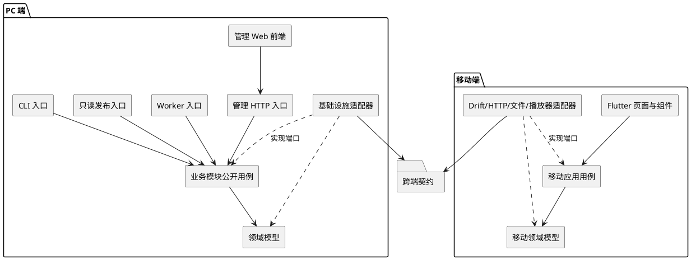
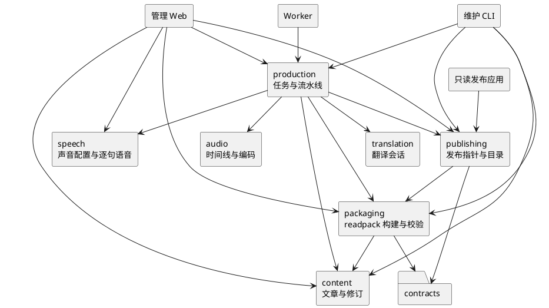
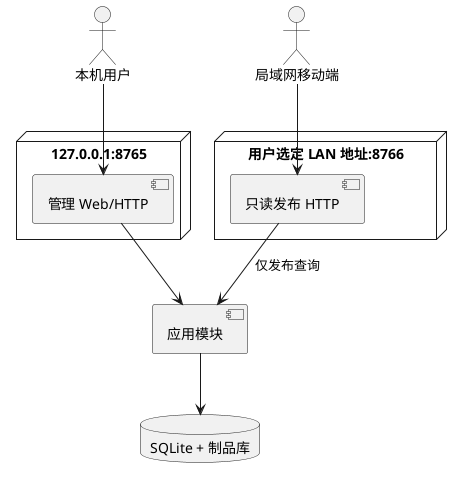
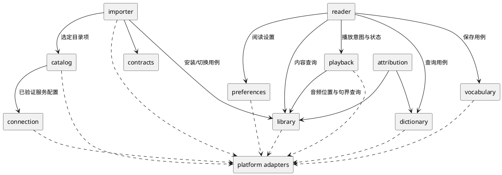
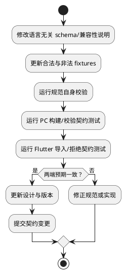

# Engirdle MVP 前后端模块与目录架构

> 文档状态：架构设计基线候选<br>
> 更新时间：2026-08-07<br>
> 需求基线：[mvp_prd.md](./mvp_prd.md)<br>
> 技术基线：[mvp_design.md](./mvp_design.md)<br>
> 风险与验证：[mvp_feasibility.md](./mvp_feasibility.md)

## 1. 文档目标

本文把 MVP 技术设计进一步落实为可直接开始实现的前后端模块边界和单仓库目录结构，主要回答：

- PC 内容生产端的管理前端、业务后端、后台 Worker 和局域网发布端如何拆分；
- Flutter Android 应用如何按业务能力拆分，避免界面、数据库、播放器和导入逻辑互相渗透；
- `.readpack`、目录协议、JSON Schema 和黄金包如何成为跨端唯一契约；
- 源码目录、运行时数据目录和本机调研目录如何隔离；
- 测试、依赖和后续演进应遵守哪些边界。

本文只规定代码组织与模块依赖，不替代 `mvp_design.md` 中的状态机、协议字段、存储事务和安全校验规则。两者发生冲突时，以 `mvp_design.md` 为准；是否属于 MVP 则以 `mvp_prd.md` 为准。

## 2. 总体架构决策

### 2.1 单仓库、两个应用、一个契约源

工程采用单仓库管理：

- `apps/pc`：Python 模块化单体，包含本机管理 Web、业务模块、单一 Worker、CLI 和只读发布应用；
- `apps/mobile`：Flutter 应用，MVP 只验收 Android；
- `contracts`：语言无关的跨端协议、JSON Schema 和黄金测试制品；
- `tools`：只在开发或资源构建时运行的工具，不被生产应用反向依赖；
- `.scratch`：当前候选设计及验证记录，不进入任何运行时导入路径。

PC 端不拆成多个可独立部署的微服务。管理 Web、Worker 和只读发布端可以作为不同进程启动，但复用同一组领域与应用模块，并访问同一个 SQLite 元数据库和受控文件制品库。

### 2.2 先按业务模块拆分，再在模块内分层

顶层不采用全局 `controllers/services/repositories/models` 的纯技术分层。代码先按内容、生产任务、翻译、语音、音频、打包和发布等业务能力拆分，再在模块内按需要划分：

- `domain`：实体、值对象、领域规则和状态转换；
- `application`：用例、命令、查询、端口和事务边界；
- `infrastructure`：SQLite、文件系统、DeepSeek、Qwen3-TTS、FFmpeg、HTTP 等适配器；
- `presentation` 或 `entrypoints`：HTTP、HTML、Flutter Widget、CLI 和进程入口。

小模块不需要为了形式创建空目录；当一个模块同时出现领域规则、用例和外部适配时，再按以上层次展开。

### 2.3 依赖方向



必须遵守以下规则：

1. 领域层不依赖 FastAPI、Pydantic、SQLAlchemy/SQLite 客户端、Qwen3-TTS、Flutter、Drift 或具体播放器库。
2. 应用层依赖领域层和抽象端口，不直接操作 HTTP 请求、Widget、SQL 行或文件路径字符串。
3. 基础设施层实现应用层定义的端口；进程装配由组合根完成，不在业务模块中创建全局单例。
4. 入口层只调用模块公开的命令、查询或 facade，不跨过应用层读取数据库表。
5. 跨业务模块只能依赖对方公开接口和稳定 DTO，不导入对方的 `infrastructure`、ORM/Drift 表或私有实现。
6. PC 与移动端不共享运行时代码或数据库，只共享 `contracts` 中的语言无关协议和测试制品。

## 3. 目标仓库目录

以下是 MVP 目标目录。目录按纵向切片逐步创建，不要求在第一次提交中建立全部空目录。

```text
engirdle/
├── apps/
│   ├── pc/
│   │   ├── pyproject.toml
│   │   ├── README.md
│   │   ├── src/
│   │   │   └── engirdle_pc/
│   │   │       ├── bootstrap/
│   │   │       ├── shared/
│   │   │       ├── modules/
│   │   │       │   ├── content/
│   │   │       │   ├── production/
│   │   │       │   ├── translation/
│   │   │       │   ├── speech/
│   │   │       │   ├── audio/
│   │   │       │   ├── packaging/
│   │   │       │   └── publishing/
│   │   │       └── entrypoints/
│   │   │           ├── admin_web/
│   │   │           ├── worker/
│   │   │           ├── publisher/
│   │   │           └── cli/
│   │   └── tests/
│   │       ├── unit/
│   │       ├── integration/
│   │       ├── contract/
│   │       └── entrypoints/
│   └── mobile/
│       ├── pubspec.yaml
│       ├── analysis_options.yaml
│       ├── android/
│       ├── assets/
│       ├── lib/
│       │   ├── app/
│       │   ├── shared_kernel/
│       │   ├── platform/
│       │   ├── contracts/
│       │   └── features/
│       │       ├── connection/
│       │       ├── catalog/
│       │       ├── importer/
│       │       ├── library/
│       │       ├── reader/
│       │       ├── playback/
│       │       ├── dictionary/
│       │       ├── vocabulary/
│       │       ├── preferences/
│       │       └── attribution/
│       ├── test/
│       └── integration_test/
├── contracts/
│   ├── README.md
│   ├── readpack/v1/
│   │   ├── schema/
│   │   ├── examples/
│   │   └── fixtures/
│   └── catalog/v1/
│       ├── schema/
│       ├── examples/
│       └── fixtures/
├── tools/
│   ├── contract_checks/
│   └── dictionary_builder/
├── tests/
│   └── acceptance/
├── .scratch/
├── .editorconfig
├── .gitignore
└── README.md
```

目录含义：

| 目录 | 职责 | 不应放入 |
|---|---|---|
| `apps/pc` | PC 生产端的可安装 Python 应用、管理界面和测试 | 模型权重、用户文章、生成音频、运行数据库 |
| `apps/mobile` | Flutter 客户端源码、Android 工程壳和移动测试 | 下载后的文章包、正式词典数据库、用户生词 |
| `contracts` | 跨端协议的唯一规范源和共享黄金制品 | PC 或 Flutter 私有业务模型、运行配置、秘密 |
| `tools` | 契约检查、词典资源构建等开发期工具 | 管理 Web 或移动端运行所必需的服务代码 |
| `tests/acceptance` | 跨应用黑盒测试和发布演练脚本 | 某一应用内部的单元测试 |
| `.scratch` | 候选设计、原型和本机验证记录 | 可被生产代码导入的模块、运行时必需资源 |

## 4. PC 端模块划分

### 4.1 模块关系



`production` 是流水线编排者，但不拥有其他模块的领域数据。它通过公开用例推进各阶段，并把阶段结果保存为 checkpoint；翻译、语音、音频或打包模块不得反向调用 `production` 推进任务状态。

### 4.2 业务模块职责

| 模块 | 拥有的数据与规则 | 对外提供的主要能力 | 明确不负责 |
|---|---|---|---|
| `content` | `Article`、不可变 `ArticleRevision`、`Block`、`Sentence`、来源与许可、结构哈希、修订状态 | 录入文章、规范化、生成候选结构、人工编辑、冻结修订、读取已确认快照 | 远程翻译、TTS、音频编码、发布 |
| `production` | `BuildJob`、阶段、租约、尝试次数、配置快照、checkpoint、结构化失败 | 创建/领取/续租/恢复任务，按顺序编排生成阶段，进入人工审阅和成功状态 | 实现 DeepSeek/Qwen/FFmpeg 细节，直接修改文章结构 |
| `translation` | 逻辑会话、已接受历史、逐块结果、人工修正、请求元数据和提示词版本 | 建立完整原文上下文、顺序翻译块、严格校验 ID、从 checkpoint 恢复 | 结构调整、上下文压缩、模型降级、记录推理内容 |
| `speech` | `VoiceProfile` 修订、锚点元数据、clone prompt 生命周期、逐句 PCM 缓存元数据 | CustomVoice 候选与确认、Base prompt 创建、按句生成/重试/缓存 | 拼接文章时间线、AAC 编码、把 `.tts` 当运行依赖 |
| `audio` | PCM 格式规则、停顿策略、样本时间线、响度/峰值和编码元数据 | 校验/统一 PCM、插入停顿、计算样本与毫秒边界、调用 FFmpeg 编码和探测 | 决定文章句界、管理声音配置、发布包 |
| `packaging` | `PackageArtifact`、`artifact_revision`、包内文件清单、哈希和校验报告 | 从确认内容和音频构建/重开校验不可变 `.readpack` | 切换当前发布指针、暴露 HTTP 路由 |
| `publishing` | 当前已发布映射、目录版本、绑定状态和发布审计信息 | 原子切换当前制品、生成 `catalog.json`、按不透明包名解析固定文件 | 构建或修改 readpack、提供管理写接口、接受任意文件路径 |

模块公开接口优先使用具有明确字段的 `dataclass` 或 Pydantic `BaseModel`。领域内部使用 `dataclass`、枚举和值对象；Pydantic 主要用于 HTTP、配置、模型响应和 JSON 协议等系统边界。不得以三元以上 tuple 或无约束 `dict` 作为模块间业务接口。

### 4.3 PC 包内目录

单个业务模块采用以下推荐结构；文件较少时可以合并，但依赖方向不变：

```text
modules/content/
├── __init__.py
├── public.py
├── domain/
│   ├── entities.py
│   ├── value_objects.py
│   ├── policies.py
│   └── errors.py
├── application/
│   ├── commands.py
│   ├── queries.py
│   ├── services.py
│   └── ports.py
└── infrastructure/
    ├── sqlite_repository.py
    ├── file_source_store.py
    └── segmenter_adapter.py
```

- `public.py` 是其他模块可导入的稳定门面，只重新导出必要命令、查询、DTO 和错误；
- `domain` 不认识数据库主键、HTTP 状态码和磁盘绝对路径；
- `application/ports.py` 中的端口由使用方定义，具体实现放在 `infrastructure`；
- 仓储返回领域对象或明确的查询 DTO，不向上返回 SQLite row、ORM 对象或任意字典；
- 文件路径使用 `pathlib.Path`，路径解析集中在受控存储适配器中。

`shared` 只允许容纳真正跨模块且语义稳定的最小能力：

```text
shared/
├── domain/
│   ├── identifiers.py
│   ├── clocks.py
│   └── errors.py
├── application/
│   ├── transactions.py
│   └── pagination.py
└── infrastructure/
    ├── database/
    │   ├── connection.py
    │   └── migrations/
    ├── workspace.py
    ├── hashing.py
    └── observability.py
```

不得把难以归属的业务逻辑放进 `shared/utils.py`。若一个能力只有一个业务模块使用，应留在该模块；若需要跨模块复用，应先判断它是稳定共享概念，还是应由原模块通过公开接口提供。

### 4.4 数据所有权与迁移

PC 各模块共享一个 SQLite 文件，但逻辑上拥有各自的数据：

| 模块 | 逻辑表/记录所有权 |
|---|---|
| `content` | 文章、文章修订、块、句子、来源与结构确认 |
| `production` | 构建任务、租约、阶段 checkpoint、任务配置快照 |
| `translation` | 翻译会话、已接受块结果、人工译文修正、请求元数据 |
| `speech` | 声音配置修订、锚点记录、句级 PCM 缓存索引 |
| `packaging` | 包制品、包文件校验结果、artifact revision |
| `publishing` | 当前发布指针、目录版本和发布审计记录 |

迁移脚本集中在 `shared/infrastructure/database/migrations`，以保证一个数据库只有一条有序迁移链；迁移文件名带模块前缀。模块只能通过自身仓储修改所属表，跨模块查询通过公开查询接口完成。`audio` 的大文件和中间结果保存在工作区，不进入 SQLite BLOB。

### 4.5 组合根和进程入口

```text
bootstrap/
├── config.py
├── container.py
├── logging.py
└── lifecycle.py

entrypoints/
├── admin_web/
│   ├── app.py
│   ├── routes/
│   ├── view_models/
│   ├── templates/
│   └── static/
├── worker/
│   └── main.py
├── publisher/
│   └── app.py
└── cli/
    └── main.py
```

- `bootstrap/config.py` 使用 Pydantic Settings 或等价的强类型配置，负责解析数据目录、模型目录、监听地址和 DeepSeek 配置；API Key 不进入普通配置持久化。
- `bootstrap/container.py` 是唯一装配仓储、适配器和应用服务的组合根。
- `admin_web/app.py` 只绑定回环地址对应的管理应用工厂。
- `publisher/app.py` 构建独立 ASGI 应用，只注册 `GET/HEAD catalog` 和固定包路由；不导入管理 routes。
- `worker/main.py` 启动单 Worker 领取循环和租约恢复，不启动 HTTP 管理界面。
- `cli/main.py` 提供迁移、契约检查、内容库一致性检查等明确命令；常规日志使用标准库 `logging`，面向用户的命令结果可以输出到终端。

## 5. PC 管理前端划分

### 5.1 技术边界

MVP 使用 FastAPI 服务端渲染的最小管理界面，与管理 HTTP 入口一同打包，但在逻辑上仍属于前端 presentation 层。默认不建立独立 SPA、Node 服务或第二套前端 DTO。

页面提交命令后采用 Post/Redirect/Get 或等价流程；长任务通过轮询任务查询获取状态，不让 HTTP 请求持续等待模型推理。JavaScript 只用于分句编辑、局部刷新、音频试听等确有交互需要的行为，并按页面模块组织为小型 ES module。

### 5.2 页面模块

| 页面模块 | 主要页面/组件 | 调用的后端能力 |
|---|---|---|
| `dashboard` | 环境状态、待处理任务、最近失败和已发布摘要 | 只读聚合查询，不直接拼 SQL |
| `articles` | 文章库、录入、来源与许可、删除确认 | `content` 命令与查询 |
| `structure_editor` | 块/句列表、合并、拆分、编辑、排序、结构确认 | `content` 结构编辑与冻结命令 |
| `production_jobs` | 创建/重建、阶段、心跳、重试和错误详情 | `production` 命令与查询 |
| `translation_review` | 模型译文、人工修正、缺失/异常提示 | `translation` 审阅与修正用例 |
| `audio_review` | 句级抽听、异常时长和编码检查 | `speech`、`audio`、`packaging` 查询 |
| `voice_profiles` | CustomVoice 参数、候选试听、确认和修订历史 | `speech` 声音配置用例 |
| `publishing` | 制品详情、发布切换、LAN 服务状态和风险提示 | `packaging`、`publishing` 用例 |
| `settings_diagnostics` | 模型路径检查、DeepSeek 可用性、工作区和一致性检查 | 配置查询与维护用例，不展示秘密值 |

推荐的前端资源目录：

```text
entrypoints/admin_web/
├── routes/
│   ├── dashboard.py
│   ├── articles.py
│   ├── production.py
│   ├── voices.py
│   └── publishing.py
├── view_models/
├── templates/
│   ├── layouts/
│   ├── components/
│   └── pages/
│       ├── dashboard/
│       ├── articles/
│       ├── production/
│       ├── voices/
│       └── publishing/
└── static/
    ├── css/
    └── js/
        ├── structure_editor.js
        ├── job_status.js
        └── audio_review.js
```

模板只接收为显示准备的 view model，不接收领域实体、数据库对象或包含 API Key 的配置对象。路由负责把 HTTP 输入转换为命令 DTO、把已知业务错误转换为用户可理解的页面错误；业务规则留在应用/领域层。

### 5.3 管理 API 与发布 API 隔离



两个应用工厂、路由表和监听配置必须分离。不得通过“在发布端隐藏按钮”代替后端路由隔离；发布进程的依赖容器也不装配文章编辑、任务写入、模型调用或任意文件浏览能力。

## 6. Flutter Android 端模块划分

### 6.1 应用结构

```text
lib/
├── app/
│   ├── app.dart
│   ├── bootstrap.dart
│   ├── dependencies.dart
│   ├── router.dart
│   └── theme.dart
├── shared_kernel/
│   ├── content_identity.dart
│   ├── failures.dart
│   └── result.dart
├── platform/
│   ├── database/
│   ├── filesystem/
│   ├── http/
│   ├── logging/
│   └── permissions/
├── contracts/
│   ├── readpack_v1/
│   └── catalog_v1/
└── features/
    └── <feature>/
        ├── domain/
        ├── application/
        ├── infrastructure/
        └── presentation/
```

- `app` 只负责启动、路由、主题和依赖装配；
- `shared_kernel` 仅保存跨 feature 必须共享且稳定的内容身份、失败类型等小型概念；
- `platform` 封装应用数据库连接、文件系统根目录、HTTP 客户端、权限和日志等平台能力，不包含文章导入或词典查询业务流程；
- `contracts` 是对根目录语言无关协议的 Dart 映射与运行时校验器，不能自行扩展协议语义；
- `features` 按用户能力组织页面、用例、领域规则和实现。

### 6.2 Feature 职责

| Feature | 领域与用例 | 主要界面 | 明确不负责 |
|---|---|---|---|
| `connection` | 服务 URL 规范化、局域网 HTTP 策略、验证与保存 | 首次连接、连接设置、权限/连接错误 | 解析目录、下载包、读取文章 |
| `catalog` | 获取目录、比较本机与远端 revision、展示可下载状态 | 目录列表、刷新与离线错误态 | 解压或安装 readpack |
| `importer` | 临时下载、外层哈希、ZIP 预检、流式解压、schema/引用校验、可恢复导入日志、原子切换 | 下载进度、导入步骤、失败与重试 | 阅读渲染、自动删除生词 |
| `library` | 已安装文章索引、当前制品指针、文章内容查询和安全删除 | 书架、文章详情、删除确认 | 联网目录获取、播放器状态 |
| `reader` | 块/句渲染、三种译文模式、句译展开、单句选择入口 | 阅读器与排版 | 移动端重新分句、直接控制播放器插件 |
| `playback` | 单播放器会话、句级 clip、连续播放、session token 和状态转换 | 句旁播放按钮、底部控制条 | 读取 ZIP、维护多个播放器实例 |
| `dictionary` | 独立词典资源版本、短语/规范形式/lemma 查询和候选排序 | 查词面板、词典资源状态 | 自动上下文消歧、修改生词数据 |
| `vocabulary` | 保存选定义项和不可变上下文快照、列表与删除 | 保存生词、生词本 | 依赖文章文件持续存在、安排复习 |
| `preferences` | 阅读模式、字体、字号、行高、边距和预设主题 | 排版设置 | 修改文章内容或包内元数据 |
| `attribution` | 展示文章、包、模型、声音和词典归属 | 归属与资源页面 | 推断或补写未知许可信息 |

`importer` 可以调用 `library` 的“安装新制品/切换当前指针”公开用例，但不能直接修改 `library` 私有 Drift DAO。`reader` 通过 `library` 查询结构化内容，通过 `playback` facade 发出播放意图，通过 `dictionary` 和 `vocabulary` 的公开用例完成查词与保存；它不直接依赖这些 feature 的 infrastructure。

### 6.3 移动端依赖关系



图中的箭头表示对公开应用接口的依赖，不表示可以导入目标 feature 的 Widget、DAO 或插件对象。若未来出现循环依赖，应提取稳定的小型值对象到 `shared_kernel`，或通过应用事件/组合层协调，不能通过互相暴露 infrastructure 解决。

### 6.4 Flutter feature 内部示例

```text
features/playback/
├── domain/
│   ├── playback_mode.dart
│   ├── playback_session.dart
│   └── playback_state.dart
├── application/
│   ├── playback_controller.dart
│   ├── playback_port.dart
│   └── playback_view_state.dart
├── infrastructure/
│   └── just_audio_player_adapter.dart
└── presentation/
    ├── playback_bar.dart
    └── sentence_play_button.dart
```

播放器插件类型只出现在 infrastructure。`playback_controller` 持有单一会话状态和 session token；Widget 订阅不可变的 view state，不直接调用 `seek`、`setClip` 或监听插件事件。

### 6.5 移动数据所有权

| Feature/组件 | `app.db` 中的逻辑所有权或文件所有权 |
|---|---|
| `connection` | 服务配置和最近验证结果 |
| `importer` | 导入操作、恢复状态、staging/moving/committed 日志 |
| `library` | 已安装文章、块、句子、当前制品指针和文章私有文件目录 |
| `vocabulary` | 生词、选定义项、文章/修订/句子引用和上下文快照 |
| `preferences` | 全局及文章级阅读设置 |
| `dictionary` | 词典 manifest；独立词典 SQLite 只读文件不并入 `app.db` 迁移 |
| `playback` | 不持久化插件状态；MVP 不保存播放进度 |

Drift 数据库定义和迁移入口集中在 `platform/database`，各 feature 通过所属 DAO/repository 访问自己的表。导入事务需要同时写多组文章表时，由 `library` 暴露一个原子安装用例；`importer` 负责流程与恢复日志，不拥有文章内容表。

## 7. 跨端契约目录

### 7.1 目录设计

```text
contracts/
├── README.md
├── readpack/v1/
│   ├── schema/
│   │   ├── manifest.schema.json
│   │   ├── article.schema.json
│   │   └── attribution.schema.json
│   ├── examples/
│   │   └── minimal/
│   └── fixtures/
│       ├── valid/
│       │   └── minimal.readpack
│       └── invalid/
│           ├── missing-file.readpack
│           ├── wrong-hash.readpack
│           └── duplicate-path.readpack
└── catalog/v1/
    ├── schema/
    │   └── catalog.schema.json
    ├── examples/
    └── fixtures/
```

根目录 schema 和黄金制品是唯一规范源：

- PC 的 Pydantic 模型和 Flutter 的 Dart 模型可以手写或生成，但必须通过同一组 schema 和 fixtures；
- 生成代码保存在各应用自己的 `contracts` 映射目录，并标注生成来源，不反向提交到规范目录；
- 修改 schema 时必须同时更新兼容性说明、合法/非法样本和两端契约测试；
- fixture 保持最小，不提交真实文章、真实 API 响应、模型权重、锚点音频或秘密；
- 恶意 ZIP 测试包只包含验证安全规则所需的最小字节，避免把大型压缩炸弹提交到仓库。

### 7.2 契约变更流程



不得先修改某一端实现，再让另一端“兼容实际行为”。所有兼容性语义先在 `contracts` 和 `mvp_design.md` 中明确。

## 8. 源码目录与运行时目录隔离

仓库目录只保存源码、最小测试资源和文档。PC 运行时工作区沿用 `mvp_design.md` 的布局，并由强类型配置指定到仓库外的用户数据目录：

```text
workspace/
├── app.db
├── source/{article_id}/{revision}/
├── working/{job_id}/
├── cache/tts/
├── voices/{voice_profile_id}/{revision}/
├── artifacts/{article_id}/{revision}/{artifact_revision}/
└── public/
    ├── catalog.json
    └── packages/
```

移动端数据只位于应用私有目录：

```text
app-private-data/
├── app.db
├── dictionaries/{dictionary_id}/{revision}/dictionary.db
├── articles/{article_id}/{revision}/{artifact_revision}/
└── staging/{import_id}/
```

隔离规则：

1. 仓库根目录 `.tts/` 继续整体忽略，只可作为本机调研参考；任何 `apps`、`contracts`、`tools` 或测试代码不得导入、硬编码或运行时回退读取该目录。
2. Qwen3-TTS 检查点放在用户配置的仓库外模型根目录，不进入 Python wheel、Flutter APK、readpack 或测试 fixture。
3. 默认开发配置也不得把正式 workspace 建在源码包内部；若为测试创建临时工作区，使用测试框架临时目录并在测试后清理。
4. `working`、缓存和 staging 可恢复或清理；`artifacts`、已确认声音配置和当前移动制品按不可变规则管理。
5. 所有受控路径由 ID 和 `pathlib`/平台路径 API 构造，外部输入不能直接成为文件系统路径。

## 9. 测试目录与边界

### 9.1 PC 测试

```text
apps/pc/tests/
├── unit/
│   └── modules/<module>/
├── integration/
│   ├── sqlite/
│   ├── filesystem/
│   ├── ffmpeg/
│   └── adapters/
├── contract/
│   ├── readpack/
│   └── catalog/
└── entrypoints/
    ├── admin_web/
    ├── worker/
    └── publisher/
```

- 单元测试使用 fake 端口，不加载真实 DeepSeek、Qwen3-TTS 或 `.tts`；
- DeepSeek 和 Qwen 适配器测试使用脱敏录制、最小 fixture 或本地 fake；
- 发布入口测试以允许路由列表为基线，证明 LAN 端不存在管理写路由；
- 契约测试直接读取根 `contracts` 的 schema 和黄金包。

### 9.2 Flutter 测试

```text
apps/mobile/test/
├── unit/features/<feature>/
├── widget/features/<feature>/
├── contract/
└── fixtures/

apps/mobile/integration_test/
├── import_recovery_test.dart
├── offline_reading_test.dart
├── playback_boundaries_test.dart
└── text_selection_test.dart
```

- feature 单元测试覆盖 URL 策略、版本比较、导入状态机、播放 session token、词典查询顺序和生词快照；
- Widget 测试覆盖三种译文模式、错误态、删除确认和排版设置；
- 根契约 fixtures 不复制出另一套可手工修改的样本；测试通过仓库相对测试配置或构建步骤读取它们；
- 音频 seek、Android 权限和选词菜单必须在代表设备上运行集成/人工测试，不能只以 Dart 单元测试替代。

### 9.3 跨端验收

`tests/acceptance` 只保留跨进程黑盒场景：

- PC 生成 readpack，Flutter 导入并离线读取；
- PC 发布新 artifact revision，移动端识别、导入并原子切换；
- 在生成、下载、解压和提交处注入失败，旧版本仍可用；
- 临时移走 `.tts` 后执行 PC 安装、测试、构建和制品清单检查；
- 从 LAN 访问发布端只能命中目录与已发布包，无法访问管理能力。

## 10. 工程依赖和配置规则

### 10.1 Python

- `apps/pc/pyproject.toml` 是 PC 应用依赖、测试和打包的唯一入口，采用 `src` layout 防止测试误导入工作目录代码；
- 生产依赖与开发/测试依赖分组并锁定精确解析结果；真实模型权重不作为 Python 包资源；
- 领域数据优先使用 `dataclass`，边界校验使用 Pydantic；结构化跨模块参数不用任意字典；
- 常规日志使用标准库 `logging`，通过上下文适配器附加 `job_id`、`article_id`、`revision` 和阶段；
- 数据库事务、时钟、ID 生成、文件存储、远程 API、模型和编码器都通过可替换端口注入，以支持故障测试。

### 10.2 Flutter

- 第三方 HTTP、ZIP、Drift 和播放器类型只出现在 platform/infrastructure；presentation 不直接持有数据库或插件对象；
- 状态管理方案由阶段 0 原型后锁定，但 feature 对外暴露用例和不可变 view state，不把状态管理库当作领域接口；
- `pubspec.yaml` 锁定实际依赖解析结果，Android 明文流量和局域网权限配置保持最小范围；
- `android/` 只放平台声明、权限和必要桥接，不复制 Dart 业务逻辑。

### 10.3 配置和秘密

配置分为：

- 应用启动配置：监听地址、数据目录、模型目录、资源上限；
- 用户偏好：PC 页面设置或移动阅读设置；
- 构建配置快照：模型、提示词、声音、编码和流水线版本；
- 秘密：DeepSeek API Key，只从本机秘密存储或环境注入。

四类配置使用不同模型和存储边界。任何包含秘密的对象不得传给模板、普通日志、数据库普通字段、catalog、readpack 或 Flutter 应用。

## 11. 分阶段落地顺序

目录和模块按纵向闭环建立：

1. **工程骨架**：建立 `apps/pc`、`apps/mobile`、`contracts` 和基础质量检查；PC 与 Flutter 均可在没有 `.tts` 时安装、测试和构建。
2. **G1 协议切片**：先完成 `contracts`、PC `packaging/publishing` 的固定制品能力，以及移动 `connection/catalog/importer/library/reader` 的最小闭环。
3. **G2 移动高风险交互**：完成 `playback`、`dictionary` 查询接口原型、阅读选词和代表设备验证；暂不构建完整词典数据。
4. **G3 生产流水线**：依次完成 PC `content`、`production`、`translation`、`speech`、`audio` 和对应管理页面，以固定端口 fake 保持每一步可测试。
5. **G4 词典与生词**：在授权和资源格式冻结后完成 `tools/dictionary_builder`、移动 `dictionary/vocabulary/attribution`。
6. **G5 发布演练**：补齐跨端失败注入、恶意包、长文、许可归属、无 `.tts` 构建和全链路验收。

每一步优先交付一个可运行纵向结果，不要求先完成所有领域抽象或基础设施封装。

## 12. 架构守则与演进触发条件

### 12.1 MVP 必须守住的边界

- 管理端、Worker 和发布端可以分进程，但业务代码只有一套模块化单体实现；
- 发布端只读且与管理路由物理分离；
- PC 和移动端只通过版本化 catalog/readpack 契约通信；
- 模型、词典、HTTP、ZIP、数据库和播放器都在适配器边界后；
- 已发布制品、文章修订、声音配置修订和移动正式文章目录不可原地修改；
- 大文件留在受控文件系统，SQLite 只保存元数据、索引和状态；
- `.tts`、本机 workspace、模型目录和用户内容都不属于源码树。

### 12.2 需要新技术决策记录的变化

以下变化不得只靠新增目录或依赖完成，应先形成 ADR 并同步更新 PRD/技术设计：

- 管理界面改为独立 SPA 或新增公共 API；
- 单 Worker 改为并行 Worker，或 SQLite 改为服务型数据库；
- 发布面从受信任 LAN 扩展到公网、鉴权或多用户；
- readpack 主版本、必需文件、ID 规则或签名模型变化；
- 移动端引入后台播放、跨设备同步或 iOS 正式验收；
- 更换 MVP 固定翻译/TTS 模型或改变完整上下文质量策略；
- 词典从独立资源变成文章包必需依赖。

## 13. 完成判定

该目录架构落实后，应能通过以下检查：

- 任一 PC 业务模块可在不启动 FastAPI、Worker 或真实模型的情况下运行领域/应用单元测试；
- 发布应用的导入图中不存在管理 routes、模型调用和文章写入用例；
- Flutter feature 的 presentation 不导入 Drift table、HTTP/ZIP 或具体播放器类型；
- PC 和 Flutter 对根 `contracts` 中相同的合法/非法样本给出一致结论；
- 删除或临时移走 `.tts` 后，源码导入、安装、测试和构建不受影响；
- 仓库构建产物不包含运行数据库、用户文章、生成音频、模型权重、API Key 或正式词典资源。
