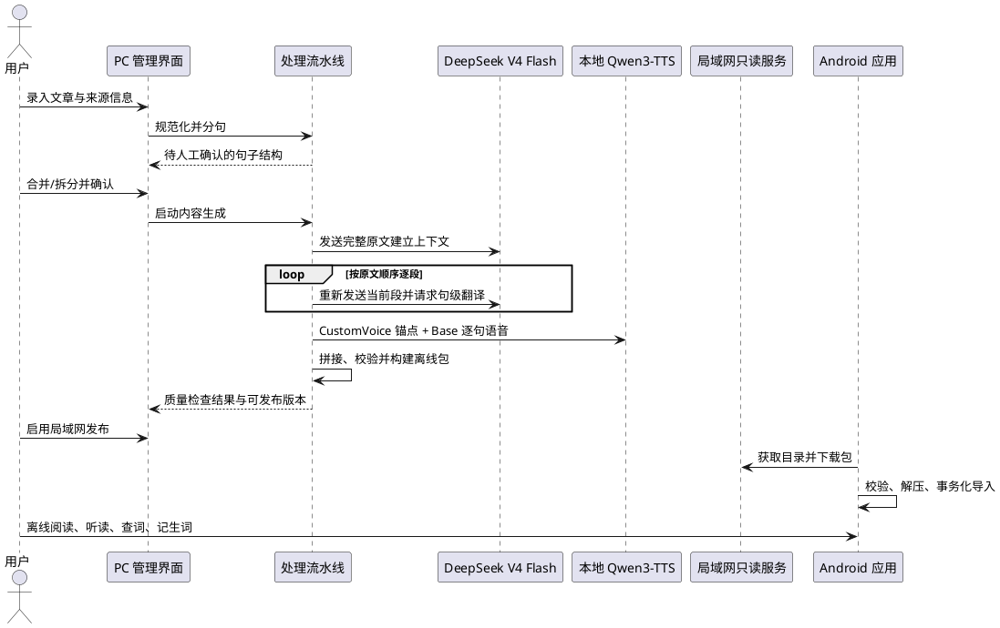

# Engirdle MVP 产品需求文档

> 文档状态：MVP 需求基线候选  
> 更新时间：2026-08-07  
> 首发平台：PC 内容生产端 + Android 移动端  
> 相关文档：[产品目的](../purpose.md) · [MVP 设计](./mvp_design.md) · [可行性评估](./mvp_feasibility.md)

## 1. 文档目标

本文定义 MVP 必须解决的用户问题、功能范围、产品规则和发布验收条件。实现方式以 [mvp_design.md](./mvp_design.md) 为准；本文未列入的后续候选不构成 MVP 承诺。

文中关键词含义如下：

- 必须：MVP 发布条件；
- 应：有充分理由才可偏离，偏离时需要记录决策；
- 可以：不影响 MVP 验收的实现选择。

## 2. MVP 边界与假设

### 2.1 产品边界

| 维度 | MVP 定义 |
|---|---|
| 用户 | 单用户，不含账号和多租户 |
| PC 端 | 一台个人 PC，通过仅本机可访问的管理界面生产内容 |
| 移动端 | Android 首发；Flutter 方案可为 iOS 复用代码，但 iOS 不属于本次验收 |
| 网络 | PC 翻译固定通过 API Key 调用 DeepSeek V4 Flash；TTS 在 PC 本地运行；移动端导入后完全离线使用 |
| 发布 | 用户显式开启受信任局域网内的无鉴权只读服务 |
| 内容语言 | 英文原文、简体中文翻译 |
| 输入 | 手工录入纯文本或已清理的 Markdown，不做网页正文抽取 |
| 使用权 | 用户负责确认文章及生成内容的使用权；系统记录来源与许可状态 |

### 2.2 前置假设

- PC 有足够磁盘空间保存模型、PCM 中间文件和离线包；具体硬件尚待登记和基准测试。
- PC 能访问 DeepSeek 官方 API，并由用户提供有效 API Key；完整文章正文会发送给 DeepSeek。
- MVP 假设 DeepSeek V4 Flash 的上下文窗口远大于目标文章及累计翻译会话，不实现上下文滑窗、摘要压缩或截断。
- PC 本地可部署 `Qwen3-TTS-12Hz-1.7B-CustomVoice` 与 `Qwen3-TTS-12Hz-1.7B-Base`。
- 用户接受内容生产为异步批处理，不要求实时反馈。
- PC 与手机可在短时间内处于同一受信任局域网。
- 首个版本允许手工检查分句和抽听语音，不追求全自动质量保证。
- 离线词典以独立版本化资源安装，不随每篇文章重复打包。

## 3. MVP 成功条件

MVP 同时满足以下条件才视为完成：

1. 用户能从本机管理界面录入文章并完成人工分句确认。
2. PC 能生成 ID 完整对应的中文句译和英文句级语音，并构建通过校验的离线包。
3. Android 设备能从局域网目录下载、校验、原子导入并替换文章修订版本。
4. 网络关闭后，用户仍可阅读、查看翻译、播放、查词和管理生词。
5. 单句播放不会明显截断当前句或泄漏相邻句语音，连续播放可从任意句子开始。
6. 失败的处理、下载或导入不会破坏上一个可用文章版本，也不会删除既有生词。
7. 包、模型、提示词、词典和文章来源具有可检查的版本与归属信息。

## 4. 核心用户流程

## 5. PC 端功能需求

### 5.1 文章录入与结构化

| ID | 需求 | 验收要点 |
|---|---|---|
| PC-ING-001 | 必须录入标题和正文；可以录入作者、来源 URL、来源名称和许可说明 | 标题与非空正文校验；未知归属显式标记为 `unknown` |
| PC-ING-002 | 必须保存原始输入与规范化结果 | 后续处理不得覆盖原始输入；两者均可追溯哈希 |
| PC-STR-001 | 必须识别自然段，并在段内执行英文分句 | 不跨段合并句子；空段和异常字符有明确处理结果 |
| PC-STR-002 | 必须允许用户在本机管理界面合并、拆分、编辑和重新排序句子 | 保存前展示最终结构；已发布修订不可被原地修改 |
| PC-STR-003 | 必须为文章、修订、段落和句子分配稳定标识 | 同一修订内唯一；外部协议不依赖连续编号 |
| PC-STR-004 | 修改已发布文章的正文或句界时必须创建新修订 | 旧包仍可追溯；不得静默复用旧句子映射 |

MVP 对 Markdown 只保证标题之外的普通段落、列表项和引用块能够转为结构化文本；不保证表格、脚注、图片、嵌入 HTML 或复杂样式。

### 5.2 翻译

| ID | 需求 | 验收要点 |
|---|---|---|
| PC-TRN-001 | 必须使用 API Key 调用 DeepSeek 官方 API 的 `deepseek-v4-flash` | 不静默切换旧别名、其他模型或本地翻译；认证、模型不可用和余额问题明确失败 |
| PC-TRN-002 | 翻译任何段落前，必须先在文章专属逻辑会话中发送一次完整已确认原文 | 上下文消息包含标题、全部块、句子 ID 和正文；模型仅确认已读取，不在该轮保存译文 |
| PC-TRN-003 | 必须按原文顺序逐段重新发送段落并请求句级简体中文翻译 | 每轮保留完整原文及此前已接受的会话历史；请求只覆盖当前段落 |
| PC-TRN-004 | 必须要求结构化输出并严格校验句子 ID | 当前段落的返回 ID 集合与输入完全相同，不允许遗漏、重复、额外 ID 或自由文本 |
| PC-TRN-005 | 必须支持从最后一个已接受会话状态只重试失败段落 | 无效回答不进入后续上下文；成功段落结果与历史可复用和追溯 |
| PC-TRN-006 | MVP 不得压缩、摘要、裁剪或滑动翻译上下文 | 每次请求发送完整消息历史；若提供方拒绝上下文长度，任务明确失败而不降级质量策略 |
| PC-TRN-007 | 必须记录端点、模型 ID、思考配置、提示词版本、请求 ID 和用量元数据 | API Key、正文和推理内容不得写入普通日志、manifest 或归属文件 |
| PC-TRN-008 | 必须允许人工查看并修正译文后再发布 | 修正结果与原始生成结果可区分 |

### 5.3 TTS 与音频

| ID | 需求 | 验收要点 |
|---|---|---|
| PC-TTS-001 | MVP 必须在 PC 本地使用 Qwen3-TTS 12Hz 1.7B 的 CustomVoice 与 Base 检查点 | 不调用远程 TTS，不提供模型切换 UI；运行时模型路径由应用配置，不能指向 `.tts` |
| PC-TTS-002 | 必须先使用 `Qwen3-TTS-12Hz-1.7B-CustomVoice` 试听并人工选定风格锚点 | 可调整英文 speaker、style instruct、锚点文本及生成参数并重复试听；用户明确确认后才可用于文章生成 |
| PC-TTS-003 | 必须把已选锚点保存为版本化声音配置 | 保存锚点 WAV、完全匹配的英文 transcript、speaker、instruct、模型修订、参数、seed 和音频哈希 |
| PC-TTS-004 | 必须使用 `Qwen3-TTS-12Hz-1.7B-Base` 从锚点音频与 transcript 创建一次可复用 voice-clone prompt | 不使用仅 x-vector 的降质模式；同一构建任务内所有句子复用同一 prompt |
| PC-TTS-005 | 必须通过 Base voice clone 按句生成统一格式的 PCM 中间结果 | 语言显式设为 English；单句失败可单独重试；句子 ID 与制品一一对应 |
| PC-TTS-006 | 必须拼接为单篇文章音频并记录句级开始、结束位置 | 时间边界基于最终时间线；开始含当前句，结束不含下一句 |
| PC-TTS-007 | 必须执行基础峰值/响度一致化和端侧编码 | 编码参数写入 manifest；不得以未压缩 WAV 作为默认端侧制品 |
| PC-TTS-008 | 发布前必须允许按句抽听，并显示缺失、零时长或异常时长检查结果 | 任何句子缺音频时不可发布；锚点和随机抽样句可回听 |

### 5.4 内容库、任务和发布

| ID | 需求 | 验收要点 |
|---|---|---|
| PC-LIB-001 | 必须展示文章、当前修订、处理状态、失败原因和已发布制品 | 进程重启后状态仍可恢复和判断 |
| PC-LIB-002 | 必须支持重建、重新发布和删除本地文章 | 删除前明确目标；已下载到移动端的内容不受远程删除影响 |
| PC-PKG-001 | 必须构建版本化 `.readpack` | 包通过 schema、引用、文件大小和哈希自检后才可发布 |
| PC-PKG-002 | 必须记录文章、流水线、模型、编码和归属元数据 | manifest 与 attribution 信息完整且机器可读 |
| PC-PUB-001 | 必须生成机器可读目录，包含文章 ID、修订、包大小、包哈希和下载地址 | 目录只列出已成功发布且文件存在的包 |
| PC-PUB-002 | 必须提供用户显式启停的局域网只读服务 | 不暴露上传、删除、管理、模型调用、任意文件访问或命令执行接口 |
| PC-PUB-003 | 管理界面必须只绑定回环地址 | 局域网地址无法访问管理功能 |

## 6. Android 端功能需求

### 6.1 连接、下载与导入

| ID | 需求 | 验收要点 |
|---|---|---|
| MOB-NET-001 | 必须配置、验证和保存一个 HTTP(S) 服务基础 URL | 无效 URL、连接拒绝、权限拒绝和超时给出可理解提示 |
| MOB-CAT-001 | 必须获取目录并区分未安装、已安装和有新制品的文章 | 同一文章更高 `revision` 或 `artifact_revision` 均视为更新；目录失败不影响本地内容使用 |
| MOB-DL-001 | 必须下载完整包到临时文件并核对大小和目录中的 SHA-256 | 中断后可清理并重试；校验失败不得进入导入 |
| MOB-IMP-001 | 必须检查格式版本、路径、条目数、展开大小、文件元数据和引用完整性 | 拒绝路径穿越、重复路径、链接、超限或未知必需结构 |
| MOB-IMP-002 | 必须在临时目录和数据库事务中导入 | 完全成功后才切换当前修订；失败保留旧版本 |
| MOB-IMP-003 | 新修订成功安装后必须清理不再使用的旧文章制品 | 清理不得影响生词中的上下文快照或仍被引用的文件 |

### 6.2 文章库与阅读器

| ID | 需求 | 验收要点 |
|---|---|---|
| MOB-LIB-001 | 必须展示已安装文章的标题、修订和可用状态，并允许删除 | 删除文章时提示生词保留策略 |
| MOB-READ-001 | 必须按包中结构渲染段落和句子，不得在移动端重新分句 | 句子交互与稳定 ID 绑定 |
| MOB-READ-002 | 必须支持仅英文、英中对照和仅中文三种显示模式 | 首次安装默认仅英文；模式选择可保存，切换不改变内容数据或播放位置 |
| MOB-READ-003 | 必须支持单句译文展开/收起 | 翻译手势不得与播放和选词冲突 |
| MOB-READ-004 | 必须支持并持久化字体、字号、行高、页面边距和预设明暗主题 | 预设主题保持可读对比度；MVP 不提供任意颜色选择器 |

### 6.3 播放

| ID | 需求 | 验收要点 |
|---|---|---|
| MOB-AUD-001 | 必须通过独立控件播放单句 | 从该句开始位置播放，在其结束边界停止，不明显播放下一句 |
| MOB-AUD-002 | 必须从任意句子或段落首句开始连续播放至文章结尾 | 播放起点准确，段落起点解析确定 |
| MOB-AUD-003 | 必须支持暂停、继续和停止当前播放 | 停止后状态清晰；新播放请求取代旧请求 |
| MOB-AUD-004 | 必须只维护一个受控播放器会话 | 单句与连续播放不会同时发声或争用状态 |

### 6.4 离线词典与生词本

| ID | 需求 | 验收要点 |
|---|---|---|
| MOB-DIC-001 | 必须允许用户在单个句子内选择单词或短语并打开离线查询 | 跨句选择不属于 MVP；自定义菜单可在目标 Android 版本工作 |
| MOB-DIC-002 | 查询必须依次尝试原样短语、规范化形式和 lemma | 清理首尾标点，但不静默改写句中内容 |
| MOB-DIC-003 | 必须优先显示英英释义，可以展开英中释义 | 无结果时明确提示；不伪造上下文词义 |
| MOB-DIC-004 | 词典必须作为独立、版本化、可归属的资源安装 | 无词典时文章其他功能仍可用 |
| MOB-VOC-001 | 必须保存表面形式、lemma、词性、选定义项、文章/修订/句子引用及原句快照 | 文章升级或删除后仍可查看当时上下文 |
| MOB-VOC-002 | 必须查看和删除生词记录 | MVP 不自动安排复习或修改熟练度 |

## 7. 跨端产品规则

### 7.1 标识与修订

- 文章由稳定 `article_id` 标识；每次已发布正文或句界变化都增加 `revision`。
- 句子引用的完整身份是 `article_id + revision + sentence_id`，不得只保存句子 ID。
- 已发布修订视为不可变。译文、声音或编码变化即使原文不变，也生成新的包和制品版本；是否增加文章修订由设计中的版本规则决定，但目录必须能识别新包。
- 移动端同一文章只保留一个当前可读制品；切换成功前保留旧的文章/制品修订。
- 生词保存原句和释义快照，不依赖旧文章继续存在。

### 7.2 翻译与词典语义

- 全文译文由句级译文按原文结构组合，不另做一次全文翻译。
- MVP 不做自动上下文义项消歧；用户选择一个候选义项后才保存为选定义项。
- 英英和英中数据可以来自不同数据集，但每条资源必须能追溯版本和许可。

### 7.3 网络与信任模型

- 无鉴权服务只适用于用户明确认可的受信任局域网。
- HTTP 下的 SHA-256 能发现传输损坏，但不能证明目录和包来自正确的 PC；MVP 不声称抵御局域网主动攻击者。
- 局域网服务默认关闭，启用时界面必须展示绑定地址、端口和风险提示。
- 移动端必须处理 Android 的局域网权限和明文流量策略；不得通过全局放宽策略无意允许任意公网明文流量。

## 8. 非功能需求

| ID | 类别 | 要求 |
|---|---|---|
| NFR-OFF-001 | 离线性 | 成功导入文章和词典后，阅读、翻译展示、播放、查询和生词管理在飞行模式下可用 |
| NFR-REL-001 | 原子性 | 流水线发布、移动下载和导入失败时，不覆盖上一个成功制品或本地修订 |
| NFR-REL-002 | 可恢复性 | PC 进程重启后不得把不完整任务误标为成功；用户可安全重试 |
| NFR-SEC-001 | 包安全 | 导入器采用允许列表、规范化路径和可配置资源上限；不执行包内内容 |
| NFR-SEC-002 | 秘密管理 | DeepSeek API Key 只从本机秘密存储或进程环境注入，不写入数据库普通字段、仓库、日志或制品 |
| NFR-COMP-001 | 兼容性 | v1 移动端接受其声明支持的 v1.x 包，拒绝未知主版本并给出提示 |
| NFR-OBS-001 | 可诊断性 | PC 日志包含任务和文章关联 ID；移动端保留最近导入错误但不记录文章正文到普通日志 |
| NFR-PRV-001 | 隐私 | 首次翻译前明确提示完整文章将发送给 DeepSeek；不上传 TTS 锚点、音频、生词和阅读行为 |
| NFR-LIC-001 | 归属 | 发布包和词典资源携带来源、版本、许可与修改说明；未知或不适用字段显式表示 |
| NFR-UX-001 | 可访问性 | 预设主题具有足够文字对比度，字号调整不导致主要操作不可用 |
| NFR-BLD-001 | 构建隔离 | `.tts/` 只作为本机参考并整体忽略；目录不存在时，项目安装、测试和构建仍必须成功 |

### 8.1 MVP 验收基线数据集

发布前至少使用以下本地测试集验证，不把具体耗时写成跨硬件承诺：

- 一篇约 10,000 英文词的长文章，用于滚动、数据库、打包和长音频定位测试；
- 至少 10 篇包含缩写、引号、括号、列表项、引用块、专名和数字的文章；
- 一份约 2 小时的合成测试音频，用于开头、中部和结尾随机 seek；
- 合法包、缺文件包、错误哈希包、路径穿越包、重复路径包和超限压缩包；
- 包含常见词形、专名、无结果词和多词短语的词典查询样本。

性能目标在阶段 0 记录目标 PC 和 Android 设备后锁定；在此之前不得以开发机的单次结果作为发布承诺。

## 9. MVP 明确排除项

- URL 正文抽取、RSS、newsletter、浏览器分享入口；
- PDF、EPUB 和任意 HTML 版式还原；
- 多 TTS 引擎切换 UI、多翻译版本和模型竞技界面；
- 自动 ASR 质检、强制对齐、逐词时间戳和逐词高亮；
- 词汇发音、自动词义消歧、间隔重复、测验和熟练度；
- 用户账号、云同步、多设备阅读进度同步；
- 公网服务、局域网鉴权、自动服务发现；
- 增量包更新；
- 锁屏/后台播放、媒体通知、耳机按键、倍速、循环和播放列表；
- 移动端 LLM 或 TTS 推理；
- iOS 发布验收。

## 10. 发布验收清单

- [ ] 所有“必须”需求有自动测试、集成测试或明确的人工验收记录。
- [ ] 阶段 0 的音频区间播放、Flutter 选词、目标 PC TTS 和词典授权门槛均已关闭。
- [ ] 使用录制的 API 交互验证“完整原文首轮 → 同一历史逐段翻译”，且无上下文压缩或静默模型降级。
- [ ] 已建立并人工确认至少一个 CustomVoice 风格锚点，Base 使用同一 clone prompt 完成代表文章逐句生成。
- [ ] 至少一次从空数据库完成“录入 → 生成 → 发布 → 下载 → 离线消费”的全链路演练。
- [ ] 在翻译、TTS、打包、下载、解压和数据库提交处分别注入失败，旧版本仍可使用。
- [ ] 测试集中的恶意或损坏包全部被拒绝，且没有在目标目录留下部分内容。
- [ ] 飞行模式下完成阅读、三种翻译模式、单句/连续播放、查词和生词增删。
- [ ] 软件清单记录依赖版本；制品记录模型、声音、提示词、数据源和许可证。
- [ ] 临时移除 `.tts/` 后，项目安装、自动测试和构建结果不变，构建输出不包含其中任何文件。
- [ ] 局域网扫描无法访问管理接口，发布服务关闭后端口不可访问。

## 11. 发布前必须确定的产品参数

以下项目不阻塞文档拆分，但阻塞 MVP 发布基线冻结：

| 决策 | 当前状态 | 关闭方式 |
|---|---|---|
| 目标 PC 操作系统、CPU/GPU、内存和可用磁盘 | 未知 | 登记实际环境并完成两个 Qwen3-TTS 检查点的串行加载与 Base 逐句生成基准 |
| Android 最低版本与代表设备矩阵 | 未定 | 根据现有设备和 Flutter 插件支持确定 |
| 英英与英中词典的最终数据源、裁剪范围和分发方式 | 未定 | 完成来源审计、体积测试和归属页面 |
| DeepSeek V4 Flash 的质量参数与超时/重试上限 | 部分确定 | 以 thinking enabled、`reasoning_effort=max` 为质量基线，实测后冻结其余参数 |
| CustomVoice 英文 speaker、style instruct、锚点文本和 seed | 未定 | 生成候选并人工试听，保存首个版本化声音配置 |
| Qwen3-TTS 检查点、本地模型目录与依赖精确版本 | 模型系列已定 | 从本地参考资产迁移到应用管理目录并记录文件哈希；不得依赖 `.tts` |
| 单包和解压上限 | 设计给出候选默认值 | 用长文章与恶意包测试后锁定 |
| 音频边界的人耳验收容差 | 待实测 | 在目标 Android 设备上盲听并记录结果 |
