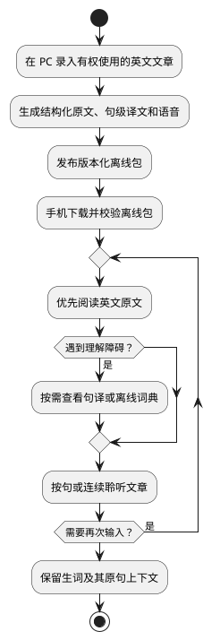

# Engirdle：产品目的与原则

> 文档状态：产品方向基线  
> 更新时间：2026-08-07  
> 相关文档：[MVP PRD](./mvp/mvp_prd.md) · [MVP 设计](./mvp/mvp_design.md) · [可行性评估](./mvp/mvp_feasibility.md)

## 1. 项目目的

Engirdle 面向已经具备一定英语基础、希望通过真实文章保持英语输入习惯的个人用户。它要解决的不是“缺少更多课程”，而是以下连续体验中的摩擦：

- 真实英文文章遇到少量障碍时，阅读容易被查词和切换应用打断；
- 文章、译文、语音和词典分散，难以在离线环境中连续使用；
- 通用 TTS 与文章句子缺少稳定对应，难以从任意句子开始听；
- 内容处理成本高，导致用户无法持续建立自己的听读资料库。

产品的核心价值是把一篇用户有权使用的英文文章加工成可携带、可追溯、可离线阅读和播放的听读包，并尽量减少阅读过程中的干扰。

## 2. 目标用户与使用环境

首要用户是项目所有者本人，典型条件如下：

- 能阅读大部分英文原文，只在局部需要翻译或词典；
- 有一台可执行文本处理、翻译和 TTS 的 PC；
- 使用 Android 手机在碎片时间阅读和听文章；
- 可以让 PC 和手机短时接入同一个受信任局域网；
- 接受内容生产耗时，不要求实时生成。

这是一款单用户、离线优先的个人研究工具，不以账号体系、公共内容分发或在线服务运营为前提。

## 3. 核心使用闭环

翻译、词典和生词本服务于阅读，不把阅读强制转换成练习流程。

## 4. 产品定位

Engirdle 更接近“个人离线英文听读包的生产与消费系统”，而不是：

- 完整英语课程或考试训练产品；
- 公共文章聚合、版权内容分发平台；
- 实时在线翻译器；
- 独立的词汇记忆或间隔重复应用；
- 通用播客、有声书或网页阅读器。

产品由三个边界清晰的部分组成：

- PC 内容生产端：录入、结构化、翻译、语音生成、质检、打包和版本管理；
- 局域网发布端：在用户明确启用时，只读发布目录和离线包；
- 移动消费端：下载、导入、离线阅读、翻译展示、播放、查词和生词记录。

“离线优先”主要约束移动消费：离线包导入后，阅读、播放、查词和生词记录不得依赖网络。MVP 的 PC 生产通过 DeepSeek V4 Flash API 翻译完整文章，并在本地使用 Qwen3-TTS 生成语音，因此生产阶段需要互联网和可运行 1.7B 模型的本地环境，不承诺完全隔离网络。

## 5. 长期设计原则

### 5.1 阅读优先

- 默认突出英文原文，翻译按需出现；
- 查词结果先提供简短英英释义，中文释义作为补充；
- 记录生词不强制触发训练；
- 手势和控件应避免打断连续阅读。

### 5.2 PC 重处理，移动端轻消费

计算量大、耗时长或结果不稳定的工作由 PC 编排：文本清洗、分句、DeepSeek API 翻译、本地 Qwen3-TTS、音频处理、打包和词典构建。移动端只承担确定性的下载、导入、渲染、查询和播放，避免移动推理带来的功耗、体积和兼容性成本。

### 5.3 离线包是稳定产品边界

PC 和移动端不共享内部数据库，也不依赖实时业务 API。二者只通过版本化离线包和只读目录通信。内部模型与实现可以替换，但已发布协议必须按兼容性规则演进。

### 5.4 原文结构是唯一主索引

原文先确定段落、句子和稳定 ID，翻译、音频区间、生词上下文再引用这些 ID。移动端不得重新分句，也不得通过译文数组下标、文本内容或易变字符偏移猜测对应关系。

### 5.5 生成结果可追溯

每个制品应能追溯到原文哈希、文章修订、处理程序、提示词、模型、声音、编码参数、生成时间、内容来源和许可证信息。未知信息应显式记录为未知，不得猜测或省略来源状态。

### 5.6 失败不破坏已有内容

耗时任务允许失败和重试；下载、解包、数据库导入和文章升级必须先在临时位置完成，成功后再切换。任何中途失败都不应破坏上一个可用版本或用户生词。

### 5.7 基础设施服从单用户规模

优先使用 SQLite、本地文件、单一 worker 和静态只读服务。只有经过测量证明单机方案不足时，才引入分布式数据库、消息队列或对象存储。

### 5.8 内容权利是数据的一部分

文章、模型、声音和词典的来源与许可必须随制品记录。个人研究用途不等于拥有再分发权；若未来扩大分发或商业使用，必须重新审核各项权利。

## 6. MVP 目标

MVP 要证明以下命题：

1. 一篇英文文章可以在 PC 上稳定转化为句级对齐的原文、译文和音频。
2. 同一份版本化内容可以经局域网安全地导入 Android 设备。
3. 用户可以完全离线地完成英文阅读、按需辅助理解和连续听读。
4. 技术实现允许替换翻译、TTS 和词典数据，而不破坏移动端核心协议。

具体功能和验收条件以 [mvp_prd.md](./mvp/mvp_prd.md) 为准。

## 7. MVP 不追求的结果

- 不证明 DeepSeek V4 Flash 或 Qwen3-TTS 是长期最优选择；它们是 MVP 的明确基线，不是永久协议依赖；
- 不追求自动抓取互联网上的任意文章；
- 不提供用户账号、云同步或公网访问；
- 不建立完整词汇学习和复习体系；
- 不还原任意 HTML、PDF 或 EPUB 的原始版式；
- 不在首个发布目标中同时保证 Android 与 iOS；
- 不承诺公共发布用户导入的文章、生成音频或第三方词典数据。

## 8. 判断产品方向是否成立

项目方向成立不以模型榜单或功能数量判断，而以真实使用结果判断：

- 从录入到手机可阅读的路径能够重复完成；
- 翻译和查词显著减少障碍，但不会主导阅读界面；
- 句级定位足以自然地单句播放和从任意位置连续播放；
- 用户愿意持续把文章加工并带到移动端；
- 替换生产端组件时，无需重写移动端内容模型。

这些结果先通过个人试用和代表性文章观察，稳定后再考虑量化留存、阅读时长或学习效果。
