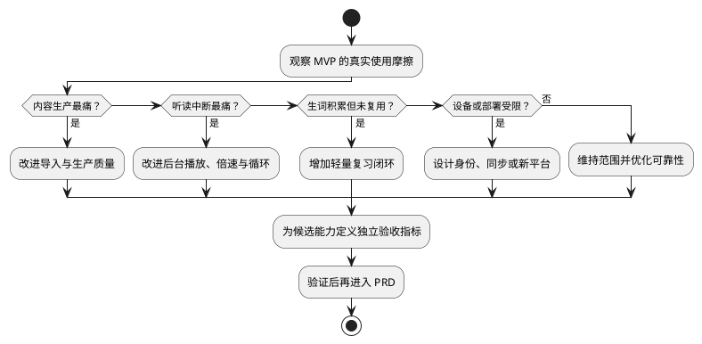

# Engirdle MVP 后路线图

> 文档状态：候选方向，不构成需求承诺  
> 更新时间：2026-08-07  
> 前置条件：[MVP PRD](./mvp/mvp_prd.md) 已验收且 [可行性评估](./mvp/mvp_feasibility.md) 中没有未接受的高影响风险

## 1. 演进原则

- 先根据真实使用中的摩擦排序，不根据模型新颖程度排序。
- 新能力通过现有稳定 ID 和包版本扩展，不绕过 readpack 边界。
- 可以在 PC 重建的派生数据不应成为移动端不可恢复的唯一数据。
- 涉及新内容来源、声音、模型或词典时，先审计权利与归属。
- 每次只推进一个可验证主题，避免同时扩展内容、播放、学习和同步。

## 2. 候选方向

| 方向 | 候选能力 | 前置条件 | 验证信号 |
|---|---|---|---|
| 听读体验 | 倍速、后台/锁屏、媒体通知、当前句自动高亮、A-B 循环、泛听模式 | MVP 播放状态和句级边界稳定 | 用户频繁连续听读，前后台切换成为主要中断 |
| 生产质量 | 多候选试听、ASR 回译、漏词/重复/静音检测、按段 TTS、强制对齐、发音词典 | 有真实 TTS 缺陷样本和可重复质量基线 | 人工抽听成本或句间不连贯成为主要瓶颈 |
| 内容导入 | URL 正文提取、RSS、newsletter、浏览器分享、Markdown/EPUB/PDF | 来源许可规则、文本规范化和失败回退成熟 | 手工录入成为持续使用的主要阻力 |
| 词汇学习 | 上下文义项、词汇发音、标签、查词统计、间隔重复、原句测验 | 生词数据质量稳定并积累真实记录 | 用户主动回看生词且需要复习闭环 |
| 内容管理 | 标签、全文检索、阅读历史、局域网发现、增量包 | 文章量与包体积达到可测瓶颈 | 目录浏览、重新下载或查找文章明显低效 |
| 同步与部署 | 多设备进度、可选鉴权、家庭服务器、备份恢复 | 明确信任模型、身份、冲突与加密方案 | 单设备/短时 LAN 已无法满足稳定使用 |
| 平台扩展 | iOS 发布、平板布局、桌面阅读端 | Android 交互稳定并完成 Apple 平台专项验证 | 用户确有第二平台使用需求 |

## 3. 建议的决策顺序

## 4. 不建议过早开展

- 在没有实际质量样本前构建多模型竞技和复杂自动评分；
- 在单机 SQLite 没有测量瓶颈前引入分布式基础设施；
- 在受信任 LAN 用例未稳定前开放公网或家庭服务器；
- 在生词本没有真实使用数据前设计完整记忆算法；
- 在 readpack v1 尚未稳定前实现增量更新；
- 在 Android 交互尚未验证前同步开发 iOS 特有适配。

路线图中的候选能力只有进入新的 PRD、给出明确范围和验收条件后，才成为正式承诺。
