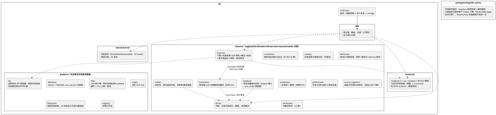

# Engirdle Android 客户端（apps/mobile）

Flutter 实现的移动端 MVP：从局域网 PC 发布服务下载不可变 readpack，离线完成听读、查词和生词管理。设计依据为 `.scratch/mvp/mvp_design.md` 与 `.scratch/android_design/index.html`（17 屏高保真稿）。

## 架构

模块化单体 + 组合根（`lib/app/dependencies.dart`）。状态管理使用 Flutter 内置 `ChangeNotifier`/`ValueNotifier` + `ListenableBuilder`，依赖通过 `AppScope`（InheritedWidget）注入；不引入 riverpod/bloc，无任何 codegen。



各 feature 目录名与职责如上图注释；`main.dart` 装配依赖后进入路由。

## 关键技术决策

- **SQLite 裸 SQL（package:sqlite3），不用 Drift**：MVP 无 codegen，迁移集中在 `platform/database/migrations.dart` 的 PRAGMA user_version 链；表所有权按模块划分，DAO 只写自己的表。
- **自研安全 ZIP 读取器，不引 archive 包**：安全规则必须自控——预检阶段拒绝路径穿越（含反斜杠变体）、绝对路径、重复规范化路径、目录条目、符号链接/设备文件、加密条目、多盘/ZIP64 与未知压缩方法；限制条目数（64）、单条目（1 GiB）、总展开（1 GiB）与路径长度（240）；解压按真实写出字节计数，必须与中央目录声明完全一致。
- **LAN HTTP 策略**：`http://` 仅允许私网 IPv4 字面量（10/8、127/8、169.254/16、172.16/12、192.168/16）与 `localhost`，其余明文地址在请求发出前拦截；`https://` 任意；所有请求有有限超时与响应上限。
- **导入原子性（MOB-IMP-002/003）**：暂存解压校验 → rename 到不可变制品目录 → 单事务切换 DB 指针 → 清理。任何失败不触碰旧版本；`import_operations` 恢复日志覆盖 downloading/staged/moving/committed/failed 五态，启动时 `recoverUnfinished()` 重放或回滚。清理阶段失败不会删除已提交内容，留待下次启动重试。
- **播放为单会话状态机**：`PlaybackController` 持有会话 token，新的「单句朗读/从此朗读」取代旧会话时才弹提示（UX-A2）；离开阅读页即停（无后台播放，MVP 排除项）。
- **生词一步保存（UX-A1）**：词典抽屉内点「保存该义项」即落库（该动作即义项选择），snackbar 提供撤销（=删除刚插入的行）；快照含句子、译文与词典版本，与文章表无外键关联。

## 与设计稿的有意偏差

- **书架/生词本的搜索图标未实现**：设计稿有图标但无交互规格，PRD 也无搜索需求，按「不交付无规格交互」省略。
- **目录未安装条目不显示作者/音频时长**：设计稿 03B 有，但 catalog v1 契约不含这两个字段；当前显示「未安装」，包大小只在 04 下载页出现（设计同时要求工程信息不进列表）。属设计稿-契约冲突，待契约演进。
- **仅中文模式标题回退为英文原题**：设计稿 s08 显示中文译名，readpack v1 契约只有 `title` 字段。
- **选词高亮只有底色、无描边**：系统选区样式无法表达描边，三色预设的 `selectHighlight` 已接线为选区底色。
- **s02「权限拒绝 + 打开系统设置」路径不存在**：Android `INTERNET` 为安装期权限、运行时不可撤销；权限卡文案已改为与事实一致的「公网明文请求在应用内一律拒绝」。
- **s09 选区约束提示 snackbar、17B 骨架列表、词菜单图标/义项序号等装饰性元素**未做（不影响交互语义）。

## 运行

需要 Flutter 3.44+（Dart 3.12+）、Android SDK 与 JDK（Android Studio 自带 JBR 即可，如 `JAVA_HOME=~/.local/android-studio/jbr`）。本仓库不提交 Flutter SDK 与构建产物；Gradle wrapper 已提交，开箱即构建。

```bash
flutter pub get
flutter analyze
flutter test                 # 单元 + 契约 fixtures + widget 冒烟
flutter run                  # 连接 Android 设备/模拟器
flutter build apk --debug    # 或直接 cd android && ./gradlew assembleDebug
```

注意：`android/gradle.properties` 将 Gradle/Kotlin 守护进程内存限制在小内存机器可用的预算内（默认 `-Xmx8G` 会在 8 GB 内存的 WSL 上引发 swap 风暴）。

## 测试

`test/` 镜像 `lib/` 结构：

- `test/contracts/`：直接消费仓库 `contracts/readpack/v1`、`contracts/readpack/v2`、`contracts/catalog/v1`、`contracts/source/v1` 的 fixtures——readpack valid 包走生产 validator 解压校验，11+11 个非法 readpack 与 5 个非法 catalog 各自按 fixtures/README 文档的首个失败原因被拒绝；v2 侧另断言 v1 客户端按主版本拒绝 v2 包；`source_fixtures_test` 用 Dart 解析器复刻共享解析语料（块/句/runs/三个哈希逐字节一致）；

### 原文导入（阶段 2，轻量文章包设计）

- `features/source_ingestion/`：粘贴/文件原文结构化。Markdown 走 `engirdle-gfm-dart@1`（markdown-it 状态机逐行移植 + CommonMark 内联算法），纯文本按空行分块 + `engirdle-segmenter-dart@3` 分句；两端对齐由 `contracts/source/v1` 黄金 fixture 保证。移动端子集明确拒绝 HTML、链接引用定义、autolink 与 HTML 实体。
- `features/importer/`：`ContentImportService` 状态机（staging → 确认页 → 原子安装），`source_imports` 日志支持进程死亡恢复与过期预览清理；重复内容（字节级 / 规范化级）只提示不合并；`.readpack` 文档导入按 manifest 主版本路由到 v1/v2 validator。
- 数据库 v6：`articles.normalized_sha256`/`source_syntax` 与 `source_imports`；安装统一走 `ValidatedArticleImport`（catalog/paste/document 三入口）。

### 前台可恢复翻译（阶段 3，轻量文章包设计）

- `features/translation/`：用户自备 DeepSeek Key 的文章翻译深模块。`TranslationModule` 暴露 queue/cancel/pause/resume/retry/watch/recover；plan 派生、prompt 投影、占位符保护、checkpoint 日志、限次重试与原子激活全部藏在接口后面。
- 协议与 PC 逐字节对齐：`contracts/translation/v1` 的 system prompt、wire schema 与黄金消息投影由 `test/contracts/translation_v1_test.dart` 复刻（含 Python 风格 JSON 分隔符），valid/invalid 响应 fixtures 双端同判。
- 任务事实源在 SQLite（v7：`translation_jobs`/`translation_units`/`llm_profiles`，部分唯一索引保证每文章每语言至多一个活跃任务）；调度器只是触发器，进程内串行执行，正确性依赖每单元 checkpoint 与租约代际（取消/暂停后的迟到响应一律丢弃）。building 译文集对阅读器不可见，全部单元完成、精确覆盖校验后才经 library 的原子激活接口上线。
- 密钥只进 Android Keystore 加密的 no-backup 存储（`packages/engirdle_native` 插件内的 `SecretStore.kt`），数据库仅存 alias；DeepSeek 官方 HTTPS 端点在构造与每次请求前双重校验，无 TLS 例外开关。
- UI：阅读页「翻译文章」确认流（隐私声明 + 保守 token 估算）、非阻塞进度条与能力刷新；任务详情页提供暂停/继续/取消/同配置重试；书架显示「翻译中 n/m」徽标；设置页管理密钥（从不回显）、模型与连接测试。
- `test/features/translation/`：黄金协议、DAO、DeepSeek 适配器（含错误分类矩阵与 429 Retry-After）与模块管线（checkpoint 跨进程恢复、取消竞态、错误矩阵、partial 永不可见、既有 active 集不受失败影响）。

### Android 后台化（阶段 4，轻量文章包设计 §9）

- **调度**：`TranslationScheduler` 的 WorkManager 适配器（`infrastructure/workmanager_scheduler.dart`）为每个任务注册 unique one-off work（keep 策略，绝不重复排队）；WorkManager input data 只带 `job_id`（§9.2），文章内容、配置快照与密钥永远从数据库和 Keystore 读取。约束在每次 schedule 时从该任务冻结的 config snapshot 解析（§8.4：设置变化只影响新任务）：始终要求联网，`仅 Wi-Fi`→ unmetered、`仅充电`→ requiresCharging。
- **退避交给系统**：瞬态失败进入 `waiting_retry` 后，worker 对该 work 返回 `Result.retry()`（§8.5 耗尽请求内重试后交给 WorkManager backoff）——keep 策略下运行中的同名 re-enqueue 会被忽略，重投递必须由当前 work 自己的 retry 结果触发，进程死亡也不丢定时；重投递到达时 `runJob` 的重入路径把任务接回 queued 继续跑。进程内调度器（测试/前台）则由模块的 `schedule(after:)` 延迟投递驱动同一重入路径。
- **全局单执行（§8.4）**：进程内串行调度器天然一次只跑一个任务；OS 调度可能并发投递多个 work，因此排他语义下沉到 `claim` 本身（单条 UPDATE 内完成「无其他 running 任务」检查与状态翻转，竞态安全）。第二个任务的 worker 拿不到槽位时向 WorkManager 返回 retry，按指数退避等待。
- **后台执行**：work 以 `dataSync` 前台服务运行（`workmanager.enableDataSyncForegroundService=true` 选择加入；独立「文章翻译」通知频道，不复用媒体播放服务）。worker 引擎上由 `translation_background.dart` 组装精简依赖（§9.2）：自己的 SQLite 连接（WAL + busy_timeout）、library 投影、翻译模块、密钥与 DeepSeek 适配器——没有 Widget、AudioService、播放器或词典。所有写入都在任务租约下事务化，进程任意时刻死亡都安全：WorkManager 重投递，下一个执行者从 journal 接力。
- **进度与通知**：worker 重发同一通知 id 展示「正在翻译：标题 n/m」进度条 + 取消动作；完成/失败用独立 id 发摘要。通知取消动作以 intent 启动 MainActivity，经 `TranslationCancelBridge` 走与界面按钮完全相同的 `module.cancel` 路径。通知内容只有标题与单元计数，绝无正文或译文（§12.4）。Android 13+ 在确认翻译时请求 POST_NOTIFICATIONS，拒绝只隐藏通知、绝不阻塞翻译（§9.3）。
- **双引擎并发**：迁移入口在写锁事务内重读 `user_version`（§9.2），fresh install 上 rollback→WAL 转换窗口内的即时 BUSY 有有界重试；`test/platform/app_db_concurrent_open_test.dart` 用多 isolate 并发首开验证。UI 引擎通过模块内的跨引擎观察者（`startExternalSync`）轮询任务表，书架徽标、阅读页状态条与任务详情页在后台引擎提交进度后照常刷新，激活完成时同时触发 library 变更通知。
- **恢复**：`recover()` 不再改写 running 状态——执行者可能还活着（UI 打开时任务正在跑），死了 WorkManager 会重投递中断的 work；两种路径都由 `runJob` 的接管语义收敛。
- **隐私**：密钥在后台引擎经同一 Keystore 通道读取（`engirdle_native` 插件在后台引擎同样注册）；密钥从不进入 WorkManager 数据、数据库、日志或通知。运维诊断：`translation-worker` / `translation-scheduler` 日志只记 job id、状态分类、用量与耗时。
- **系统限制的诚实预期（§9.3）**：正确性依赖单元 checkpoint 而非连续线程；Android 15+ 的 dataSync 6 小时/24h 限额与厂商省电只会让任务回到等待/重调度。真机验收矩阵见 `docs/phase4_device_acceptance.md`（本仓库无真机环境，矩阵为待执行的清单）。
- `test/platform/`：恶意 ZIP 矩阵（手写最小 ZIP 构造器伪造声明大小/标志位/Unix 模式）、LAN URL 策略、基于回环 `HttpServer` 的传输上限与取消语义、数据库迁移链（v3/v4/v5/v6/v7 逐级）；
- `test/features/`：词典查询顺序与降级、生词快照/撤销/无 FK、导入全链路（真实 fixture 经回环 HTTP 服务器下载，成功/哈希不符/HTTP 失败/两种启动恢复路径）；
- `test/widget_smoke_test.dart`：首启路由、生词本空态、排版设置页渲染（假播放引擎 + 内存数据库）。

## 待办（不在本次交付）

- 真实词典资源格式与安装流（依赖 PC 端 G4 词典构建器）；
- 选词手势的真机交互微调；
- Android 真机/模拟器运行验证：阶段 4 后台化的真机验收矩阵见 `docs/phase4_device_acceptance.md`（需 API 31/33/35/36 真机与一台激进省电机型，本仓库开发环境不可上机）。上架 Google Play 前还需完成 `dataSync` 前台服务类型的 Play Console 申报。
