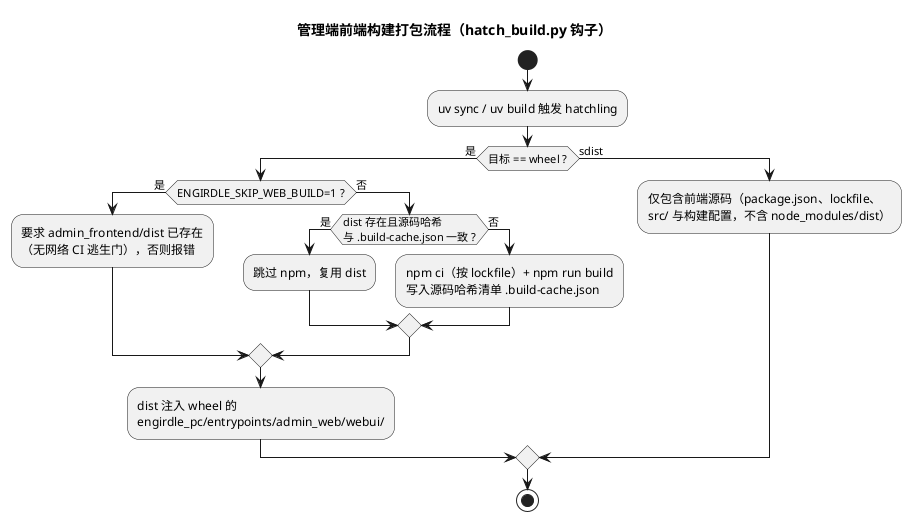

# Engirdle PC 内容生产端

PC 端采用模块化 Python 单体。管理 Web、单 Worker 与局域网只读发布端共享领域和应用模块，但使用独立进程入口及路由表。

## 当前能力

- 录入标题、英文 Markdown、作者、来源与许可，并分别保存原始/规范化文本及哈希；
- 解析冻结的 GFM 子集（标题、段落、列表、引用、强调/加粗/删除线、链接、行内代码、表格、代码块、分隔线），生成带行内 runs 的类型化文档；
- 在管理页面合并、拆分、编辑、重排并冻结结构；结构确认页展示解析警告、结构树和派生的翻译/朗读资格（只读，不可手工切换）；
- 通过 DeepSeek `deepseek-v4-flash` 进行“代码零泄漏的完整上下文 + 顺序翻译单元”翻译：文本句按批请求（行内代码与链接 URI 用占位符保护），整表一次结构化请求并强制同形状返回；人工修正与原始输出分别保存；
- 用本地 Qwen3-TTS CustomVoice 生成英文锚点候选，试听确认后冻结为版本化、唯一激活的声音配置；
- 用本地 Qwen3-TTS Base 复用激活锚点的 clone prompt，默认按句长分组、每批 4 句推理，分别生成 24 kHz 单声道 PCM，再按原文顺序拼接（表格、代码块和分隔线不进入任何 LLM 或 TTS 请求）；
- 持久化任务阶段、尝试次数、心跳、配置快照、检查点和结构化失败，失败后复用已接受的翻译单元与有效句级 PCM；
- 审阅并修正句译与整表译文（表格按 cell 修正，保存时校验形状），逐句试听音频并查看缺失、零时长和异常时长检查；音频审阅只列出可朗读句子；
- 以峰值与 loudnorm 一致化、64 kbps AAC-LC 编码音频，并把编码参数写入 manifest；
- 构建、重开校验并原子发布 Readpack 1.1（声明 `markdown-blocks` 能力，携带 runs、表格与代码块）和 `catalog.json`，失败时保持旧目录和旧包可用；
- 创建正文新修订、重建同一修订、重新发布既有不可变制品，以及确认后将本地文章移入可恢复 trash；
- 在管理页查看绑定地址、风险与持久化进程状态，并启停独立只读发布进程；管理端重启后仍可识别和停止遗留进程，发布进程仅提供 `GET/HEAD /catalog.json` 和固定包路由。

翻译与 TTS 的生产默认均为真实适配器（DeepSeek API / 本地 Qwen3-TTS）。确定性 stub 只作为测试 fixture 存在于 `tests/`（`translation_fake.py`、`speech_fake.py`），生产代码与入口不引用、不回退到 stub；缺少 TTS 依赖或模型文件时入口进程直接报错退出。

## 安装

需要 Python 3.10+ 与 `uv`。FFmpeg 由锁定的 Python 依赖提供，不读取仓库根目录 `.tts/`。

```bash
cd apps/pc
uv sync --extra dev
```

运行真实 TTS 还需要可选的 `tts` extra（torch/qwen-tts/soundfile 等，含 CUDA 轮子）：

```bash
uv sync --extra dev --extra tts
```

默认 workspace 是 `~/.local/share/engirdle`。可为开发或验收指定仓库外目录：

```bash
export ENGIRDLE_WORKSPACE=/absolute/path/to/engirdle-workspace
```

## 语音模型与声音配置

Qwen3-TTS 检查点放在应用管理的本地模型目录（默认 `~/.local/share/engirdle/models`，可用 `ENGIRDLE_SPEECH_MODEL_ROOT` 覆盖）：

```text
models/
├── Qwen3-TTS-12Hz-1.7B-CustomVoice/
└── Qwen3-TTS-12Hz-1.7B-Base/
```

把本机已有的检查点复制进去即可（约 8.6 GB），例如从仓库根目录的调研副本：

```bash
mkdir -p ~/.local/share/engirdle/models
cp -r .tts/Qwen3-TTS-12Hz-1.7B-CustomVoice .tts/Qwen3-TTS-12Hz-1.7B-Base \
  ~/.local/share/engirdle/models/
```

生产代码只读取该模型目录，从不导入或回退到 `.tts/`；模型不进入 Git、安装包或 readpack。

其他 `ENGIRDLE_SPEECH_*` 部署配置（均为非秘密项，有默认值）：`SPEECH_DEVICE`（`cuda:0`）、`SPEECH_DTYPE`（`bfloat16`）、`SPEECH_ATTN_IMPLEMENTATION`（`sdpa`）、`SPEECH_SEED`（`0`）、`SPEECH_MAX_NEW_TOKENS`（`2048`）、`SPEECH_ANCHOR_CANDIDATES`（`3`）。

首次使用前，在管理端“声音配置”页选择英文 speaker（Ryan/Aiden）、锚点朗读文本与风格 instruct，生成候选并试听；确认某个候选会把它冻结为不可变锚点（记录 WAV 哈希、seed 与参数）并设为当前激活配置。调整任何一项都会创建新修订，已发布制品引用的旧修订保持可读。生产任务只使用激活配置：常驻 Worker 按声音配置修订及锚点哈希复用 clone prompt，跨批次和任务共享；CustomVoice 仅在生成锚点时加载、用完即释放，同一 backend 实例内两个 1.7B 检查点不会同时常驻。

### TTS 批量合成

`ENGIRDLE_SPEECH_BATCH_SIZE` 控制每次模型调用的最大句数，默认 `4`，必须为正整数。设为 `1` 时逐句生成；显存不足时可降低到 `2` 或 `1`。管理端和 Worker 必须使用相同配置，调整后重启两个进程，例如：

```bash
export ENGIRDLE_SPEECH_BATCH_SIZE=4
```

Worker 先复用检查点中仍有效的句级 PCM，再对待生成句子按文本字符数升序分组，等长句保持原文顺序，最后一批可以不足配置句数。每批只调用一次 Base 模型并重置配置 seed，每句独立保存 PCM、元数据和检查点，最终音频时间线恢复原文顺序。表格和代码仍不进入 TTS。

整批返回数量、句子身份和音频有效性通过校验后才接受结果。批次失败不接受该批未完成的句子，重试保留已接受且有效的 PCM；剩余句子会重新分组，因此恢复后的新音频不保证与未中断运行逐样本一致。生成期间声音配置改变会使任务失败，不会混用声音发布。

批量策略和 batch 大小会写入任务配置快照，同时纳入 `qwen3-clone@v2` 生成参数摘要。升级前的任务仍可读取，但其旧快照不能用新默认配置继续生成；请为同一文章修订**重新构建任务**，不要仅重试旧任务。改变 batch 大小后也应新建或重建任务，不会静默修改已有检查点。既有审阅音频和已发布制品保持可读。

## 运行完整生产流程

启动管理端与 Worker：

```bash
uv run engirdle-pc admin
uv run engirdle-pc-worker
```

- 管理端：`http://127.0.0.1:8765`
- 发布端：`http://<LAN 地址>:8766/catalog.json`

发布端默认由管理页的“局域网只读服务”面板启停；它没有鉴权，只应在受信任的局域网临时开启。也可用 `uv run engirdle-pc publisher` 手工启动独立发布进程。

在管理端录入文章并确认结构；Worker 完成生成后，任务进入 `review_required`。修正译文并抽听音频后发布，目录才会切换到新制品。失败任务不会改变已有 catalog 指针。

单步演练可使用 `uv run engirdle-pc worker-once`；`uv run engirdle-pc check` 会初始化数据库并重建 catalog。

## 质量检查

```bash
uv run ruff check hatch_build.py src tests
uv run mypy src
uv run pytest
uv build

# 管理端前端（需 Node ≥ 22，版本固定见 admin_frontend/.nvmrc）
cd admin_frontend
npm run lint
npm run typecheck
npm run test
```

测试直接使用根目录 `contracts` 中的合法/非法 fixtures，并包含从空数据库完成“录入 → 生成 → 审阅 → 发布 → 下载”的黑盒流程、失败重试、租约恢复、只读路由隔离和旧制品保护。

### 构建与打包（管理端前端）

管理端 SPA（`admin_frontend/`）由 hatchling 构建钩子（`hatch_build.py`）在**源码构建**时编译，并作为 `engirdle_pc/entrypoints/admin_web/webui/` 预置进 wheel，因此安装预构建 wheel 不需要 Node。



要点：

- **Node 要求**：从源码或 sdist 构建 wheel 需要 Node ≥ 22 与 npm（`admin_frontend/.nvmrc` 固定 Node 24）；安装预构建 wheel 不需要 Node。
- **`uv sync` 触发构建**：首次同步会执行前端构建；钩子用 `admin_frontend/.build-cache.json`（源码内容哈希清单，不入库）比对输入，未变更则跳过 npm 直接复用 `dist/`，后续同步不重复构建。
- **`uv build` 语义**：默认先产出 sdist，再从 sdist 二次构建 wheel（每次都会在临时目录重新执行 npm）；sdist 不含 `node_modules/` 与 `dist/`，从 sdist 到 wheel 的链路依赖 `npm ci` 按 lockfile 还原依赖。源码树的哈希缓存作用于 `uv sync` 与 `uv build --wheel`。
- **逃生门**：无 Node 或无网络环境（如纯 Python 改动的 CI）可设 `ENGIRDLE_SKIP_WEB_BUILD=1` 跳过前端构建，但要求 `admin_frontend/dist` 已存在，否则构建失败并提示先预构建或安装 Node。
