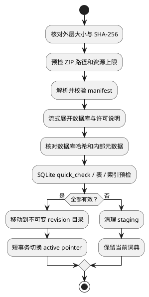

# Dictionary pack v1

`.dictpack` 是独立于 APK 和 `.readpack` 的版本化 ZIP 资源。正式 v1 产品资源固定为 `engirdle-en-zh`，并且恰好保留 `oewn-2025` 与 `freedict-eng-zho-2025.11.23` 两个来源。

## 容器布局

包内只允许以下路径：

- `manifest.json`；
- `dictionary.db`；
- manifest 明确列出的 `licenses/*.txt`。

移动端先验证 catalog 声明的完整包大小和 SHA-256，再预检 ZIP 中央目录、解析 manifest、流式展开、校验数据库字节、运行 SQLite `quick_check`，最后才切换显式 active pointer。

## SQLite v1 语义

- v1 规范化版本固定为 `unicode-nfc-lower-v1`：Unicode NFC、空白折叠与 Unicode 小写转换；客户端必须使用同一版本生成查询键。
- `entries` 保存规范化词头、命名空间限定的 `sense_id`、可选英英/英中释义、发音、`source_id` 及显式排序权重；每个义项至少有一种非空释义。
- `forms` 保存规范化词形到 lemma 的映射并保留来源与可选词性。
- `dictionary_meta` 的 `dictionary_id`、`revision`、`schema_version`、`normalization_version` 必须与 manifest 一致。
- 必需索引为 `idx_entries_headword_order`、`idx_entries_normalized_order`、`idx_forms_normalized_order`。

## 冻结输入快照

- `oewn-2025`：`english-wordnet-2025.xml.gz`，SHA-256 `9ca6d1dcb75f822fdd66617f7d9da48142ace38dd544d6ad5e2feca1674ad3fe`；内部 Lexicon 版本必须为 `2025`。
- `freedict-eng-zho-2025.11.23`：`freedict-eng-zho-2025.11.23.src.tar.xz`，SHA-256 `78f6909786861809886201827e5e3d55dbf8e12f753d7a7183e785dbc574de8b`；内部 edition 必须为 `2025.11.23`。

Schema 位于 [`schema/manifest.schema.json`](./schema/manifest.schema.json)，兼容性见 [`COMPATIBILITY.md`](./COMPATIBILITY.md)。
